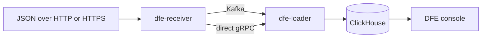

# DFE documentation

Land it. Use it. Scale it. The Data Fusion Engine (DFE) does what you used Splunk, Elastic and a lakehouse for, without the limitations. Every source in, the whole picture out, from gigabytes to petabytes, in your own environment.

DFE 2.2 is the first open-source release of a platform that has run in production since 2018. [How we got here](history.md) explains the history and the version numbers.

Under the hood, DFE is a data pipeline you run yourself. Your agents and shippers send events in over HTTP or HTTPS. They travel over a Kafka message bus, or a low-latency gRPC hop, and land in ClickHouse, where you search them in the DFE console. It runs on any Kubernetes cluster, on-premises or in your cloud account, or on Docker on one host.

> **Coming from Splunk or Elastic?** DFE takes every field without a mapping first, so a source changing upstream breaks nothing. It doesn't index every byte or keep a raw copy of every event either, and every record carries an `_org_id`, so who sees what is built in. [Coming from Splunk, Elastic or a Lakehouse](coming-from.md) says what's different, why, and what it does for you. Read it before the rest.

Every page here comes from a suite repository's own `docs/`, at the version one DFE release pins. The version menu switches the whole suite between releases. Each repository has its own section in the sidebar.

That's the default path. The leaner profiles skip Kafka and go receiver to loader over gRPC. Every component also sends its own logs and metrics over OpenTelemetry into ClickHouse, so the console shows the stack's health before your first event arrives.

## Who does what

| Repository | Role |
|---|---|
| dfe-engine | Decides what every other component does, and writes it to your git deploy repo. It's also the only thing that changes the ClickHouse schema and Kafka topics. |
| dfe-ui | The console. Every change you make there goes through the engine. |
| dfe-infra | Puts the whole stack, backing services included, onto Kubernetes through Argo CD. |
| dfe-docker | Runs the same stack under Docker Compose. |

Then start with a [quickstart](quickstart/README.md): Docker, Kubernetes on-premises or AWS.
