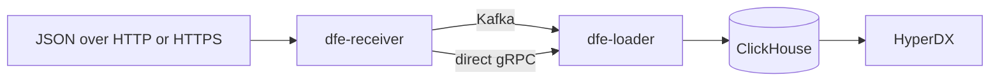

# DFE documentation

The Data Fusion Engine (DFE) is a product suite an organisation deploys to run its own data pipeline. Events arrive over HTTP or HTTPS, travel through Kafka or a direct gRPC hop, and land in ClickHouse, where HyperDX searches them. DFE deploys onto any Kubernetes cluster, on-premises or in a cloud, or under Docker Compose on a single host.

Every page on this site comes from a suite repository's own `docs/`, at the version one DFE release pins. The version menu switches the whole suite between releases, and each repository has its own section in the sidebar. dfe-hyperdx sits inside dfe-ui's section, because the console embeds it.

That is the default data path. The leaner deployment profiles skip Kafka and send events from the receiver to the loader over gRPC. Every component also sends its own logs and metrics over OpenTelemetry into ClickHouse, so HyperDX shows the stack's health before any data arrives.

## Who does what

| Repository | Role |
|---|---|
| dfe-engine | The configuration control plane. It decides what each component does and writes that to a git deploy repo. |
| dfe-ui | The console over the engine. |
| dfe-infra | Deploys the backing services and the components onto Kubernetes, through Argo CD. |
| dfe-docker | Runs the same stack under Docker Compose. |

Start with the [quickstarts](quickstart/README.md) for Docker, Kubernetes on-premises and AWS.
