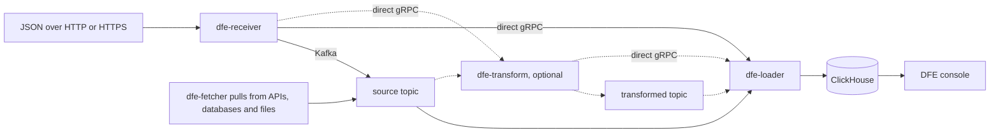

# Data Fusion Engine overview

Land it. Use it. Scale it. The Data Fusion Engine (DFE) does what you used Splunk, Elastic and a lakehouse for, without the limitations. Every source in, the whole picture out, from gigabytes to petabytes, in your own environment.

DFE 2.2 is the first open-source release of a platform that has run in production since 2018. [How we got here](history.md) explains the history and the version numbers.

Under the hood, DFE is a data pipeline you run yourself. Your agents and shippers send events in over HTTP or HTTPS. They travel over a Kafka message bus, or a low-latency gRPC hop, and land in ClickHouse, where you search them in the DFE console. It runs on any Kubernetes cluster, on-premises or in your cloud account, or on Docker on one host.

> **Coming from Splunk or Elastic?** DFE takes every field without a mapping first, so a source changing upstream breaks nothing. It doesn't index every byte or keep a raw copy of every event either, and every record carries an `_org_id`, so who sees what is built in. [Coming from Splunk or Elastic](coming-from.md) says what's different, why, and what it does for you, and [coming from a lakehouse](coming-from-lakehouse.md) does the same for Snowflake, Databricks, BigQuery and Athena. Read yours before the rest.

Every page here comes from a suite repository's own `docs/`, at the version one DFE release pins. The version menu switches the whole suite between releases. Each repository has its own section in the sidebar.

That's the default path. The leaner profiles skip Kafka and go receiver to loader over gRPC. A transform app (dfe-transform-vrl, dfe-transform-vector or dfe-transform-elastic) is optional. On Kafka a source that needs grok or your own logic gets one: it reads the source's topic and writes a second one, and the loader reads that one instead. Over gRPC the receiver sends to the transform and the transform sends to the loader, and the lean gRPC profiles run only the fixed transforms a deployment ships, not one per source, so a source that needs its own is refused there. Every component also sends its own logs and metrics over OpenTelemetry into ClickHouse, so the console shows the stack's health before your first event arrives.

## Purpose-built where it's hot, generic where it has to be

Every event lands through dfe-loader, and most enter through dfe-receiver or dfe-fetcher: parse, validate, route, enrich, batch, write. A cycle spent there is spent on nearly every event. So those bookends are purpose-built Rust, not a general transform engine pointed at the job.

A general-purpose transform engine comes in only where the job needs one: a vendor message body that needs grok, or your own logic. That's the optional dfe-transform-* apps.

Such an engine interprets your program. VRL, for one, compiles it at startup into a tree it walks for every event, and the Rust compiler only ever sees the interpreter.

Release builds add profile-guided optimisation (PGO) and BOLT, which means 'run it under real load, record what's hot, rebuild around it'. A bookend's hot path is the same work in every deployment, so a profile trained on it carries over. An interpreter's profile only matches the programs it was trained on.

Parsing is where this pays most, because grok and regex over a vendor message body are some of the most expensive per-event work in a pipeline. So dfe-transform-elastic doesn't interpret Elastic ingest pipelines. Their processors compile to Rust, one module per source, and their Painless scripts run as hand-transcribed or pattern-matched Rust. A script it doesn't recognise is counted and skipped.

Zero-copy parsers replace grok for the patterns they cover.

## Who does what

| Repository | Role |
|---|---|
| dfe-engine | Decides what every other component does, and writes it to your git deploy repo. It's also the only thing that changes the ClickHouse schema and Kafka topics. |
| dfe-ui | The console. Every change you make there goes through the engine. |
| dfe-infra | Puts the whole stack, backing services included, onto Kubernetes through Argo CD. |
| dfe-docker | Runs the same stack under Docker Compose. |

Then start with a [quickstart](quickstart/README.md): Docker, Kubernetes on-premises or AWS.
