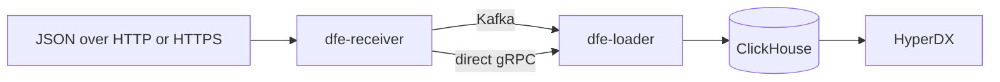

# DFE documentation

The Data Fusion Engine (DFE) is a product suite an organisation deploys to run its own data pipeline. Events arrive over HTTP or HTTPS, travel through Kafka or a direct gRPC hop, and land in ClickHouse, where HyperDX searches them. DFE deploys onto any Kubernetes cluster, on-premises or in a cloud, or under Docker Compose on a single host.

Every page on this site comes from a suite repository's own `docs/`, at the version one DFE release pins. The version menu switches the whole suite between releases, and each repository has its own section in the sidebar. dfe-hyperdx sits inside dfe-ui's section, because the console embeds it.

That is the default data path. The leaner deployment profiles skip Kafka and send events from the receiver to the loader over gRPC. Every component also sends its own logs and metrics over OpenTelemetry into ClickHouse, so HyperDX shows the stack's health before any data arrives.

## Purpose-built where it's hot, generic where it has to be

Every event lands through dfe-loader, and most enter through dfe-receiver or dfe-fetcher: parse, validate, route, enrich, batch, write. A cycle spent there is spent on nearly every event. So those bookends are purpose-built Rust, not a general transform engine pointed at the job.

A general-purpose transform engine comes in only where the job needs one: a vendor message body that needs grok, or your own logic. That's the optional dfe-transform-* apps.

Such an engine interprets your program. VRL, for one, compiles it at startup into a tree it walks for every event, and the Rust compiler only ever sees the interpreter.

Release builds add profile-guided optimisation (PGO) and BOLT, which means 'run it under real load, record what's hot, rebuild around it'. A bookend's hot path is the same work in every deployment, so a profile trained on it carries over. An interpreter's profile only matches the programs it was trained on.

Parsing is where this pays most, because grok and regex over a vendor message body are some of the most expensive per-event work in a pipeline. So dfe-transform-elastic doesn't interpret Elastic ingest pipelines. Their processors compile to Rust, one module per source, and their Painless scripts run as hand-transcribed or pattern-matched Rust. A script it doesn't recognise is counted and skipped.

Zero-copy parsers replace grok for the patterns they cover. In an initial spike bench dfe-transform-elastic ran 5-10x faster than our previous VRL pipeline, and the range moves with data shape and error rate. Definitive benches are tracked in [dfe-transform-elastic#162](https://github.com/hyperi-io/dfe-transform-elastic/issues/162).

## Who does what

| Repository | Role |
|---|---|
| dfe-engine | The configuration control plane. It decides what each component does and writes that to a git deploy repo. |
| dfe-ui | The console over the engine. |
| dfe-infra | Deploys the backing services and the components onto Kubernetes, through Argo CD. |
| dfe-docker | Runs the same stack under Docker Compose. |

Start with the [quickstarts](quickstart/README.md) for Docker, Kubernetes on-premises and AWS.
