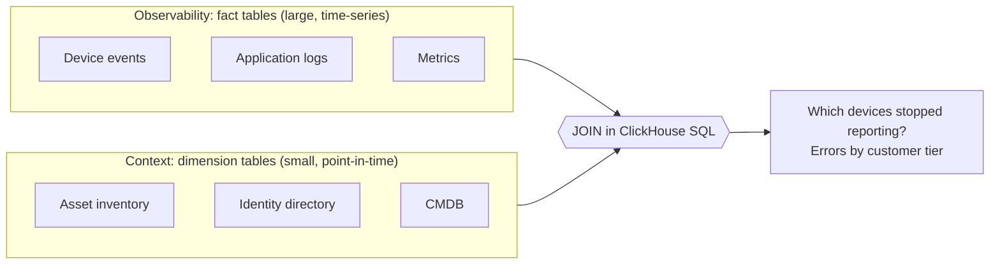

# Coming from Splunk, Elastic or a Lakehouse

If you've run Splunk, Elastic, OpenSearch or a lakehouse, or several of them, you'll bring assumptions about how a data platform works. DFE can take the place of more than one, with one platform to run instead of several. DFE does several things differently, and the rest of the docs assume you know them.

## Nothing breaks when a source changes

Index engines will take a field you never mapped, but it has a cost. Unplanned fields grow the index, and the hardware under it grows with them. A lakehouse wants the model before the data arrives. DFE lands every field from day one, and a field with no mapping yet lands in automatic typed columns.

We built it that way because you rarely control your sources. Vendors change formats in an update, and partners change feeds without telling you. So there's no data contract to negotiate or police upstream, and a supplier adding or renaming a field doesn't cost you events.

That gives you a two-step approach:

1. Land it all. Every field is queryable from the first event.
2. Put schema effort only where it pays you back. Promote a field in the meta schema (`dfe-schemas`) and new records land in its own column, while older ones stay readable where they were. Tighten its definition, such as type and cardinality. Add an index by naming the search you need (exact match, word search, substring or key search), and DFE picks and maintains the right ClickHouse index.

Nothing that already works breaks while you tune.

## The original bytes are off by default

Splunk keeps `_raw` for every event, and most pipelines carry the original line beside the parsed fields all the way to storage. DFE parses at the edge and drops the original. It keeps `_raw` only for the sources you turn it on for, such as a tool downstream that parses the native format itself, or evidence that must be byte-exact ([per-format list](https://github.com/hyperi-io/dfe-infra/blob/main/docs/design-principles.md#json-out-raw-only-where-its-worth-it)).

That's one of the biggest efficiency gains in DFE. A second copy of every record doubles what every stage writes and reads: Kafka, the loader, ClickHouse and the archive all move it, and storage keeps it. Leave it off and each of them handles the record once.

## Open at every joint

Most stacks are built as closed stacks: their agent, their pipeline, their store and their UI, each made to work with the others. DFE is consciously built as a set of loosely coupled parts with a standard protocol at every joint.

Senders use their own protocols, so Vector, Fluent Bit, Fluentd, the OpenTelemetry Collector, Beats, Logstash and anything that speaks Splunk HEC send to dfe-receiver unchanged. Between the stages it's plain Kafka, whether that's in your cluster, Amazon MSK, Confluent Cloud or Redpanda Cloud. The store is ClickHouse, in your cluster or ClickHouse Cloud. Transforms run the engine you pick: VRL, Vector, or your Elastic pipelines. DNS, the certificate authority, the secrets store and the git host are each a config choice ([architecture](dfe-infra/architecture.md#swappable-components-the-modularity-contract)).

We built it that way so no single part, ours included, locks you in. You can swap one without replacing the rest, use the managed cloud services you already pay for, and put your own tools at any joint.

Keep the pipeline you already run. The transforms you've built keep running upstream of dfe-receiver, and DFE takes their output. No field is required: DFE fills in the common header fields, such as `_timestamp` and `_org_id`, when a record arrives without them.

## Stored as ClickHouse columns

Index engines build an index over every event as it arrives, which costs storage and CPU on every byte, whether anyone searches that byte or not. DFE builds no such index. It lands each source as columns in ClickHouse, which compress well and scan fast without one. You query with SQL, or search in the DFE console.

Keeping data around is cheap. Being able to actually use it months later is what counts.

Working with AWS and ClickHouse in August 2025, we ran two tests on DFE 2.1 to prove its schema models and ingest scale, the design that became DFE 2.2. An OpenSearch cluster ran alongside, so we measured it too.

At petabyte-a-day throughput, OpenSearch couldn't keep up and DFE did. The 270-versus-14-days result came from the long-term analysis test, at terabyte scale. DFE with ClickHouse also used 10-25% of the resources there, counting the engine and ingestion pipeline together.

This OpenSearch comparison is based on a fully tuned and resourced cluster with dedicated ingestion, hot, warm and cold tiers and optimised index templates, implemented by Lucene specialists. Results are HyperI's own and imply no endorsement by AWS or ClickHouse. Your mileage will vary depending on your data's shape and volume.

That changes what you can ask. A newly disclosed vulnerability (a CVE) may have been exploited in the wild for nine months before anyone published it. With months of data queryable, you check whether it was used against you back then, not only in the last 14 days. A team in a theatre of operations that spots a new pattern today can trace it back the same way, through months of sensor and track data.

## Parsed once, at the edge

Splunk extracts many fields at search time, so every search pays that cost again. DFE parses once, as data arrives. dfe-receiver and dfe-fetcher turn the transport (syslog headers, beats and HEC envelopes, OTLP) into JSON at the first hop, and the transforms parse vendor message bodies after that. Searches and dashboards then read fields that already exist.

## Sources join

Index engines are built for searching events. Matching events against an inventory usually means a lookup table or exporting two result sets.

DFE keeps two kinds of table. Fact tables hold the observability data: the large, time-series stream of events, logs and metrics from each source. Dimension tables hold the context: smaller, point-in-time reference data such as an inventory, an identity directory or a CMDB. You join the two in ClickHouse SQL.

"Which devices in my inventory stopped reporting this week?" is one query.

## GitOps by design, from the ground up

DFE was built GitOps-first. There's no settings database behind the console. Every change, from the console or the API, is a commit to your own deploy repo. On Kubernetes Argo CD applies it, and under Docker Compose one command does. dfe-engine is the only thing that creates or changes ClickHouse tables and Kafka topics.

That gives you a history of who changed what and when, and you can put changes through pull-request review on your git host. A config change undoes with a git revert. When a table changes, the engine's commit is the one place to look.

## Multi-tenant by default, with visibility control

Index engines usually split tenants by index, with a role per index, so every new customer means new plumbing. DFE is multi-tenant from the first row. Every record carries an `_org_id`, and ClickHouse row policies keep each organisation to its own rows, in the DFE console and in plain SQL alike ([ClickHouse identity](dfe-infra/clickhouse-identity.md)).

The same `_org_id` that isolates customers also splits visibility by business unit, region, team, or any line you choose to draw. When someone searches in the DFE console, their view is cut to their organisation on every query, so nobody has to remember to filter.

So a service provider serves its customers, and their customers in turn, from one deployment and one set of tables. One company splits what each group sees the same way. Adding an organisation is a record in DFE, not a new index to build and secure.

## It runs on your infrastructure

DFE isn't a hosted service. It runs in your data centre or your own cloud account, on Docker Compose or any standard Kubernetes cluster, and your data never passes through a HyperI cloud. We designed it for petabyte scale first, then brought it down to one box. The same images and config model run at both ends, so growing is a deployment change.

## Run it alongside what you have

You don't rip anything out to start. dfe-receiver speaks the protocols your agents already use: Beats, Splunk HEC, syslog, OTLP, Fluent Forward, GELF and plain HTTP JSON. Filebeat, Logstash, Vector, Fluent Bit and the OpenTelemetry Collector are tested sending to it as they are ([dfe-receiver](dfe-receiver/architecture.md)).

So point a copy of one feed at DFE and keep the rest where it is. Logstash, Vector, Fluent Bit and the OpenTelemetry Collector can send to two outputs at once. Filebeat sends to one, so copy its feed at a relay. Compare the two side by side, then move the next feed.

Two limits to know. Elastic Agent isn't tested yet. And DFE doesn't write back into an Elastic cluster, so it runs beside one rather than in front of it.

## Lift and shift

dfe-transform-elastic is built to carry Elastic data across unchanged, from the shipper to the ECS fields. Beats data arrives in its own protocol, and dfe-transform-elastic runs the Elastic ingest pipelines for each supported Beats and Elastic Agent integration, with the same ECS field mapping, type coercion and enrichment Elastic's own pipeline gives it ([parity](dfe-transform-elastic/parity.md)). For the integrations it covers, anything downstream that expects ECS fields finds them.

Saved searches need rewriting. SPL, KQL and Lucene queries don't translate on their own, so each becomes ClickHouse SQL, and one that alerts becomes a rule on its source. Sigma rules are the shortcut where you have them: the Sigma pipeline turns a selected rule into a DFE rule and a hunt (off by default in this release, see [detections and hunts](operate/detections-and-hunts.md)).

## Doing it the DFE way

| You'd do this in Splunk or Elastic | In DFE you do this |
|---|---|
| Define a sourcetype and props, or an index template and ingest pipeline, before data arrives | Create a source from the catalogue ([sources](operate/sources.md)). Parsing comes with it, and a mapping is optional |
| Extract a field at search time with `rex`, or change the mapping and reindex | Query the `_json` path straight away (`_json.a.b`). When it's hot, add it to the meta schema. No reindex |
| Keep a CSV lookup or an enrich processor | Load the reference data (with a fetcher, or your own pipeline in) as a dimension table and join it in SQL. GeoIP, ASN, IP reputation, Community ID and user-agent parsing are built in, switched on per source |
| Schedule a saved search or a Watcher to alert | Write a rule (SQL on a source) and run it on a schedule with a hunt. Correlation is a rule over `alerts` |
| Run ILM through hot, warm, cold and frozen, or thaw Splunk's frozen buckets before you can search them | Set the table's retention and pick a storage model. With `cached-object` the data lives in object storage behind a local cache, so there's nothing to thaw ([storage](dfe-infra/deployment/storage.md)) |
| Give each customer an index and a role per index | Keep one table. Every row carries an `_org_id`, and ClickHouse row policies keep each organisation, your customers' customers included, to its own rows |
| Click config into a console, then export saved objects to keep it | Change it in the console or the API, and it's already a commit in your deploy repo |

## What you can do now

- Find what went quiet. Load an inventory as a dimension table and anti-join it against the events: the devices that should be reporting and aren't. An event store alone can't show you what never arrived.
- Look back months, not days. When something new comes to light, check the whole period it could have been happening, not just the last two weeks.
- Ask about fields nobody planned for. Every field landed, so if last month's events carried it, you can query it today.
- Put business context on any event. Join events to an asset register, a customer table or a CMDB, then rank or filter by what they touch, such as errors by customer tier or alerts by asset criticality.
- Take feeds you don't control. When a partner or supplier changes their fields, the data keeps landing with no pipeline project. A new transport or message format still needs a parser.
- Serve your customers, and their customers, from one deployment. Each organisation sees only its own rows.

## What maps to what

| If you know | In DFE |
|---|---|
| An index, or a sourcetype | A source, landed as its own ClickHouse table |
| An ingest pipeline, or props and transforms | A transform: VRL, Vector, or dfe-transform-elastic |
| SPL, KQL or Lucene queries | SQL on ClickHouse, and search in the DFE console |
| A saved search that alerts | A rule (a SQL query on a source), run on a schedule by a hunt |
| Hot, warm and cold tiers | ClickHouse storage tiering ([guide](dfe-infra/deployment/clickhouse-tiering.md)) |
| dbt models over a lake | The `dfe-schemas` definition, compiled to tables by dfe-engine |
