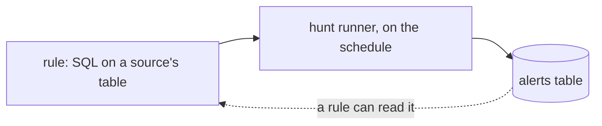

# Detections and hunts

A rule is one SQL query tied to a source. A hunt runs rules on a schedule and writes what they match to the `alerts` table.

The `alerts` table is itself a source. It has the same schema management, retention and query surface as any other, and a rule written against it is how you express correlation. [Detections on a source](../dfe-engine/data-plane/source-detections.md) has the rule file, the hunt, which organisations a hunt reads, and the lookup databases a rule condition may read.

## In the console

Rules and Hunts sit under Detect. Matches are under Observe, in Hunt Results. A search in HyperDX can start a rule: the Create Rule trigger sends the search's SQL to the rule editor. [Creating a rule from a search](../dfe-ui/hyperdx-rule-create.md) walks it.

## Sigma

Sigma is off in 2.2.1. Every path under `/api/v1/sigma` answers 404 until the engine runs with `DFE_SIGMA_ENABLED=true`. A `sigma` entry in a source's `views` is a field-map view and deploys either way. Turned on, [the Sigma pipeline](../dfe-engine/data-plane/sigma.md) pulls community rule feeds into a catalogue you curate, and each rule you select becomes a DFE rule and a hunt. [Field mapping](../dfe-engine/data-plane/field-mapping.md) says how Sigma's field names reach your columns.

## Running the hunts

The hunt runner is one pod by default. Autoscaling is beta and opt-in, through `huntRunner.autoscaling.enabled`. [Hunt-runner scaling](../dfe-engine/data-plane/hunt-runner-scaling.md) says how the due backlog is computed and what the runner does with no engine.

## Conditions

Match conditions use CEL. [The expression language](../dfe-engine/data-plane/expressions-cel.md) is the decision behind it.
