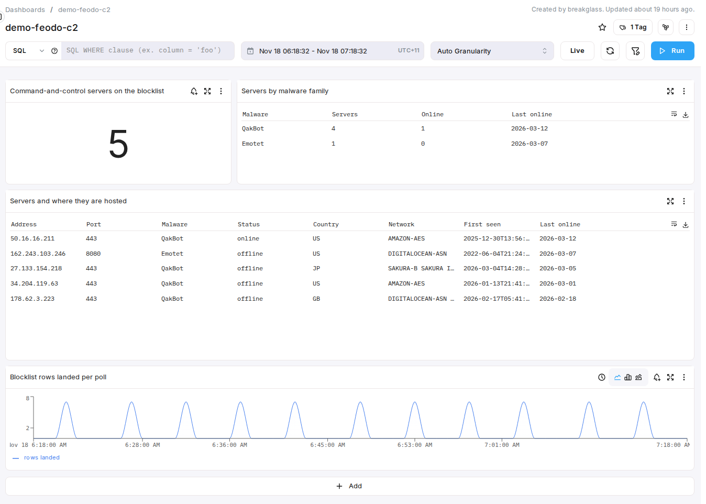
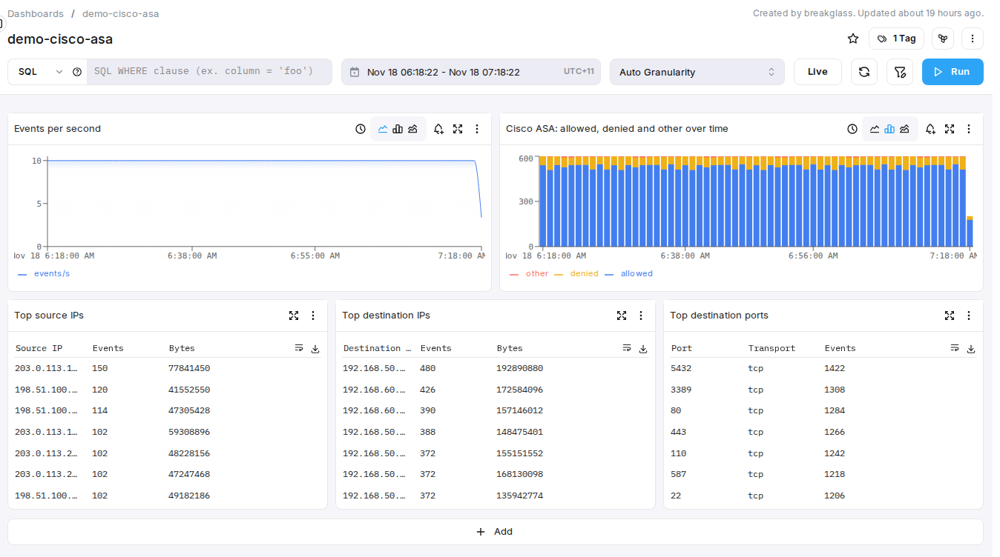
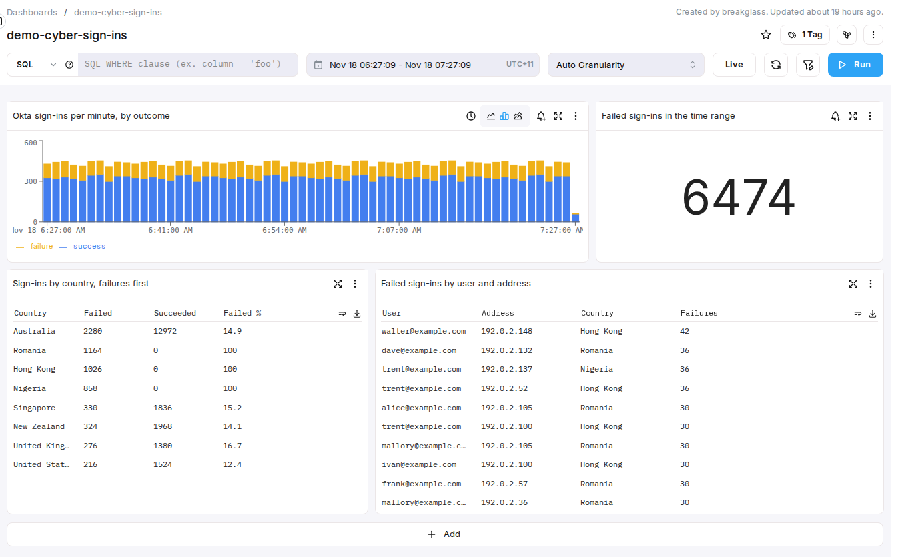
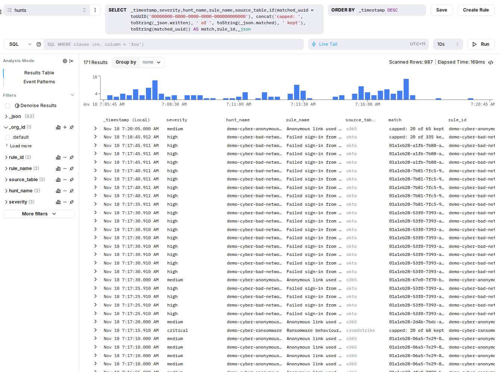
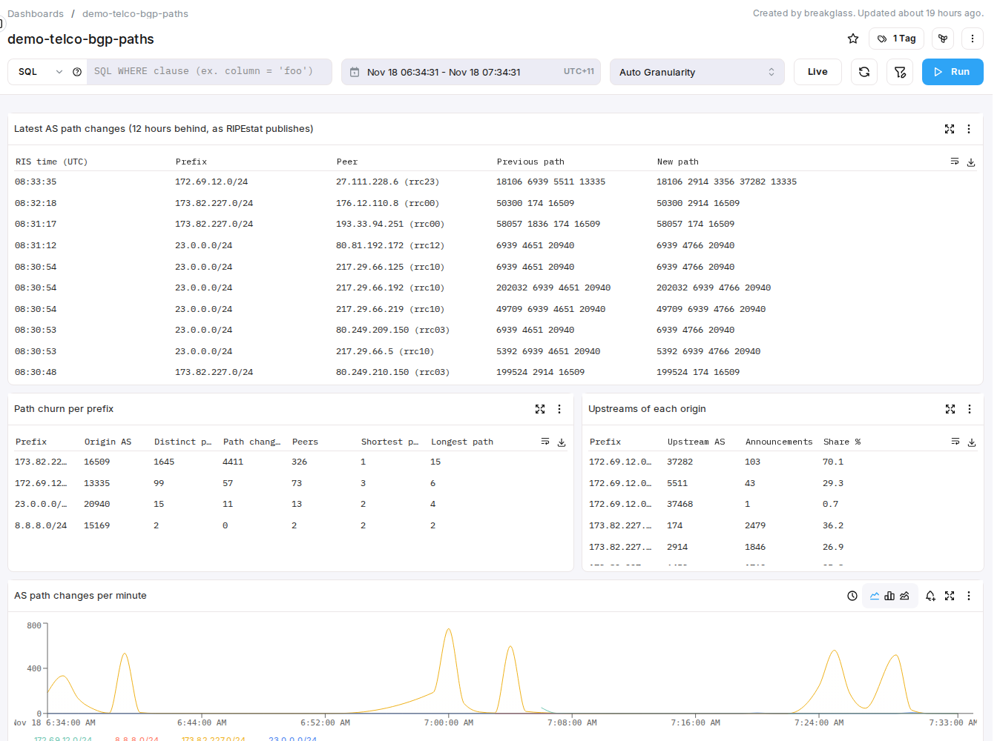
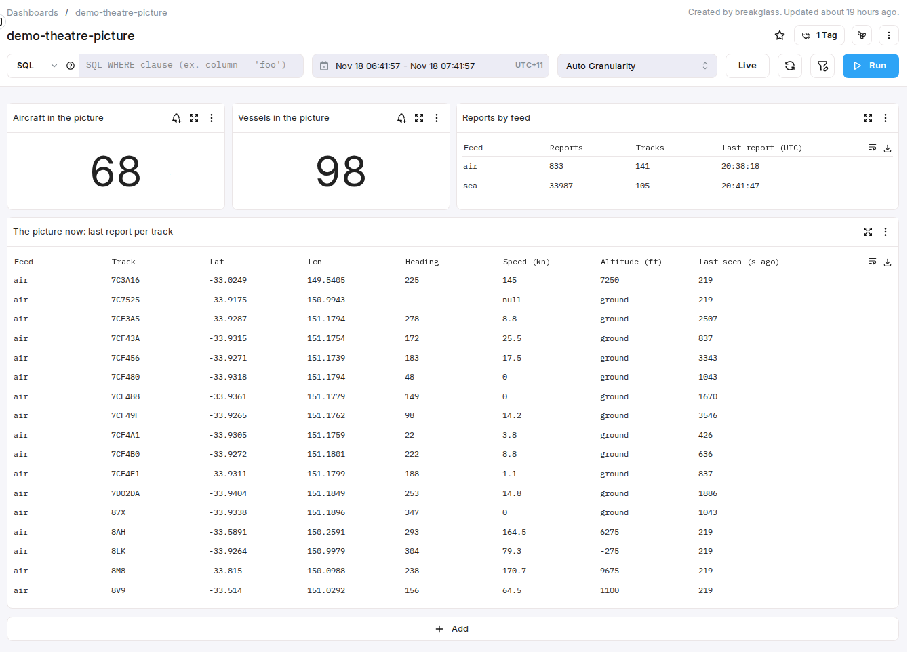

# Where to look in the demo

Each demo pack opens its console at http://localhost:3000 with its dashboards, saved searches and hunts already made. The pointers below name what to open, what it shows and how the data got there. Start a pack from [the demo quickstart](demo.md).

Dashboards are under **Dashboards** in the console's left bar, hunt hits under **Hunt Results** (http://localhost:3000/observe/hunt-results) and each source's flow and sample events under **Sources** (http://localhost:3000/sources).

Three paths bring the data in:

- Pushed: syslog or JSON arrives at dfe-receiver, dfe-transform-elastic parses it where the source names a parser, and dfe-loader writes one ClickHouse table per source.
- Pulled: dfe-fetcher polls a public API on a schedule, and dfe-loader writes the rows to that source's table.
- Hunts: the hunt runner queries the stored rows on a schedule and writes each hit to Hunt Results.

## demo: firewall syslog and a live threat feed

| Open | What it shows | How it got there |
|---|---|---|
| `demo-cisco-asa` | Cisco ASA events over time: allowed, denied, top addresses and ports | Raw ASA syslog to dfe-receiver. dfe-transform-elastic works out which product sent each line and parses it, with no Elastic Agent, into `cisco-asa` |
| `demo-fortinet` | FortiGate traffic and SSH denies | The same path, into `fortinet` |
| `demo-syslog` | Lines no product parser claimed | Kept as sent, in `demo-syslog` |
| `demo-feodo-c2` | Live botnet command-and-control servers, their malware, country and hosting network | dfe-fetcher pulls the abuse.ch Feodo Tracker blocklist every 5 minutes |
| `demo-component-releases` | The latest release of each DFE component | dfe-fetcher polls the GitHub releases API every 15 minutes |
| Hunt Results | Hits from `demo-asa-logon-failed` and `demo-fortinet-ssh-denied` | The hunt runner over the ASA and FortiGate tables |

## demo-cyber: a SOC's day on Elastic integration data

| Open | What it shows | How it got there |
|---|---|---|
| `demo-cyber-sign-ins` | Okta sign-ins by outcome, failures by country, user and address | Okta records in the envelope an Elastic Agent ships, posted to dfe-receiver, routed on `data_stream.dataset` and parsed by dfe-transform-elastic into `okta` |
| `demo-cyber-edr` | CrowdStrike Falcon detections | The same path, into `crowdstrike` |
| `demo-cyber-o365-admin` | Microsoft 365 admin activity | The same path, into `o365` |
| `demo-cyber-denied`, `demo-cyber-bad-networks` | Firewall denies, and traffic from known-bad networks | ASA and FortiGate syslog, as in `demo`, with some outside addresses moved onto a list of known-bad networks |
| Hunt Results | `demo-cyber-bad-network-sign-in`, `demo-cyber-anonymous-link`, `demo-cyber-ransomware` | The hunt runner over `okta`, `o365` and `crowdstrike` |

## demo-telco: a mobile network and the routes around it

| Open | What it shows | How it got there |
|---|---|---|
| `demo-telco-bgp-paths`, `demo-telco-bgp-peers` | BGP announcements, withdrawals and AS path changes for four well-known prefixes | dfe-fetcher polls RIPEstat every minute. RIPEstat publishes 12 hours behind, so each poll reads the minute 12 hours ago |
| `demo-telco-cells` | 5-minute counters for 20 cells on 7 sites: throughput, signal (RSRP), load, users | Generated counters with three injected cell faults, posted to dfe-receiver as JSON and loaded to `ran-kpis` with no parser |
| `demo-telco-probes` | Core network procedures (NGAP, GTPv2-C, Diameter) with result, cause and latency | Generated probe records with one failure burst, on the same path into `core-probes` |
| `demo-telco-rfo` | A reason-for-outage timeline from the cell counters and probes | A dashboard over both tables |
| Hunt Results | `demo-telco-weak-signal`, `demo-telco-hss-too-busy`, `demo-telco-peer-withdrawals` | The hunt runner over the three tables |

The replay puts a full generated day behind the moment the pack starts, so the cell faults and the probe failures land in the hour before it started, and at that time each day after. Set the time range back over that hour, or the faulted tiles and the RFO timeline read "No data found".

## demo-theatre: live aircraft and ships

| Open | What it shows | How it got there |
|---|---|---|
| `demo-theatre-picture` | The air and sea picture now: the last report per track | dfe-fetcher polls adsb.lol for aircraft within 100 nautical miles of Sydney airport, and Fintraffic's Digitraffic for ships within 60 km of Helsinki |
| `demo-theatre-altitude`, `demo-theatre-tracks-seen`, `demo-theatre-churn`, `demo-theatre-vessel-moves` | Altitude bands, tracks seen, track turnover and ship movement | The same two feeds, one row per aircraft or ship per poll |
| Hunt Results | `demo-theatre-aircraft-low`, `demo-theatre-vessel-silent` | The hunt runner over the two track tables |

When a feed is down or has nothing to report, the pack serves a captured poll with its times moved to now, so the picture never sits empty.

## Tiles that stay empty

The docker stack doesn't collect ClickHouse's own server and process metrics, so those tiles read "No data found" on the stock DFE dashboards and on `demo-syslog`.
