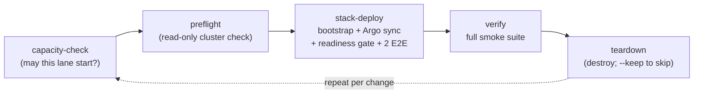

# The validation cycle: create -> test e2e -> destroy

This repeatable loop is the validation SSoT this repo owns -- THE way to prove
a DFE deployment works: on a development cluster, on a teammate's clone, on a
production estate. Everything estate-specific rides in a gitignored env file,
so the committed repo runs the same cycle everywhere.



One command runs the whole loop (mode defaults: `scale` on Kubernetes, `slim`
on Compose):

```bash
python3 scripts/dfe-ops cycle --mode single \
    --kubeconfig .tmp/target.kubeconfig --env-file bootstrap/.env
```

A dev/test deployment is ephemeral by design: create it, test it, destroy it,
redeploy it in another mode, without asking anyone. The one exception is a
resident reference deployment, pinned to a version and updated
only explicitly after an extended stable-release period.

Each stage self-executes as its own `dfe-ops` subcommand, so the cycle and the
hand-run commands cannot drift, and the cycle exports `--kubeconfig` as
`KUBECONFIG` to every stage so they all aim at the SAME cluster (by hand they
use your current context; check it first). A failed deploy still destroys -- a
broken cycle must not strand a half-stack. `--keep` skips the destroy, on a dev
cluster only.

## Batching a full cloud cycle

A full cloud cycle runs once per BATCH of changes to the managed-Kafka path,
never once per finding -- a cycle proves a batch. Stage every proof job before
`tofu apply`, so no cluster time is spent authoring one. The managed cluster is
the long pole: it comes up first and goes down first, and its proofs run the
moment it reports ACTIVE. Proofs needing only the Kubernetes side run during its
waits. A broker-count change runs one direction only. Teardown starts the moment
the last proof lands.

## Unattended cloud runs

An unattended cloud cycle runs through `dfe-ops cloud-cycle --tf-dir <root> --run-length 3h -- <cycle args>`. The cycle's mode is the dial's profile: the guard adds `--mode <profile>`, and before anything is created it refuses a `--mode` that names another and any argument `dfe-ops cycle`'s own parser rejects. It creates nothing unless `dfe-ops cloud-preflight` passes: the account's guardrails are readable, the credential outlives the run plus its teardown, and no earlier run is left: no run record, and no run-tagged resource, expired or live (a NAT gateway, VPC endpoint, instance, network interface, volume, subnet, security group, security group rule, route table, internet gateway, VPC, launch template or Elastic IP that EC2 reports deleted, terminated or not found does not count, nor does a KMS key scheduled for deletion or an EKS pod identity association whose cluster is gone, and the check says how many such hits it dropped). Its check (e) refuses a runner missing any command bootstrap.sh or destroy.sh runs, on the PATH the run's children get. `bootstrap/check_tools.py` is the one list of them, and bootstrap.sh runs it again before its first cluster call. The run gets its own state key and `dfe-e2e`/`expires-at` tags (`scripts/cloud_run.py`), and every exit short of SIGKILL tears it down. `scripts/cloud_reaper.py reap` removes what an expired run left, skips the same already-deleted resources the tagging API goes on listing, and does nothing while `DFE_REAPER_AWS_ROLE` is unset. Flags, variables and refusals: `scripts/dfe_ops_cloud_guard.py` and `scripts/cloud_reaper.py`.

Preflight also refuses a session credential (`AWS_SESSION_TOKEN`) whose expiry it cannot read, and every child of a run gets the dial's region as `AWS_REGION`, so a call that names no region never lands outside the run's. A runner outside the VPC hands the guard its own address as `DFE_RUN_ENDPOINT_CIDR` (one /32), and the run opens the Kubernetes API's public endpoint to that address alone, in place of the dial's endpoint, and fences the public gateway to that address plus the cluster's NAT addresses. The private endpoint stays on, and the allowance goes with the cluster at teardown.

The GitHub Actions workflows that dispatch a cycle and schedule the reaper are not in this repository. Their logs carry the account's resource ids and domain, so they run from a private repository that checks this one out and holds the GitHub environments the runner and reaper roles trust by OIDC.

A provider's error body can quote a credential it had just created, and an Actions log keeps it. `dfe-ops redact` writes stdin to stdout a line at a time through the failure-evidence redactor, so the step pipes its output through it: `set -o pipefail; tofu apply ... 2>&1 | scripts/dfe-ops redact`. Without `pipefail` the step exits with the redactor's status, 0 whatever tofu exited with. The redactor ignores SIGINT, SIGTERM and SIGHUP and ends at end of input, so a teardown running after the runner cancels the step still has a pipe to write to. A private key block is masked across its lines, and a line past 1 MiB is cut and ends in `***TRUNCATED***`.

The run length is a deadline that apply and the cycle share: a cycle still running at it is stopped with its process tree and the run exits 124, leaving the whole margin (`--teardown-margin`, default 45m) to the teardown. The workload teardown gets half of it, so `tofu destroy` always runs. When that destroy fails, the teardown deletes the network interfaces carrying the run's tag and runs `tofu destroy` once more: the VPC CNI allocates them outside tofu, and one whose node terminated mid-destroy holds its subnet. Nothing else is swept while state remains, and an interface EC2 will not delete is named and left.

`dfe-ops cycle --acceptance-suite <suite>` runs `acceptance` as a stage after smoke and before ui, from the deploy's terraform outputs and as its minted admin; a failed stage skips the rest and destroy still runs.

### The edge stage

`--acceptance-suite edge` proves the receiver's public door lets in the address on the allow list and no other. It admits one address on the ingest door and sends a record from it. The send has to be accepted, the row has to land in `dfe.main`, and dfe-ui's search and HyperDX both have to find it. Then it sends from the cluster's own NAT egress, which the list does not name, and expects a refusal, which proves the list rather than a dead door.

The stage writes the allow list to the deploy repo's overlay and puts it back afterwards (`--keep` leaves it). Only a cloud lane has a public load balancer to send to, so `all` never includes it. It reads two inputs:

- `DFE_RUN_INGEST_ALLOW_CIDR` is the address the suite sends from, taken from the environment or an `--env-file`. It has to be one network and never `/0`, because a refusal cannot prove a list that admits everyone.
- `DFE_EGRESS_CIDRS` is the cluster's NAT egress as /32s, taken from the cloud root's tofu output through `--from-terraform`.

A missing or `/0` allow address is refused before it costs a cluster. `dfe-ops cloud-cycle` refuses it ahead of the preflight and the apply, and `dfe-ops cycle` refuses it ahead of the deploy.

### Choosing the backend for one run

`scripts/cycle_backend.py --dial <file> --backend <name>` picks what a run deploys against without editing the one dial. `default` runs the dial as written. Any other name applies `scripts/cycle-backends/<name>.yaml` over it, so it has to run before the tofu render and the sizing read the dial. An overlay commits only the shape -- `msk` sets `kafka.provider: msk` and the `kafka.msk` block -- and a value written `env:<NAME>` is read from the environment, so no host or cluster id reaches the repository or its logs.

| Backend | What the run deploys against | Read by the overlay |
|---|---|---|
| `msk` | AWS MSK brokers the run creates | nothing |
| `confluent-cloud` | a Confluent Cloud Basic cluster per run, public endpoint, in a standing environment, topics capped at 8388608 bytes | `DFE_CYCLE_CONFLUENT_ENVIRONMENT_ID` |
| `redpanda-cloud` | a Redpanda Cloud Serverless cluster per run, public endpoint, in a standing resource group | `DFE_CYCLE_REDPANDA_RESOURCE_GROUP_ID` |
| `clickhouse-cloud` | the standing ClickHouse Cloud service, beside the dial's own broker | `DFE_CYCLE_CH_HOST`, `DFE_CYCLE_CH_USER` |

Every backend a run names is its AWS instance, and the plan refuses one on another cloud ([deployment/managed-backends.md](deployment/managed-backends.md)).

### MSK runs last, and rarely

An MSK cluster is the slowest thing a run builds: one took 41m14s to create on 2026-10-14, and the EKS cluster sat built and idle for about 27 minutes of that wait. Brokers bill by the broker-hour and the cluster, nodes and NAT gateways bill by the hour through all of it, for no test value. So iterate on `confluent-cloud` or `redpanda-cloud`, and run `msk` once, after the shared external-Kafka changes have already passed on one of them.

## Upgrading a persistent deploy instead of cycling it

A reference deploy is not cycled: destroying it is the whole thing we do not
want. Argo tracks a git ref there, so a `git push` to that ref IS the upgrade,
and `refresh` is the other half. It hard-refreshes every Application so the
pushed commit lands now rather than at the next poll, waits for every tracked
Application to report Synced and Healthy with no operation still running, then
re-proves the deploy with the readiness gate and the `verify` smoke suite.
Without that wait the gate exits on its first clean poll, which is the old
revision's pods.

```bash
python3 scripts/dfe-ops refresh --mode slim \
    --kubeconfig .tmp/target.kubeconfig --env-file bootstrap/.env
```

It deploys nothing and tears nothing down. `--readiness-timeout` bounds the sync
wait and the gate separately. `--skip-verify` stops after the gate, which proves
the deploy is Ready but not that it works -- and is the one path needing no
namespace: the smoke stage runs inside the app namespace, so `refresh` otherwise
refuses to start when neither `--env-file` (`DFE_NAMESPACE`) nor `--namespace`
names one, and every namespaced suite would fail on `namespaces "dfe" not found`.

## What the readiness gate refuses

Beyond pod readiness and replica counts, the gate asks the engine's
`/api/v1/auth/setup-status` whether the deployment is running the shipped admin
password, and FAILS when it is and `DFE_ENV` is not a dev posture (`dev`,
`development`, `local`, `test`, `ci`). Ready is not the same as safe: the deploy
mints `admin` and `breakglass` through ESO Password generators, so a stack still
on the default has not taken them.

An engine too old to serve `default_credentials` answers without the field, and
that only warns: the probe reached the engine and only the contract is missing.
A probe that could not RUN at all -- an RBAC denial on `kubectl exec`, a wrong
`READINESS_ENGINE_TARGET`, a non-200 from setup-status -- leaves the gate unable
to say whether the shipped password is in use, so it FAILS outside a dev posture
and warns inside one.

It then runs `dfe-ops admin-probe`, which fetches every admin UI in the `dfe-admin-links` ConfigMap through the gateway address under its own hostname, following redirects. A redirect loop, a 5xx or no answer FAILS in any posture: a Ready pod behind a looping route is still a UI nobody can open. So does a 4xx other than 401, 403 or 404 at the end of the chain, such as an IdP answering 400 to a redirect URI it has not registered. A redirect off the deployment's domain is a login handed to an IdP and passes. No ConfigMap, no Gateway address, or a gateway this machine cannot reach is a named SKIP, and a failing UI is re-probed for `READINESS_ADMIN_UI_WAIT` seconds (default 120) before it fails the gate.

When the gate times out it runs `dfe-ops readiness-report` once, because a ready count cannot tell a pod with nowhere to schedule from one that cannot pull its image. The report prints, for every pod not Ready in a judged namespace or kube-system, the scheduler's verdict and each container's wait, then the newest Warning events, every node's placement labels, taints and requested-against-allocatable CPU and memory, Karpenter's NodePools, NodeClaims, EC2NodeClasses and controller errors, unbound volume claims, and Argo Applications not Synced and Healthy. It reads and never writes, and it never changes the gate's exit code.

`dfe-ops creds` prints where each minted credential is fetched from, reading both
Secret names off the live engine Deployment.

## When a stage fails

The cycle runs `dfe-ops failure-evidence` once before the destroy, so the evidence outlives the cluster. It writes one file per capture into a timestamped directory under `--evidence-dir`, by default `failure-evidence/` under `--acceptance-shots-dir`: `nodes -o wide`, each node's conditions and allocatable, `pods -A -o wide`, every namespace's Warning events oldest first, kube-system events oldest first, Services and Gateways `-A -o wide` (a load balancer never programmed shows as a Service with no address), the cert-manager Certificates in kube-system, a summary, the events and the container logs of each kube-system pod not Running and Ready, the same for up to 40 pods in any namespace with a container waiting on `ImagePullBackOff`, `ErrImagePull`, `CrashLoopBackOff` or `CreateContainerConfigError`, or with an init container not yet finished, then each pod that is Running but not Ready, such as one whose readiness probe fails (the events carry the kubelet's pull or config error, and a not-Ready pod past the 40 is named on a closing `+N more not-Ready pods` line), the AWS Load Balancer Controller's webhook configurations with each `caBundle` reduced to a digest and its containers' newest log lines, the events of each node reporting `InvalidDiskCapacity`, every aws-node container's newest log lines, the CNI's `ipamd.log`, `plugin.log` and `network-policy-agent.log`, and what an ESO re-mint leaves behind: every ExternalSecret's sync status, their Normal events, the external-secrets controller's newest log lines, and the creation time, `resourceVersion` and `immutable` flag of each Secret a generator writes, read by those field names alone. A pod summary comes from the pod list already read: node, phase, conditions, and for every init and main container its image, state, restart count and last termination. It leaves out every container's env, envFrom, args and command, the pod's volumes and its annotations, and nothing runs `kubectl describe`, because that prints literal env values into an artefact CI uploads. Each of those pod reports also carries the containers' logs: the previous run of one that restarted or sits in `CrashLoopBackOff`, a running or failed init container, and a running container that is not ready. A read keeps the newest 200 lines within 64 KiB, and all pod logs of a run stop at 8 MiB. Every log passes through a redactor first, which masks values under credential-named keys, URL userinfo, bearer tokens, private key blocks and common token shapes. `index.txt` names the command behind each file and how it ended. Each call is capped at 30 seconds and 1 MiB and the whole capture at 300 seconds, a failing call never stops the rest, nothing reads a Secret's data, and the cycle's verdict does not change.

## Diagnostics bundle

With `--diagnostics-dir DIR`, a failed stage from `deploy+e2e` on runs `dfe-ops diagnostics` before the destroy, as does the source suite before it removes its source and that source's transform pods. Each run writes `DIR/<UTC time>-<label>/`: `logs/` (the last 30 minutes of the receiver, loader, archiver, engine, hunt runner and every transform), `workloads.txt`, `events/`, `argo-applications.txt` and `kafka/` (group and topic offsets, broker API versions, the loader group read step by step). The Kafka reads come from a short-lived pod that mounts the engine's own SASL Secret, so no Secret is read. On `msk` it copies MSK's broker logs from S3 into `kafka/broker-logs/`, and S3's batching can leave out the last few minutes. Every file is redacted, the whole capture stops at 300 seconds, and a capture that fails is recorded in `index.txt` while the rest still run.

## The env-file contract (how a teammate gets running)

Everything estate-specific -- addresses, domains, storage class, secrets
endpoints -- lives in ONE flat `DFE_*` env file. The committed
[bootstrap/local.env.example](../bootstrap/local.env.example) is the template
(placeholder values only: RFC 2606 domains, RFC 5737 addresses); the filled copy
(`bootstrap/.env`) is gitignored and distributed out-of-band, e.g. as a
Bitwarden secure note.

The whole onboarding:

1. `git clone` this repo.
2. Get the deployment's `.env` out-of-band -> save as `bootstrap/.env`.
3. Get a kubeconfig (`python3 scripts/dfe-ops kubeconfig --node <addr>
   --vault-path <kv path of the node SSH key> --out .tmp/target.kubeconfig`, or
   from whoever runs the cluster).
4. `python3 scripts/dfe-ops cycle --mode single --kubeconfig
   .tmp/target.kubeconfig --env-file bootstrap/.env`

No step edits a tracked file. If a value belongs in git, it is not
estate-specific; if it is estate-specific, it belongs in `.env` -- never both.
Two settings live there and nowhere else: `DFE_SKIP_PLATFORM_CHECK=true`
installs onto a cluster outside `platform.kubernetes`, warning as it goes; and
`DFE_LOCAL_PATH_DIR` puts the local-path-provisioner's volumes somewhere other
than upstream's `/opt/local-path-provisioner`, for nodes that keep their data
off the root filesystem. Unset is upstream's behaviour; an adopted StorageClass
ignores it.

## The cluster contract ("vanilla Rancher") and preflight

The product rule: assume a vanilla Rancher/RKE2 cluster and BRING what the
stack needs. "Vanilla" means the things bootstrap CANNOT create for itself --
everything else (cert-manager, ESO, Argo CD, MetalLB, local-path storage) is
detect-or-install: an existing operator is adopted, an absent one installed.
The Argo CD bootstrap installed is the exception: a re-run upgrades it in place to the pinned chart and flags, and preflight previews that as UPGRADES.

What the cluster must supply:

| Contract item | Why | Preflight check |
| --- | --- | --- |
| Reachable API server inside the stack's `platform.kubernetes` (versions.yaml) | the deploy target, and the support window | FAIL below the floor, as `bootstrap/check_platform.py` does at bootstrap |
| Admin-ish RBAC (create ns/CRD/clusterrole/deploy/secret) | bootstrap installs operators | FAIL if not |
| >= 1 Ready node (3 for `scale`) with headroom | scheduling | WARN under guidance floors |
| The workload node label, when the overlay selects on one | pods sit Pending forever without it -- looks like a chart fault, is the wrong cluster | FAIL if no Ready node carries it |
| A default StorageClass -- or none at all | PVCs; bootstrap falls back to local-path when absent | WARN/FAIL as applicable |
| A LoadBalancer path on cloud targets | on-prem gets MetalLB from bootstrap, pooled on `DFE_GATEWAY_IP`/`DFE_RECEIVER_IP` | WARN |
| No Strimzi CRD storing a version the 1.x operator no longer serves (`status.storedVersions` other than `v1`, e.g. `v1beta2`) | the 1.x operator chart cannot apply over it, so no Kafka broker starts and the readiness gate times out | FAIL naming each CRD and the `kubectl delete crd <name>` that clears it. Runs in `preflight` and again in `stack-deploy` just before `bootstrap.sh`, so a deploy without the cycle is refused too. A cluster carrying a live Kafka needs `dfe-ops upgrade preflight` instead. `stack-deploy --check-only` contacts no cluster and skips it, and a CRD list that cannot be read is a WARN |
| Pull access to the image registry | image supply | WARN (from the operator's machine) |

Check any cluster read-only before touching it:

```bash
python3 scripts/dfe-ops preflight --mode scale --env-file bootstrap/.env \
    --require-label dfe.hyperi.io/workload=dfe
```

On a shared cluster whose nodes lack the workload label, preflight fails that
check -- the wrong-cluster trap it exists to catch.

## Targets: on-prem now, cloud by parameter

The cycle is target-neutral: the target is (kubeconfig + env file), nothing else.

- On-prem Rancher/RKE2 (the first-class baseline): as above.
- AWS (and other clouds): `tofu apply` the environment first, then either
  `--from-terraform terraform/environments/aws` (reads the outputs) or an `.env`
  exported from them. Cloud deltas live in the env file (`DFE_STORAGE_CLASS=gp3`,
  cloud LB, workload-identity annotations) -- the cycle itself is identical. **A
  cloud test deployment is destroyed the same day, no exceptions**: the cycle
  destroys by default, and when it was provisioned via `--from-terraform` the
  destroy stage also runs the IaC destroy (`teardown --with-terraform`), so the
  control plane and nodes die with the test, not just the DFE workloads on them.
- **Local kind** (a throwaway cluster on the machine you run it from): `dfe-ops kind up --ref <ref> --mode single --env-file bootstrap/.env` creates the cluster on a docker network of its own, has the cluster CA sign each kubelet's serving certificate (kind's own carries no IP SAN, which metrics-server refuses), adds the StorageClass the `local-dfe` overlay asks for and two front-door addresses from that network for bootstrap's MetalLB, then runs the ref's OWN `stack-deploy` from a checkout of it, with Argo pinned to the resolved commit. `DFE_*` comes from the env files alone; DNS, an external deploy repo and CA persistence are forced off. single, slim and mesh need no env file at all: the published images pull anonymously and nothing those tiers deploy reads a secrets store. Pass one for a private chart repo, scale's store, or a private mirror of your own. On Linux the front door answers from the host; on Docker Desktop use the port-forwards `acceptance` and `ui` open. `kind status` reports health, and `kind down` removes the cluster, its network and `.tmp/kind/<name>`, then proves each gone.

## What the stages actually run

| Stage | Wraps | Gate |
| --- | --- | --- |
| `capacity-check` | `--lane k8s` reads allocatable minus scheduled requests; `--lane docker` the daemon host's available memory | the mode's `lane_floor` in `scripts/profiles.py`; a breach REFUSES, and `--watch` keeps checking while a lane runs so the newer lane aborts instead of the host swapping |
| `preflight` | read-only kubectl against the target | cluster contract above |
| `stack-deploy` | offline pin/drift/render preflight, the Strimzi stored-version read of the target cluster, then `bootstrap/bootstrap.sh` (Layer 0/1 + Argo profile sync at the pinned stack) | bounded readiness + the 2 default E2E tests (receiver->CH data path, self-monitoring OTel) |
| `verify` | `bootstrap/run-all-smoke-tests.sh` | readiness, auth, data, KEDA, integration. The scale proof injects pressure through the shim twice: phase 1 takes a throwaway Deployment 1->2->1, and phase 2 takes every app whose ScaledObject carries the shim trigger from its floor to one above and back, all at once. A ScaledObject with no shim trigger, or whose Deployment the profile does not run, is a reported SKIP, so slim, where `apps/dfe-receiver/profile-slim.yaml` clears the trigger, skips phase 2. At scale-out the HPA's pressure reading must be at or over target. UNPROVEN fails the stage like FAIL, and `DFE_KEDA_SCALE_TEST=0` skips the proof |
| `acceptance` | `onboarding` drives the setup wizard and first console session in Chrome (`--console-only` on a deploy already set up); `flows` is the engine repo's live pytest suite over port-forwards; `source` is the section below; a suite needing a source the deployment already carries goes through the pytest passthrough | `all` runs onboarding FIRST and stops on it: a deployment nobody could have onboarded has failed whatever the data path then does. The wizard's screens come from the engine's own `auth/setup-status`, so a screen the deployment no longer asks for is a failure, not a variation |
| `ui` (opt-in: `--ui-repo`, needs `--e2e`) | the onboarding runner signs in with the minted admin password, makes the forced password change and completes the wizard, then every dfe-ui spec not tagged `@docker-only` runs over the gateway URL, with the suite's time budgets raised for a deployed stack (`--test-timeout-ms` 120000, `--expect-timeout-ms` 30000, `--nav-timeout-ms` 30000) | a failed onboarding stops the run; an engine serving no `/api/e2e` is refused |
| `teardown` | `bootstrap/destroy.sh` (`--with-terraform` also destroys IaC state) | leaves the cluster as preflight found it |
| `refresh` (not a cycle stage) | the section above | the tracked ref landed and every tracked Application is Synced + Healthy, then bounded readiness + the full smoke suite |

## The post-deploy source tests (`acceptance --suite source`)

Not part of the stock POST: the default E2E tests prove the deploy moved data,
these prove an operator can add a source and watch it work. Run on demand after
a deploy, here and on docker through dfe-docker's `make test-source`, which
calls the same runner. Three cases, chosen with `--source-case`: `filebeat` (the default) pushes the corpus's cisco_ios lines at the receiver in the Elastic Agent envelope, routed on `data_stream.dataset`, through the bundled VRL, `elastic` pushes the same lines at a transform compiled into dfe-transform-elastic, and `cloudwatch` (run as `--aws-service cloudtrail`) lets a fetcher pull an AWS upstream.

The CloudWatch case needs a SIXTH env file naming the upstream
(`.tmp/aws-test.env`: `DFE_AWS_REGION`, `DFE_AWS_LOG_GROUP`), and
`--fetcher-credentials-vault-path kv/<path>` to put the AWS keys in the Secret
the fetcher chart names before the source is created.

What each case does and what proves it: [SOURCE-SUITE.md](SOURCE-SUITE.md).
