# DFE architecture

DFE takes events from your agents, products and APIs, carries them over Kafka, and lands them in ClickHouse, where you search them in the DFE console. This page is the map of the whole suite, and dfe-infra is the repo that deploys it onto Kubernetes.

```mermaid
---
config:
  theme: base
  look: neo
  fontFamily: Inter, -apple-system, Segoe UI, Roboto, Helvetica, Arial, sans-serif
  flowchart:
    curve: linear
    nodeSpacing: 40
    rankSpacing: 64
    padding: 18
    wrappingWidth: 280
    htmlLabels: true
  elk:
    preset: modelOrder
  themeVariables:
    fontSize: 15px
    lineColor: "#64748B"
    primaryTextColor: "#0F172A"
    clusterBorder: "#0072B2"
    edgeLabelBackground: "#FFFFFF"
  themeCSS: >-
    p{margin:0}
    .node[data-look] rect,.node[data-look] path,.node[data-look] polygon,.node[data-look] .outer-path{filter:drop-shadow(0 1px 2px rgba(15,23,42,.10)) drop-shadow(0 6px 14px rgba(15,23,42,.10))}
    .node rect{rx:10px;ry:10px}
    .cluster rect{rx:16px;ry:16px}
    .node .label div{min-width:150px}
    .node.decision .label div{min-width:0}
    .cluster[data-look] rect{filter:none}
    .nodeLabel{line-height:1.35}
    .nodeLabel b{font-weight:600;font-size:15px;letter-spacing:-0.01em}
    .nodeLabel span{font-size:12.5px;font-weight:400;color:#334155}
    .cluster-label span.nodeLabel{display:inline-block;background:#FFFFFF;color:#0B2A3F;border:1.5px solid #0072B2;border-radius:999px;padding:2px 12px;font-size:11.5px;font-weight:700;letter-spacing:.09em;text-transform:uppercase}
    .flowchart-link{stroke-width:1.75px}
    .labelBkg{background:transparent!important}
    span.edgeLabel{display:inline-block;background:#FFFFFF!important;color:#1E293B;border:1px solid #94A3B8;border-radius:999px;padding:2px 10px;font-size:12px;font-weight:500}
    span.edgeLabel p{background:transparent!important}
    .label-icon{width:20px;height:20px;vertical-align:-4px;margin-right:6px}
    .ingest .label-icon{color:#0E8A7D}
    .xform .label-icon{color:#7B4FB0}
    .load .label-icon{color:#0072B2}
    .bus .label-icon{color:#A8517F}
    .store .label-icon{color:#00785A}
    .ui .label-icon{color:#D9480F}
    .ext .label-icon{color:#64748B}
---
flowchart LR
  accTitle: L2 Services -- DFE suite
  accDescr: Your sources feed dfe-receiver and dfe-fetcher, which write a source topic on Kafka. dfe-loader inserts into ClickHouse and dfe-archiver writes files to object storage. An optional transform turns the source topic into a transformed one, and direct gRPC skips Kafka.
  S("<b>Your sources</b><br/><span>agents, APIs, databases, files</span>")
  subgraph IN["Collect"]
    direction TB
    R("<b>dfe-receiver</b><br/><span>takes what is sent</span>")
    F("<b>dfe-fetcher</b><br/><span>pulls what is not</span>")
  end
  subgraph BUS["Kafka"]
    direction TB
    K1("<b>Source topic</b><br/><span>*_land</span>")
    T("<b>Transforms</b><br/><span>optional, grok or custom</span>")
    K2("<b>Transformed topic</b><br/><span>*_load</span>")
    K1 -.-> T
    T -.-> K2
  end
  subgraph OUT["Store"]
    direction TB
    L("<b>dfe-loader</b><br/><span>inserts into tables</span>")
    C[("<b>ClickHouse</b>")]
    A("<b>dfe-archiver</b><br/><span>writes compressed files</span>")
    O[("<b>Object storage</b>")]
    L --> C
    A --> O
  end
  S --> IN
  IN --> BUS
  BUS --> OUT
  IN -.->|direct gRPC, no Kafka| OUT
  class S ext
  class R,F ingest
  class K1,K2 bus
  class T xform
  class L,A load
  class C,O store
  classDef ext fill:#F4F6F8,stroke:#94A3B8,stroke-width:1.5px,stroke-dasharray:5 4,color:#0F172A
  classDef ingest fill:#FFFFFF,stroke:#0E8A7D,stroke-width:3px,color:#0F172A
  classDef xform fill:#FFFFFF,stroke:#7B4FB0,stroke-width:3px,color:#0F172A
  classDef load fill:#FFFFFF,stroke:#0072B2,stroke-width:3px,color:#0F172A
  classDef bus fill:#FFFFFF,stroke:#A8517F,stroke-width:3px,color:#0F172A
  classDef store fill:#FFFFFF,stroke:#00785A,stroke-width:3px,color:#0F172A
  classDef ui fill:#FFFFFF,stroke:#D9480F,stroke-width:3px,color:#0F172A
  classDef decision fill:#FFFFFF,stroke:#9A6700,stroke-width:3px,color:#0F172A
  classDef error fill:#FFFFFF,stroke:#C2410C,stroke-width:3px,color:#0F172A
  classDef control fill:#FFFFFF,stroke:#334155,stroke-width:3px,color:#0F172A
  classDef part fill:#FFFFFF,stroke:#94A3B8,stroke-width:1.5px,color:#0F172A
  style IN fill:none,stroke:#0072B2,stroke-width:1.5px,stroke-dasharray:6 4
  style BUS fill:none,stroke:#0072B2,stroke-width:1.5px,stroke-dasharray:6 4
  style OUT fill:none,stroke:#0072B2,stroke-width:1.5px,stroke-dasharray:6 4
```

*Figure 1. L2 Services -- DFE suite.* Dotted paths are optional. Up: top of the DFE docs. Down: [L4 Detail -- DFE suite control path](#the-control-path), [L3 Components -- Argo CD](argo-cd.md), and each repo's architecture page in [Components](#components).

### The control path

Nothing reaches the cluster except through git: the console's changes go through dfe-engine to the deploy repo, and Argo CD applies what is committed.

```mermaid
---
config:
  theme: base
  look: neo
  fontFamily: Inter, -apple-system, Segoe UI, Roboto, Helvetica, Arial, sans-serif
  flowchart:
    curve: linear
    nodeSpacing: 40
    rankSpacing: 64
    padding: 18
    wrappingWidth: 280
    htmlLabels: true
  elk:
    preset: modelOrder
  themeVariables:
    fontSize: 15px
    lineColor: "#64748B"
    primaryTextColor: "#0F172A"
    clusterBorder: "#0072B2"
    edgeLabelBackground: "#FFFFFF"
  themeCSS: >-
    p{margin:0}
    .node[data-look] rect,.node[data-look] path,.node[data-look] polygon,.node[data-look] .outer-path{filter:drop-shadow(0 1px 2px rgba(15,23,42,.10)) drop-shadow(0 6px 14px rgba(15,23,42,.10))}
    .node rect{rx:10px;ry:10px}
    .cluster rect{rx:16px;ry:16px}
    .node .label div{min-width:150px}
    .node.decision .label div{min-width:0}
    .cluster[data-look] rect{filter:none}
    .nodeLabel{line-height:1.35}
    .nodeLabel b{font-weight:600;font-size:15px;letter-spacing:-0.01em}
    .nodeLabel span{font-size:12.5px;font-weight:400;color:#334155}
    .cluster-label span.nodeLabel{display:inline-block;background:#FFFFFF;color:#0B2A3F;border:1.5px solid #0072B2;border-radius:999px;padding:2px 12px;font-size:11.5px;font-weight:700;letter-spacing:.09em;text-transform:uppercase}
    .flowchart-link{stroke-width:1.75px}
    .labelBkg{background:transparent!important}
    span.edgeLabel{display:inline-block;background:#FFFFFF!important;color:#1E293B;border:1px solid #94A3B8;border-radius:999px;padding:2px 10px;font-size:12px;font-weight:500}
    span.edgeLabel p{background:transparent!important}
    .label-icon{width:20px;height:20px;vertical-align:-4px;margin-right:6px}
    .ingest .label-icon{color:#0E8A7D}
    .xform .label-icon{color:#7B4FB0}
    .load .label-icon{color:#0072B2}
    .bus .label-icon{color:#A8517F}
    .store .label-icon{color:#00785A}
    .ui .label-icon{color:#D9480F}
    .ext .label-icon{color:#64748B}
---
flowchart LR
  accTitle: L4 Detail -- DFE suite control path
  accDescr: The DFE console queries ClickHouse and sends every change through dfe-engine, which commits it to the deploy repo that Argo CD applies.
  C[("<b>ClickHouse</b>")]
  subgraph CTL["Control"]
    direction LR
    H("<b>DFE console</b><br/><span>search, dashboards, rules</span>")
    E("<b>dfe-engine</b><br/><span>commits every change</span>")
    D[("<b>Deploy repo</b>")]
    G("<b>Argo CD</b><br/><span>applies the repo</span>")
    H --> E
    E --> D
    D --> G
  end
  C -->|query results| CTL
  class C store
  class H ui
  class E,D,G control
  classDef ext fill:#F4F6F8,stroke:#94A3B8,stroke-width:1.5px,stroke-dasharray:5 4,color:#0F172A
  classDef ingest fill:#FFFFFF,stroke:#0E8A7D,stroke-width:3px,color:#0F172A
  classDef xform fill:#FFFFFF,stroke:#7B4FB0,stroke-width:3px,color:#0F172A
  classDef load fill:#FFFFFF,stroke:#0072B2,stroke-width:3px,color:#0F172A
  classDef bus fill:#FFFFFF,stroke:#A8517F,stroke-width:3px,color:#0F172A
  classDef store fill:#FFFFFF,stroke:#00785A,stroke-width:3px,color:#0F172A
  classDef ui fill:#FFFFFF,stroke:#D9480F,stroke-width:3px,color:#0F172A
  classDef decision fill:#FFFFFF,stroke:#9A6700,stroke-width:3px,color:#0F172A
  classDef error fill:#FFFFFF,stroke:#C2410C,stroke-width:3px,color:#0F172A
  classDef control fill:#FFFFFF,stroke:#334155,stroke-width:3px,color:#0F172A
  classDef part fill:#FFFFFF,stroke:#94A3B8,stroke-width:1.5px,color:#0F172A
  style CTL fill:none,stroke:#0072B2,stroke-width:1.5px,stroke-dasharray:6 4
```

*Figure 2. L4 Detail -- DFE suite control path.* Up: [L2 Services -- DFE suite](architecture.md).

## How data flows

1. Agents and products post to dfe-receiver over HTTP or HTTPS in the protocol they already speak: Splunk HEC, Elastic bulk, OTLP, syslog and more. dfe-fetcher pulls from cloud and SaaS APIs, databases and files. Both write each source to a `*_land` topic of its own.
2. A source that needs grok or custom logic gets a transform. It reads `*_land` and writes `*_load`. Most sources need none.
3. dfe-loader inserts each topic's records into ClickHouse tables. Every field lands, mapped or not. dfe-archiver writes the landing topics to compressed files in object storage, so a replay never depends on Kafka retention.
4. The DFE console queries ClickHouse. Every change you make there, a source, a rule or a user, goes through dfe-engine.
5. dfe-engine commits each change to the deploy repo, and Argo CD applies it. dfe-engine also creates every ClickHouse table and Kafka topic when it starts.

On the `slim` tier there is no Kafka, and each stage sends to the next over gRPC. A per-source transform needs Kafka, so `slim` runs just the transforms a deployment ships.

## Components

| Part | Role | Its page |
|---|---|---|
| dfe-receiver | Takes what senders post, in their protocol, and hands on JSON | [dfe-receiver](https://github.com/hyperi-io/dfe-receiver/blob/main/docs/architecture.md) |
| dfe-fetcher | Pulls from APIs, databases, files and containers on a schedule | [dfe-fetcher](https://github.com/hyperi-io/dfe-fetcher/blob/main/docs/architecture.md) |
| Source topic | One `*_land` topic per source, created by dfe-engine | [Kafka providers](deployment/kafka/README.md) |
| Transforms | Optional per-source parsing: VRL, Vector, or compiled Elastic ingest pipelines | [vrl](https://github.com/hyperi-io/dfe-transform-vrl/blob/main/docs/architecture.md), [vector](https://github.com/hyperi-io/dfe-transform-vector/blob/main/docs/architecture.md), [elastic](https://github.com/hyperi-io/dfe-transform-elastic/blob/main/docs/architecture.md) |
| Transformed topic | The `*_load` topic a transform writes and the loader reads instead | [Kafka providers](deployment/kafka/README.md) |
| dfe-loader | Inserts records into ClickHouse without a mapping first | [dfe-loader](https://github.com/hyperi-io/dfe-loader/blob/main/docs/architecture.md) |
| dfe-archiver | Writes streams to compressed files in a local path or object store | [dfe-archiver](https://github.com/hyperi-io/dfe-archiver/blob/main/docs/architecture.md) |
| ClickHouse | Every table you search, plus the stack's own logs and metrics | [ClickHouse](deployment/clickhouse.md) |
| Object storage | The archive, one compressed file per topic and org per roll | [Archiving](https://github.com/hyperi-io/dfe-archiver/blob/main/docs/archiving.md) |
| DFE console | Search, dashboards, sources, rules and admin | [dfe-ui](https://github.com/hyperi-io/dfe-ui/blob/main/docs/architecture.md) |
| dfe-engine | The config API, schema and topic owner, and the token issuer every DFE service trusts | [dfe-engine](https://github.com/hyperi-io/dfe-engine/blob/main/docs/architecture.md) |
| Deploy repo | One git repo per environment: pins, values, backing-service settings and config | [State, storage and repositories](deployment/state-and-repos.md) |
| Argo CD | Applies dfe-infra's charts and the deploy repo to the cluster | [Argo CD](argo-cd.md) |

## External dependencies

Every backend is a config choice, not a code change. We never fork a chart to swap one, and a part just one provider can supply is a bug. A dependency goes in this table before it merges.

| Backend | Switch | Choices |
|---|---|---|
| Cluster | the vanilla-cluster contract, checked by bootstrap preflight | RKE2 and EKS, tested. AKS and GKE Standard through values overlays |
| Kafka | `kafka` chart mode, `kafka.bootstrapServers` | in-cluster single broker or Strimzi, Amazon MSK, Confluent Cloud, Redpanda (licence gate) |
| ClickHouse | `clickhouse.mode` single, cluster or external, `clickhouse.host` | in-cluster, ClickHouse Cloud |
| Object storage | the archiver's destination settings | local path, MinIO, S3, GCS, Azure Blob |
| Document store | `mongodb.uri` in the dfe-hyperdx values | bundled DocumentDB on CloudNativePG, any external MongoDB-protocol service |
| Deploy repo | `DFE_BUNDLED_DEPLOY_REPO` and its credentials | bundled Forgejo, GitHub, GitLab |
| Secrets | External Secrets `ClusterSecretStore` | OpenBao or Vault, AWS Secrets Manager |
| TLS | cert-manager `ClusterIssuer`, `tls.acme.*` or `tls.vault.*` | ACME, Vault or OpenBao PKI |
| DNS | external-dns provider, or the deployment's DNS | CoreDNS on-premises, Route 53 |
| Load balancer | `envoyGateway.service.*` | MetalLB, a cloud NLB, NodePort behind a hardware balancer, external IPs |
| Login | the external OIDC issuer in the deploy repo's `config/` | any OIDC identity provider |

`versions.yaml` holds every pin. `argocd/values/common.yaml` holds every other shared fact, including the `hostnames:` map each surface's DNS name comes from.

## Deployment variants

| Tier | Between stages | What runs |
|---|---|---|
| `slim` | gRPC | one replica of each core app and the archiver, a single ClickHouse node |
| `single` | one Kafka broker, no operator | adds the VRL and Elastic transforms |
| `scale` | Strimzi or Redpanda through an operator, or a managed broker | two replicas up, KEDA to 12, a ClickHouse cluster through its operator |

The cluster secret's `dfe.hyperi.io/profile` label picks the tier. What a tier deploys comes from `apps.yaml`, and sizing from the deploy repo, so a tier is a default, not a lock.

On Docker, [dfe-docker](https://github.com/hyperi-io/dfe-docker) runs the same images on one host as `slim` or `single` profiles over Kafka or gRPC. Compose can't scale out, so there's no `scale` there.

The edge VPN is optional on `scale`. [culvert](https://github.com/hyperi-io/culvert) lets appliances behind carrier NAT dial in and post through the tunnel ([edge-fleet VPN](deployment/edge-vpn.md)).

## Design considerations

**Security.** The stack is an OIDC relying party to your identity provider. dfe-engine issues the tokens the DFE services check, and publishes the keys they check them with. Every record carries `_org_id`, and an `org_viewer` login sees its org's rows and no others, enforced by its ClickHouse role. Every UI with a login is reachable from outside by default, and the infra UIs have a kill switch ([edge exposure and auth](edge-auth.md)). Secrets come from your secrets store through External Secrets, never from git.

**Reliability.** Kafka is the buffer between stages. Its retention covers consumer downtime plus archiver lag, and the archive covers anything older. A record no stage can handle goes to a dead-letter topic and stays 7 days ([dead-letter topics](deployment/kafka/dead-letter-topics.md)). An app pod waits for dfe-engine's `/readyz` before it starts, so nothing writes to a table that isn't there yet.

**Operations.** What runs is what's in git. A change made live outside it is reverted by the next sync. Every component sends its logs and metrics over OpenTelemetry into ClickHouse, so the console shows the stack's health before your first event lands ([observability](observability/README.md)).

**Performance.** The receiver, fetcher and loader handle nearly every event, so they're purpose-built Rust with profile-guided builds. A general transform engine runs where a source needs one, and nowhere else ([design principles](design-principles.md#the-hot-path-zero-copy-simd-batches)). KEDA scales each app on its pressure signal ([autoscaling](autoscaling.md)).

## Why it's built this way

**dfe-infra deploys, dfe-engine configures.** The engine never installs a backing service or writes an Argo Application, and dfe-infra never reads or writes engine config. Each concern has one writer, so a deploy and a config change can't fight over the same object.

**dfe-engine alone owns the schema and topics.** `dfe-schemas` declares every ClickHouse object and Kafka topic, and the engine applies them at startup on every tier and broker. An app can then wait on one readiness check instead of racing a migration job. `scripts/tests/test_engine_only_schema_control.py` fails the build if DDL or a topic-creation step turns up anywhere in this repo.

**Config lives in git, not a database.** A system definition gets review, rollback and an audit trail for free. Per-user state, such as saved searches, is the one thing kept in a database.

**Kafka between stages, except on `slim`.** A broker lets each stage fail, restart or scale alone, and gives the archiver a separate read of every topic. `slim` drops it to fit the core path on a small footprint.

**No MongoDB.** Its SSPL licence rules it out of the product, test scaffolds included. The console's search metadata lives in DocumentDB, which speaks the same protocol.

## Diagram map

- Figure 1. L2 Services -- DFE suite, at the top of this page
  - Figure 2. [L4 Detail -- DFE suite control path](#the-control-path)
  - [L3 Components -- Argo CD](argo-cd.md)
    - [L4 Detail -- Deployment layers](deployment/README.md#the-three-layers)
    - [L4 Detail -- The deploy repo](deployment/state-and-repos.md#the-repositories)
    - [L4 Detail -- Edge exposure](edge-auth.md#exposure-topology)
    - [L4 Detail -- Federated login](edge-auth.md#the-identity-plane-engine-authority--external-oidc)
  - Each component's architecture page, linked from [Components](#components), with a diagram map of its own.

## What's next

- Install: [on-premises](deployment/on-prem.md), [AWS](deployment/aws.md), or [Docker](https://github.com/hyperi-io/dfe-docker).
- Configure: [deployment and the values cascade](deployment/README.md), [shared values](deployment/values-shared.md) and [managed backends](deployment/managed-backends.md).
- Prove a deployment: [the testing cycle](testing-cycle.md).
- Change dfe-infra itself: the Context section of [CONTRIBUTING.md](../CONTRIBUTING.md#context).
