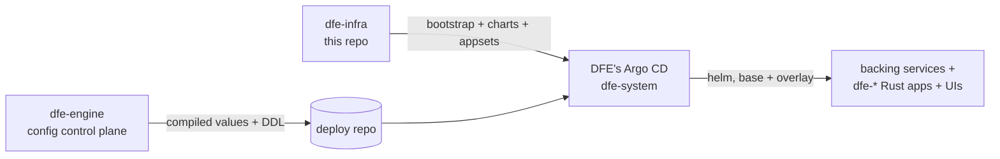

# dfe-infra architecture

dfe-infra is how DFE gets onto a bare Kubernetes cluster: the Helm charts, Argo CD ApplicationSets and bootstrap. Every deployment starts from its pinned base. It never writes config. The engine writes overlays and DDL into the deploy repo, and this repo's appsets reconcile them. Never the reverse.

## Where this repo sits in the suite

The suite rule is **dfe-infra deploys, dfe-engine configures.** The engine never installs backing services or authors Argo Applications. This repo never reads or writes engine config. The whole-suite map lives in the dfe-engine repo (`docs/architecture.md` there). This page covers the infra side only.

One exception to "this repo owns its charts": dfe-engine controls dfe-hyperdx, the search fork embedded in the DFE console (dfe-engine is the SSoT and integrates most closely). Anything dfe-hyperdx needs, whether the fork, the image or this repo's hyperdx chart, goes through a GitHub issue on dfe-engine first. If it's time-critical, security-urgent, or a small change that clearly can't affect dfe-engine, make it here directly and raise a dfe-engine issue saying so, for politeness.

This repo owns:

| Area | Where | What it does |
|---|---|---|
| Bootstrap | `bootstrap/` | bare-cluster Layer 0: detect-or-install for StorageClass, cert-manager, ESO, DFE's own Argo CD |
| ApplicationSets | `argocd/appsets/` | layer1 addons, layer2 data + apps (git-files fan-out over the deploy repo's `values/*-values.yaml`), scale-tier operators |
| Tier values | `argocd/values/` | `profile-{slim,single,scale}.yaml` + `common.yaml` + per-cloud overlays |
| Charts | `helm/charts/` | backing services (clickhouse-cluster, kafka, documentdb, forgejo, kafbat, otel-collector), platform charts and dfe-extras. Each dfe-* service deploys from its published thin chart |
| Chart library | `helm/library/dfe-common` | shared templates for the charts in this repo (image, names, labels, security context, the Kafka provider table, the mesh pool listener, the wait-for-engine init container) |
| Version pins | `versions.yaml` | single source for chart/operator/image versions |
| Cloud prep | `terraform/` (OpenTofu-first, terraform-compatible) | secrets/IAM prep per cloud target |

## Swappable components (the modularity contract)

Why it works this way is in [design principles](design-principles.md#your-cluster-your-choice-of-parts). This table is where each part gets switched in this repo.

| Component | Switch | Dial | Swap targets |
|---|---|---|---|
| Cluster | vanilla-cluster contract | (bootstrap preflight) | RKE2 (built when there is no cluster), EKS, AKS, GKE Standard |
| DNS | external-dns / estate-managed | provider config, or the deployment's own DNS | CoreDNS record (on-prem), Route53, ... |
| Private CA / TLS | cert-manager ClusterIssuer | `tls.acme.*` or `tls.vault.*` (exactly one) | ACME/Let's Encrypt, Vault/OpenBao PKI, cloud CA issuer later |
| Secrets manager | ESO ClusterSecretStore | bootstrap store template + env | OpenBao/Vault, AWS SM (+IRSA), ... |
| Kafka | chart mode + endpoint | `kafka` chart mode, `kafka.bootstrapServers` | in-k8s single/Strimzi cluster, MSK, Redpanda (licence gate) |
| ClickHouse | chart mode + endpoint | `clickhouse.mode` single/cluster/external, `clickhouse.host` | in-k8s, ClickHouse Cloud SaaS, private cloud |
| Document store | mongo-protocol endpoint | documentdb chart (a DocumentDB CR on the DocumentDB operator's CloudNativePG -- the stack's only postgres), `mongodb.uri` in the hyperdx values | bundled DocumentDB, external mongo-protocol service |
| Edge / LB | Gateway API + EnvoyProxy CR | `envoyGateway.service.*` (type, class, annotations, externalIPs) | MetalLB, cloud NLB, NodePort behind HW LB, externalIPs with no LB controller |
| Deploy repo | provider mode | `DFE_BUNDLED_DEPLOY_REPO` + creds | bundled Forgejo, GitHub/GitLab |

Two files hold the shared facts (the hyperi-ci versions.yaml pattern). `versions.yaml` holds every pin. `argocd/values/common.yaml` holds every shared deploy-config fact, including the canonical `hostnames:` map (role-named service subdomains: `dfe`, `hyperdx`, `auth` for the issuer, `argocd`, `git`, `kafbat`, `links`, `otel`) that the gateway routes, links page and dfe-ui embed URLs all resolve from. A shared fact defined anywhere else is config sprawl, and we merge it into one of those two.

## Schema and topics: dfe-engine is the only controller

Nothing in this repo creates, alters or drops a ClickHouse database, table, view or role, or a Kafka topic. `dfe-schemas` declares every one of them and dfe-engine applies them at its own startup, from the wheel pinned inside its image, on both tiers and every broker provider. A CI guard (`scripts/tests/test_engine_only_schema_control.py`) fails the build if DDL or a topic-creation step turns up under `helm/`, `argocd/`, `bootstrap/`, `scripts/` or `terraform/`.

> **Coming from Splunk or Elastic?** You don't set up indexes or mappings on these clusters. dfe-engine applies the schema from the versioned `dfe-schemas` definition when it starts, and the CI guard fails the build if this repo tries to. You change a schema by changing its definition, never by editing a table in place. More in [what's different](../docs-site/content-root/coming-from.md).

What that leaves this repo:

- The clusters themselves. ClickHouse and Kafka are deployed, sized, backed up and upgraded here. Only the schema inside them moved.
- The managed-broker ACLs. `terraform/modules/managed-kafka/` writes the DFE principal's grants on confluent-cloud and redpanda-cloud, topic Create among them, and creates no topic. dfe-engine creates those topics at startup like every other provider's.
- The MSK first ACL. `msk-bootstrap-job.yaml` writes the SCRAM principal's ACLs over SASL/IAM. On a cluster that has stopped granting by default, nothing can write the FIRST ACL unless it's already permitted. The job creates no topic. Its grants match `kafka-user.yaml`'s, grant for grant: Read, Write, Create, Describe, Alter and Delete on topic `*`. Create makes the bootstrap topic set, Alter raises a partition count, and Delete lets deleting a source take that source's `_land`/`_load` pair with it. Every cluster operation is withheld.
- The ordering. dfe-engine syncs at Argo wave 5, the otel collector at 6 and every other app at 7. Each app pod runs a `wait-for-engine` init container (`dfe-common.waitForEngine`) that polls the engine Service's `/readyz`. Ready means the last schema pass converged, so an app can't start against an absent table. That failure reads as data loss and is really start ordering. The hunt runner ships in the engine's own chart and syncs in its wave, so the same init container holds it until its coordination tables exist.

`bootstrap/smoke-test-integration.sh` asserts the engine's own `schema` readiness check (CORE 0) before it looks at any pipeline. The per-object record is `GET /api/v1/system/schema` on the engine.

## Dead-letter queues

Every k8s-deployed app dead-letters to a Kafka topic dfe-engine creates: `dfe_receiver_dlq`, `dfe_loader_dlq`, `dfe_archiver_dlq`, `dfe_fetcher_dlq`, and one shared `dfe_transform_dlq` for the transforms (a transform overrides only when it really needs its own). Kafka is the DEFAULT DLQ target because the file fallback can't work under the charts' read-only rootfs and silently drops. In dfe-docker, DLQs are opt-IN per component, EXCEPT the single-node full deploy, which carries the same DLQ topics as k8s.

The five names and their retention are declared in dfe-schemas and created by dfe-engine at its own startup, on every tier and every provider. A DLQ write happens AT failure time, the one moment nothing can be creating topics, so the engine's wave-5 sync is what guarantees they're there before an app can poison one. DLQ topics keep 7 days, against the 72h data-topic default. A poisoned message is exactly the record an operator must still find days later, and once its source offset commits it exists nowhere else. Chart env points the four fleet apps at their topic (the same `DLQ_TOPIC` / `DLQ_MODE` on every app, each in the app's own env regime). Chart env doesn't point the transforms at `dfe_transform_dlq`. dfe-transform-vrl#30 and dfe-transform-vector#46 track that wiring.

## How engine dials land here

> **Coming from Splunk or Elastic?** The engine writes every config change, from the console or the API, to the deploy repo, and Argo CD reconciles it, so what's running is what's in git. More in [what's different](../docs-site/content-root/coming-from.md#gitops-by-design-from-the-ground-up).

One mechanism does it. layer2-apps generates one Argo Application per `values/<service>-<instance>-values.yaml` in the deploy repo, from four sources:

- the component's thin chart over OCI, pinned by digest (`chart-digests` in `versions.yaml`)
- `helm/charts/dfe-extras`, its DFE-only objects
- this repo as ref `infra`, for the value files
- the deploy repo as ref `values`, whose overlay file is layered last

Add a values file and you add the app. Remove it and the app goes. The engine turns dials and this repo defines what dials exist, so every dial must be a chart value.

The overlay entry is `$values/{{ .path.path }}/{{ .path.filename }}` (`argocd/appsets/layer2-apps.yaml`), the directory and name of the file the generator matched, so each Application layers its own file and no other.

Each Application is named `<service>-<instance>-<cluster>`, and that name is its Helm release name and the `app.kubernetes.io/instance` label on its objects. Helm refuses a release name past 53 characters, so a longer Application name installs under its first 44 characters, a `-` and the first 8 hex characters of its sha256.

## Documents in this area

| Doc | Covers |
|---|---|
| [deployment/README.md](deployment/README.md) | layers, tiers, values cascade, bootstrap contract |
| [deployment/rke2.md](deployment/rke2.md) | RKE2, the hardened default distribution |
| [deployment/on-prem.md](deployment/on-prem.md) | build, deploy, test and tear down on an on-prem cluster (the `local` target) |
| [deployment/kafka/](deployment/kafka/README.md) | managed-Kafka guides + Redpanda licence gate |
| [deployment/clickhouse.md](deployment/clickhouse.md) | CH target matrix + operator history (official operator / ClickHouse Cloud, private-cloud swap, Altinity untested) |
| [deployment/deployment-logs/](deployment/deployment-logs/template.md) | per-deploy log template |
| [testing-cycle.md](testing-cycle.md) | THE validation loop (preflight -> deploy+E2E -> smoke -> destroy), the env-file contract, the vanilla-cluster contract |
| [cloud-cycle.md](cloud-cycle.md), [release-rounds.md](release-rounds.md), [failure-evidence.md](failure-evidence.md) | the cycle on a cloud account, how a release candidate is proven, and what the readiness gate refuses and a failed stage leaves |
| [source-suite.md](source-suite.md) | the post-deploy source tests the cycle's `acceptance --suite source` runs: the two cases, what proves each, the reload-and-restart rule |
| [autoscaling.md](autoscaling.md) | KEDA pod scaling vs the per-target node-autoscaler fork decision |
| [edge-auth.md](edge-auth.md) | web-plane exposure + auth: every UI with a login external by default, route class (product/infra/ingest), the infra kill switch, edge OIDC + group RBAC, per-surface policy |
| [ingest-edge.md](ingest-edge.md) | the dfe-receiver data door: public LoadBalancers vs the Gateway route, source ranges, why an empty allow-list is the whole internet |
| [design-principles.md](design-principles.md) | the rules every DFE app follows: any source on day one, swappable parts, who owns the schema, where parsing happens |
