# Argo CD

Argo CD applies dfe-infra's charts and the deploy repo to your cluster, and it is how every other part of the [DFE suite](architecture.md) gets there.

| | |
|---|---|
| Repo | [dfe-infra](https://github.com/hyperi-io/dfe-infra): `argocd/appsets/`, `argocd/values/`, `bootstrap/` |
| Chart | upstream `argo/argo-cd`, release `argocd` in namespace `argocd`, pinned at `bootstrap.argocd` in each stack of `versions.yaml` |
| Config reference | [ApplicationSets](deployment/appsets.md), [the values cascade](deployment/README.md#tiers-and-the-values-cascade) |
| Endpoints | `argocd.<domain>`, an infra route behind edge OIDC ([edge exposure](edge-auth.md#exposure-topology)) |
| Health | each Application's sync and health status, `kubectl -n argocd get applications` |

Bootstrap starts Argo CD once. From then on every change reaches the cluster through git.

```mermaid
---
config:
  theme: base
  look: neo
  fontFamily: Inter, -apple-system, Segoe UI, Roboto, Helvetica, Arial, sans-serif
  flowchart:
    curve: linear
    nodeSpacing: 40
    rankSpacing: 64
    padding: 18
    wrappingWidth: 280
    htmlLabels: true
  elk:
    preset: modelOrder
  themeVariables:
    fontSize: 15px
    lineColor: "#64748B"
    primaryTextColor: "#0F172A"
    nodeBorder: "#334155"
    clusterBorder: "#0072B2"
    edgeLabelBackground: "#FFFFFF"
  themeCSS: >-
    p{margin:0}
    .node[data-look] rect,.node[data-look] path,.node[data-look] polygon,.node[data-look] .outer-path{filter:drop-shadow(0 1px 2px rgba(15,23,42,.10)) drop-shadow(0 6px 14px rgba(15,23,42,.10))}
    .node rect{rx:10px;ry:10px}
    .cluster rect{rx:16px;ry:16px}
    .node .label div{min-width:150px}
    .node.decision .label div{min-width:0}
    .cluster[data-look] rect{filter:none}
    .nodeLabel{line-height:1.35}
    .nodeLabel b{font-weight:600;font-size:15px;letter-spacing:-0.01em}
    .nodeLabel span{font-size:12.5px;font-weight:400;color:#334155}
    .cluster-label span.nodeLabel{display:inline-block;background:#FFFFFF;color:#0B2A3F;border:1.5px solid #0072B2;border-radius:999px;padding:2px 12px;font-size:11.5px;font-weight:700;letter-spacing:.09em;text-transform:uppercase}
    .flowchart-link{stroke-width:1.75px}
    .labelBkg{background:transparent!important}
    span.edgeLabel{display:inline-block;background:#FFFFFF!important;color:#1E293B;border:1px solid #94A3B8;border-radius:999px;padding:2px 10px;font-size:12px;font-weight:500}
    span.edgeLabel p{background:transparent!important}
    .label-icon{width:20px;height:20px;vertical-align:-4px;margin-right:6px}
    .icon-shape path[stroke-width="0"][fill="none"]{fill:#FFFFFF;stroke:#FFFFFF;stroke-width:12px;stroke-linejoin:round}
    .icon-shape p{background:transparent!important;color:#0F172A}
    .ingest .label-icon{color:#0E8A7D}
    .xform .label-icon{color:#7B4FB0}
    .load .label-icon{color:#0072B2}
    .bus .label-icon{color:#A8517F}
    .store .label-icon{color:#00785A}
    .ui .label-icon{color:#D9480F}
    .ext .label-icon{color:#64748B}
---
flowchart LR
  accTitle: L3 Components -- Argo CD
  accDescr: bootstrap.sh installs or adopts DFE's Argo CD. Argo CD reads charts, ApplicationSets and tier values from dfe-infra, dfe-engine's overlays from the deploy repo and each app's thin chart by digest. Layer 1 and the platform sync first, then Layer 2's backing services and apps, and Helm applies them to your cluster.
  subgraph SRC["Reads"]
    direction LR
    I("<b>dfe-infra</b><br/><span>charts, appsets, tiers</span>")
    D[("<b>Deploy repo</b><br/><span>dfe-engine's overlays</span>")]
    O[("<b>Thin charts</b><br/><span>OCI, by digest</span>")]
    B("<b>bootstrap.sh</b><br/><span>installs or adopts Argo CD</span>")
    I ~~~ D
    B ~~~ O
  end
  subgraph ARGO["Argo CD"]
    direction TB
    A1("<b>Layer 1 and platform</b><br/><span>waves 1-3</span>")
    A4("<b>Layer 2</b><br/><span>data at 4 and 6, apps at 5 and 7</span>")
    A1 --> A4
  end
  subgraph K8S["Your cluster"]
    direction TB
    S[("<b>Backing services</b><br/><span>ClickHouse, Kafka, DocumentDB</span>")]
    P("<b>DFE apps</b><br/><span>one Application each</span>")
    S ~~~ P
  end
  SRC --> ARGO -->|helm| K8S
  class B,I control
  class D control
  class O ext
  class A1,A4 part
  class S store
  class P part
  classDef ext fill:#F4F6F8,stroke:#94A3B8,stroke-width:1.5px,stroke-dasharray:5 4,color:#0F172A
  classDef ingest fill:#FFFFFF,stroke:#0E8A7D,stroke-width:3px,color:#0F172A
  classDef xform fill:#FFFFFF,stroke:#7B4FB0,stroke-width:3px,color:#0F172A
  classDef load fill:#FFFFFF,stroke:#0072B2,stroke-width:3px,color:#0F172A
  classDef bus fill:#FFFFFF,stroke:#A8517F,stroke-width:3px,color:#0F172A
  classDef store fill:#FFFFFF,stroke:#00785A,stroke-width:3px,color:#0F172A
  classDef ui fill:#FFFFFF,stroke:#D9480F,stroke-width:3px,color:#0F172A
  classDef decision fill:#FFFFFF,stroke:#9A6700,stroke-width:3px,color:#0F172A
  classDef error fill:#FFFFFF,stroke:#C2410C,stroke-width:3px,color:#0F172A
  classDef control fill:#FFFFFF,stroke:#334155,stroke-width:3px,color:#0F172A
  classDef part fill:#FFFFFF,stroke:#94A3B8,stroke-width:1.5px,color:#0F172A
  style SRC fill:none,stroke:#0072B2,stroke-width:1.5px,stroke-dasharray:6 4
  style ARGO fill:none,stroke:#0072B2,stroke-width:1.5px,stroke-dasharray:6 4
  style K8S fill:none,stroke:#0072B2,stroke-width:1.5px,stroke-dasharray:6 4
```

*Figure 1. L3 Components -- Argo CD.* Up: [L2 Services -- DFE suite](architecture.md). Down: [L4 Detail -- Deployment layers](deployment/README.md#the-three-layers), [L4 Detail -- The deploy repo](deployment/state-and-repos.md#the-repositories).

## How it works

1. `bootstrap/bootstrap.sh` checks for a StorageClass, cert-manager, External Secrets and Argo CD. It adopts a healthy one it finds and installs the rest. An Argo CD it installed is upgraded on every re-run, and an adopted one is never reconfigured.
2. Argo CD reads three sources: this repo's charts and ApplicationSets, the deploy repo dfe-engine writes, and each DFE app's thin chart over OCI, pinned by digest.
3. Layer 1 and the platform sync first. KEDA, external-dns and the cloud controllers come up at waves 1-3, beside the network policies, the gateway, and Strimzi and the ClickHouse operator on `scale`.
4. Layer 2 data brings ClickHouse, Kafka and the DocumentDB store up at wave 4. dfe-engine syncs at wave 5 and creates every table and topic. The OTel collector waits for its tables at wave 6, and every other app syncs at wave 7.

## Interfaces

Layer 2 apps make one Application per `values/<service>-<instance>-values.yaml` in the deploy repo. Add a file and the app appears. Remove it and the app goes. dfe-engine turns the dials and this repo decides which dials exist, so every dial has to be a chart value.

Each app's Application layers four sources, last one winning:

- the app's thin chart over OCI, pinned by `chart-digests` in `versions.yaml`
- `helm/charts/dfe-extras`, its DFE objects
- this repo as ref `infra`, for the value files
- the deploy repo as ref `values`, the app's overlay file

An Application is named `<service>-<instance>-<cluster>`, and that is its Helm release and its `app.kubernetes.io/instance` label. Helm rejects a release name over 53 characters, so a longer one installs as its first 44 characters, a `-`, and 8 hex characters of its sha256.

The cluster secret is the other input. Its `dfe.hyperi.io/profile` label picks the tier, and its annotations name the deploy repo, the registry and the environment. Argo CD doesn't reconcile that secret, so a change to what writes it reaches the cluster only when bootstrap runs again.

## Scaling and failure

- On a bundled deploy the git host is itself an Application. Everything that reads the deploy repo shows `ComparisonError` until it's up, then converges.
- Each app pod runs a `wait-for-engine` init container that polls dfe-engine's `/readyz`. A pod held there is waiting for the schema, not broken.
- A chart that isn't published, or has no digest entry, fails its render, and the Application keeps its current spec.
- KEDA owns replica counts, so Argo ignores them and never fights the autoscaler.
- `Synced` isn't health. An Application can be Synced and Degraded with every pod failing its image pull. Read the pods.

## Key metrics

Each Application's sync and health status in Argo CD is the signal. `bootstrap/smoke-test-integration.sh` checks dfe-engine's schema readiness before it looks at any pipeline, and dfe-engine's `GET /api/v1/system/schema` lists each object it applied.

## Related

- [ApplicationSets](deployment/appsets.md), the reasoning behind each one
- [Deploying DFE with dfe-infra](deployment/README.md), the tiers and the values cascade
- [State, storage and repositories](deployment/state-and-repos.md), what the deploy repo holds
- [DFE on Kubernetes on-premises](deployment/on-prem.md#what-you-see), what each wave looks like on a live cluster
