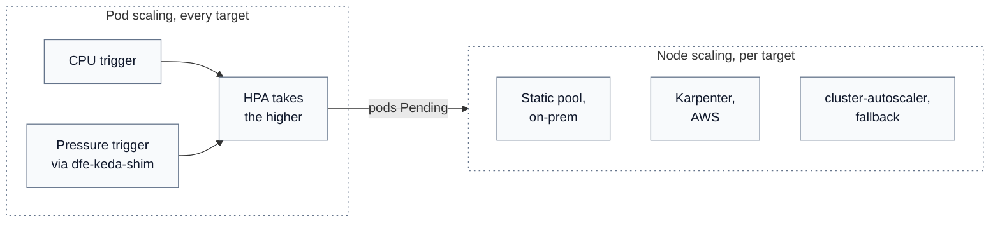

# Autoscaling: the two layers and the per-target fork

Two independent layers scale a DFE deployment. KEDA scales the pods the same way on every target, and the node autoscaler that turns Pending pods into nodes differs by target.

*Figure 1. L4 Detail -- Autoscaling layers.* Up: [dfe-infra documentation](README.md).

The AKS and GKE node renderers are planned in dfe-infra#806, so the figure leaves them out. Node scaling forks by target, and that fork is a DECLARED decision, recorded here, never an assumption baked into a chart.

## Pod scaling

Each app's thin chart (scalo-rs `charts/scalo-service`) ships its ScaledObject, and dfe-extras ships the hunt runner's. On-prem and cloud run the same ScaledObjects.

Two triggers render and the HPA takes the higher. The app charts ship `keda.cpu` (the native scaler, nothing of ours in the path) and a `metrics-api` entry in `keda.extraTriggers` (`argocd/values/apps/_fragments/pressure-trigger.yaml`). That entry is the scalo ScalingPressure composite, read through the fail-safe dfe-keda-shim. A tier or an instance drops it with `keda.extraTriggers: []`.

- The shim matches the bare `scaling_pressure` gauge and any `<prefix>_scaling_pressure` for that ServiceName (dfe-engine `scaling_pressure.py`), so an app's metrics namespace needs no app release.
- The shim address comes from the release namespace, so a deployment in any namespace reaches it without a values override. `keda.pressure.shimAddress` is for a shim outside the release namespace.
- The three transforms have the pressure trigger in their single, scale and mesh profiles. Their slim profiles have none, so cpu is the one trigger there.
- The hunt runner scales on its due-hunt backlog through the same shim. That trigger is beta and off by default: `huntRunner.autoscaling.enabled` in the dfe-engine values turns it on.

`bootstrap/keda-scale-test.sh` tests the path on each deploy. It injects pressure for a throwaway Deployment, then for every app whose ScaledObject has the shim trigger at once, and each goes from its floor to one above and back. Its scale-out bound is the HPA sync period twice over plus a pod-start allowance, because above a floor of zero the HPA reads the metric itself and KEDA's pollingInterval plays no part. At scale-out it logs each HPA reading and fails when the pressure reading is under target, so a cpu-driven scale can't pass for a pressure one. It fails an app that wrote no `scaling_pressure` rows, because the shim reads no rows as 0 and that app scales on cpu alone. UNPROVEN (exit 3: the HPA read the pressure over target and left the replicas alone, or an app was off its floor before the run) fails the smoke run like a FAIL does.

## Which trigger each tier gets

> **Coming from Splunk or Elastic?** DFE scales pods on a composite pressure signal beside the CPU trigger. The composite gates to 0 when the downstream sink's circuit is open and forces 100 over the memory threshold, which CPU alone can't see.

CPU at 70% is the baseline everywhere and never comes out. It's native KEDA with nothing of ours in the path, so a component outage can't take scaling with it. Each tier decides whether the composite renders beside it.

| Tier | Pressure | Ceiling | Why |
| ---- | -------- | ------- | --- |
| slim | off | 2 | No broker and a 2-replica ceiling. CPU is the whole signal worth having, and the shim isn't worth putting in the path for it. |
| single | on | 3 | Has a broker, so `kafka_lag` measures the backlog an I/O-bound loader's CPU hides. The ceiling is the partition count the kafka chart derives for one broker (3), because a 4th consumer joins the group and gets nothing. |
| mesh | on | 10 | No broker, but every stage holds what the next hasn't taken, so `buffer_depth` and `memory` stand in for `kafka_lag`. Replicas share load through the Service, so no partition count bounds the ceiling. |
| scale | on | 12 | Has a broker. The ceiling is a DIVISOR of the derived partition count (12) so every reachable replica count holds the same number of partitions. At 10, two consumers hold 2 and eight hold 1, and the busy pair sets the group's lag. |

Why the composite pressure and not KEDA's native `kafka` scaler? The native scaler reads consumer-group lag from the broker and needs no shim. It's blind to the two things that decide whether another pod helps. The composite gates to 0 when the downstream sink's circuit is open (more loaders can't relieve a dead ClickHouse) and forces 100 over the memory threshold (scale before the OOM). Lag alone would scale the loader out against a sink that is refusing writes, and the composite has the lag term in it. A deployment that wants the native scaler can have it: `keda.triggers` takes a verbatim scaler list the chart passes straight through.

The thresholds are inherited. 70 on both the CPU trigger and the 0-100 composite came across from the fleet default with no load run behind it. Sizing them needs a run with more source topics or more partitions on `default_land` than a single-source rig has, because replicas 4-12 would otherwise idle.

## The fork decision for DFE deployments

> **Coming from Splunk or Elastic?** Node scaling isn't one mechanism here. KEDA scales the pods on every target, and the node autoscaler is chosen per target, with a static node pool on-prem because Karpenter needs a cloud provisioning API.

| Target | Node autoscaler | Notes |
| ------ | --------------- | ----- |
| On-prem Rancher/RKE2 (the baseline) | **None: static node pool.** cluster-autoscaler IF the node layer gains a provisioning API (Rancher node pools on a cloud provider, Harvester, etc.) | Karpenter is NOT an option here, because it needs a cloud provisioning API. A fixed node pool is the sovereign and air-gap default: capacity planning replaces node autoscaling, and KEDA still does the pod side. |
| AWS EKS | **Karpenter**, the node-pools chart's `karpenter-aws` renderer | The one renderer built. |
| Azure AKS | **Node Auto Provisioning** (managed Karpenter) | A planned renderer, dfe-infra#806. |
| GCP GKE | **ComputeClass plus OpenTofu node pools** | A planned renderer, dfe-infra#806. GCP has no supported Karpenter. |
| Multi-cloud / mixed | **cluster-autoscaler** | The portable fallback. Runs everywhere. |

One rule covers every component whose best implementation differs by target (node autoscaler, gateway controller, secret store, load balancer, storage class): state the choice per target, keep the chart neutral with the choice in values or the target overlay, and name the portable fallback (here cluster-autoscaler) so no target is stranded.

Node scaling is a pools interface. The resolver writes one pool class per workload, in fields every node autoscaler shares, and `helm/charts/node-pools` hands the classes to the renderer `pools.renderer` names. Karpenter on AWS (`karpenter-aws`) is the one renderer today. The AKS and GKE renderers are planned in dfe-infra#806.

`argocd/appsets/layer2-platform.yaml` deploys the pools chart only to a cluster whose secret declares a cloud with a renderer (AWS today), so the on-prem baseline gets no pool object at all. Every other chart places a pod by the pool's `dfe.hyperi.io/workload` label and the cloud-neutral node labels, never by Karpenter's or a cloud's own (`scripts/tests/test_charts_select_only_the_pool_label.py`).
