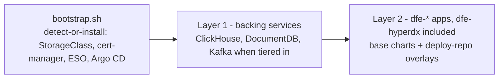

# Deploying DFE with dfe-infra

You hand it a bare cluster and get a running DFE back. Bootstrap lays the Layer 0 baseline, then DFE's own Argo CD reconciles the backing services (Layer 1) and the apps with their engine-authored overlays (Layer 2).

Tier and every default live in values files. You override single dials, never templates.

## The three layers



- Bootstrap (`bootstrap/bootstrap.sh`) probes each dependency. A healthy controller already on the cluster is adopted, otherwise we install our own copy. The Argo CD we installed (release `argocd` in namespace `argocd`) is upgraded in place on every re-run, so a chart pin or an install flag reaches a live cluster. An adopted Argo is never reconfigured.
- Layer 1 (`argocd/appsets/layer2-data.yaml` and `layer1-addons.yaml`) is the backing services, from base charts plus the deploy repo's `infra/` overlay.
- Layer 2 (`argocd/appsets/layer2-apps.yaml`) is one Application per deploy-repo `values/*-values.yaml`. Each is the component's thin chart over OCI, pinned by digest, beside `helm/charts/dfe-extras`, with the `$values` overlay layered last.

## Tiers and the values cascade

The cluster secret's `dfe.hyperi.io/profile` label picks the tier. Values merge in this order, and later wins:

```text
<chart>/values.yaml                  chart defaults (helm/charts/, or the app's thin chart)
argocd/values/common.yaml            fleet-wide overrides
argocd/values/<cloud|site>.yaml      per-target overrides
argocd/values/profile-<tier>.yaml    tier composition (slim / single / scale, plus mesh, which cannot be selected)
deploy repo sizing/<tier>.data-charts.values.yaml   resolver sizing, layer2-data only
deploy repo infra/common.yaml        deployment-wide (every appset)
deploy repo infra/<chart>.yaml       one data-layer or platform chart
deploy repo values/<app>-...yaml     engine-authored overlay (Layer 2 apps)
```

Everything from `infra/` down is yours, and it merges last. So `clickhouse.mode`, `kafka.mode` and the storage models are reachable without editing this repo. The profile file is a tier default, not a lock.

That makes the data layer depend on the deploy repo resolving. On a bundled deploy (no external git) the git host is `layer2-deploy-repo`'s own single-source Application. The data-layer and platform Applications report ComparisonError until it's up, then converge.

What each tier is proven to do:

| Tier | Transport | Status |
|---|---|---|
| `single`, `scale` | Kafka between every stage | Supported and proven. They need Kafka: a broker in the cluster, or a managed one ([managed-backends.md](managed-backends.md)). |
| `slim` | gRPC, stage to stage, one replica each | Supported and proven without archiving. A source with archive on routes a copy to the archiver as a second gRPC destination, and that fan-out is not yet proven. |
| `mesh` | gRPC through a balancer per stage pool, no Kafka | Present in the charts, never run against a live cluster, and not supported in this release: `dfe-ops`, `bootstrap.sh` and the terraform `profile` variable refuse it with `use scale`. |

gRPC itself is proven app to app: receiver to loader, and receiver to transform to loader, on the docker stack's `*-grpc` profiles and on `slim`.

Kafka on tier `single` runs the non-operator single-broker KRaft path (`helm/charts/kafka`, `kafka.mode: single`). The Strimzi operator installs only on `scale` clusters (`layer-scale.yaml`).

### Secrets store

| Tier | Reads the secrets store | What to set |
|---|---|---|
| slim, single | nothing | nothing: `DFE_SECRETS_BACKEND` resolves to `none`, no ClusterSecretStore |
| scale | the Strimzi broker's client credential | `DFE_SECRETS_BACKEND=openbao` with `DFE_VAULT_ADDR`, `DFE_VAULT_ROLE_ID`, `DFE_VAULT_SECRET_ID`, or `aws-sm` with `DFE_SECRETS_REGION` |

`dfe-ops stack-deploy` checks each store-referencing template's render condition and refuses `none` where one fires. `DFE_CA_PERSIST=true`, gateway OIDC (on in `aws.yaml`), an external or managed broker, an external ClickHouse and object storage each add a consumer on any tier. So can a deploy-repo overlay, and `stack-deploy` can't see that one before the deploy. On AWS the backend is `aws-sm` and `openbao` is refused. Elsewhere an unnamed backend is `openbao`, as is any OpenBao value ([managed-backends.md](managed-backends.md)).

Every DFE image and thin chart pulls anonymously from `DFE_REGISTRY`, so no pod names a pull secret.

Which apps a tier deploys comes from `apps.yaml`, not the profile file. [composition.md](composition.md) has the table and how it's derived.

### The mesh tier

Not supported in this release. The pieces below render and pass their chart tests, but no mesh deploy has run against a live cluster.

`mesh` is `scale` without a broker. The stages hand records to each other over gRPC. `mesh.enabled` puts a Gateway API listener in front of every stage pool. A Kubernetes Service balances per connection and gRPC holds one open, so without the listener a sender pins itself to one pod however many replicas KEDA adds. Each pool's route carries its own policy (`mesh.routePolicy`): a request timeout at or above the sender's 30 s deadline, retries only on connect failure and resource exhausted, and ejection of a pod that keeps answering unavailable.

With `acknowledgements.enabled` (the default) the receiver answers a sender only once the loader confirms delivery, and builds no buffer or spool. A loader outage reaches senders as a 503 once the hold expires, and they retry from their own copy. With acknowledgements off, the raised receiver buffer is the only slack in the chain. An outage shorter than it is invisible to senders. A held record has already had its 2xx, so it dies with the pod.

## Storage model - decided at deploy, not after

> **Coming from Splunk or Elastic?** Retention capacity and hot-disk capacity are separate choices here. `tiered-block` moves older parts to a second volume, and `cached-object` keeps them in object storage behind a local cache. The model is fixed at deploy because a PVC can't grow in place without a StatefulSet recreate.

Both data stores take a `storageModel`, and it fixes the on-disk layout for the life of the deployment. It defaults to `local`, which changes nothing. Models are named `<family>-<bulk>`. The family says whether data moves to the bulk store or is copied to it, and the bulk half says what that store is.

| chart | `local` | the alternatives |
|---|---|---|
| `clickhouse-cluster` | parts on the PVC | `cached-object`: parts on an object-store disk behind a local read-through cache. `tiered-block`: a hot SSD volume and a cold bulk volume, parts demoted as the hot one fills |
| `kafka` | every segment on the PVC | `tiered-object`: closed segments to object storage (KIP-405 tiered storage), with the PVC sizing the hot window |

The alternative is growing a PVC later. That needs `allowVolumeExpansion: true` on the StorageClass and a StatefulSet recreate, because `volumeClaimTemplates` are immutable. `local-path` can't resize at all. Choose the storage model before deploying.

Every model with an object bulk store reads its credentials from the environment. ESO materialises them from `<project>/<env>/clickhouse/s3` and `<project>/<env>/kafka/tiered`, never inline in a values file.

The engine holds the models and the modes as protected vars, so the API refuses a post-deploy edit. See the deploy repo's `infra/README.md`.

[storage.md](storage.md) has every combination with its status and evidence. That's the deploy-time matrix, including the cells that are refused and the ones not built yet.

## Upgrading onto the generated JWT signing key

Older releases minted `dfe-engine-jwt` from the chart template. On the first upgrade past that, the ExternalSecret adopts the existing Secret (`creationPolicy: Owner`) and writes a new key into it. Every token issued before the upgrade stops verifying and the engine rolls once. Operators and any machine caller log in again, and nothing else is affected.

`refreshPolicy: CreatedOnce` then holds that key for the life of the deployment. In testing, the Secret's `resourceVersion` moved on that first reconcile and held across the two renders after it.

Can't take even one invalidation? Set `auth.jwtSecret` to the key you already have. That renders a plain Secret and no generator.

## Upgrading onto the `main` landing table

> **Coming from Splunk or Elastic?** There's no data contract with the supplier to negotiate, because DFE takes whatever a source sends. Unmapped fields land in `_json`, so adding a field doesn't need a matching schema change before ingest can continue. New records go to `main`, and existing rows stay in `default` and must be queried there.

The landing table and the catch-all source are both named `main`. A deployment cut before that rename has a `default` table holding its rows, and nothing moves or drops it. The engine's DDL writer creates `main` alongside it, the receiver stamps an unmatched record `_source: main`, and the loader writes new records to `main`. Query the old table directly for anything older than the upgrade, and drop it once nothing needs it.

The Kafka landing topic moves with the source name, from `default_land` to `main_land`. dfe-engine creates the new one at startup. The old topic keeps whatever it holds until you delete it.

## Version pins

`versions.yaml` is the one place chart, operator and image versions are set. `scripts/check_versions_drift.py` checks it. Images are pinned as `name:tag@sha256`. The tag lives in `apps:` and the immutable digest in `digests:`. `scripts/dfe-stack` renders the combined form and `dfe-stack verify` re-checks the digests against GHCR.

A dfe-infra release tag certifies the whole set as one stack version (`stack:` metadata plus lockstep `content:` repo tags). The full release model is in [stack-versioning.md](stack-versioning.md).

`content.dfe-docker` records the dfe-docker release tag that runs the stack. To reproduce an old stack's docker path, check dfe-docker out at that stack's recorded tag.

The engine also serves authored files an app ships: the reference transform pipelines and each app's config contract. The engine chart's `content.entries` turns each into one init container that fills `/etc/dfe-engine/content` from the pinned app image. The engine reads that directory through `DFE_ENGINE_LIBRARY_SEED_DIR` and `DFE_ENGINE_APP_CONTRACT_DIR`. The files never travel through a value or a ConfigMap, because either form re-serialises them into etcd on every Argo sync. The source catalogue the console offers isn't one of them. It's dfe-schemas package data, installed with the engine.

## Version check

Every DFE service boots with a release check you can turn off. It's one POST of `{product, current_version, os, arch, instance_id}` to the HyperI releases endpoint, and it logs whether a newer version exists. The id is a one-way UUIDv5 derived from the platform. Deployment names are never sent. Any failure costs one WARN line and nothing else.

The `versionCheck` values key overrides it. The `dfe-common.versionCheckEnv` helper renders it into every app. Set it in your deploy repo's `infra/common.yaml`, or per app in its overlay. `argocd/values/common.yaml` is the pinned default, not a file to edit:

```yaml
versionCheck:
  enabled: false        # total opt-out -- no check, nothing sent (air-gap)
  sendInstanceId: false # keep the check, strip the install id
  apiUrl: ""            # point the check at a mirror
```

## Optional: your own private mirror

If your mirror needs a login, point `DFE_REGISTRY` at it and set `DFE_PULL_SECRET_TOKEN`, with `DFE_PULL_SECRET_USER` (default `token`) and `DFE_PULL_SECRET_SERVER` (default `DFE_REGISTRY`'s host). Bootstrap creates `ghcr-pull-secret` in every DFE namespace, records it on the cluster secret (`dfe.hyperi.io/image_pull_secret`) for the appsets to hand their charts, and registers the token as Argo CD's read credential for each thin chart.

## Related

- [architecture.md](../architecture.md) - where this repo sits in the suite
- [wizard.md](wizard.md) - `dfe-ops init`, the prompt-driven wizard that writes a deployment.yaml dial
- `python3 scripts/dfe-ops --help` - every `dfe-ops` subcommand in one list, and `dfe-ops <subcommand> --help` for its flags
- [composition.md](composition.md) - which apps a profile deploys by default, how apps.yaml's `default_in` reaches Argo and Compose, and what an app with nothing to do does instead of crash-looping
- [storage.md](storage.md) - the storage-deploy matrix: service x mode x storage model, with the status and evidence behind every cell
- [edge.md](edge.md) - the edge module: every door into a deployment, and the dial key that turns each one on
- [gateway-oidc.md](gateway-oidc.md) - edge OIDC: the values that turn it on, the private-CA IdP shape, and what Envoy Gateway can't do with a groups claim
- [edge-vpn.md](edge-vpn.md) - the opt-in tunnel a field appliance dials in on
- [toolbox.md](toolbox.md) - the troubleshooting image, the opt-in in-cluster pod, and the on-demand AWS bastion
- [rke2.md](rke2.md) - the default distribution
- [on-prem.md](on-prem.md) - build, deploy, test and tear down on an on-prem cluster through the `local` target
- [aws.md](aws.md) - deploying on AWS: EKS, Karpenter, sizing, and the MSK/Confluent/Redpanda Kafka and ClickHouse choices
- [aws-operations.md](aws-operations.md) - running a deployed AWS cluster: node pools and images, admin UI exposure, Kafka telemetry and autoscaling, upgrades
- [aws-teardown.md](aws-teardown.md) - tearing an AWS cluster down: lifecycle tags, the teardown order, and sweeping what's left
- [state-and-repos.md](state-and-repos.md) - which repository owns each kind of state
- [stack-versioning.md](stack-versioning.md) - one pin selects a certified stack, overrides and the upgrade rules
- [node-autoscaling.md](node-autoscaling.md) - what an elastic on-prem node layer needs
- [upgrade-rollback.md](upgrade-rollback.md) - the rollback runbook, the `dfe-ops upgrade rollback` refusal rule, and the soak before a Kafka finalise
- [deploy-helpers.md](../deploy-helpers.md) - the release and deploy-overlay helpers, and the logins a deploy carries
- [deploy-tls-trust.md](../deploy-tls-trust.md) - which CA signs the gateway certificate
- [kafka/](kafka/README.md) - managed-Kafka alternatives and the Redpanda gate
- [clickhouse.md](clickhouse.md) - CH target matrix (official operator or ClickHouse Cloud, Altinity untested) and operator history
- [upgrades.md](upgrades.md#migrating-from-dfe-2x-before-22) - migrating a pre-2.2 private-cloud deployment off the retired ClickHouse fork onto cached-object
- [deployment-logs/](deployment-logs/template.md) - record every deploy
