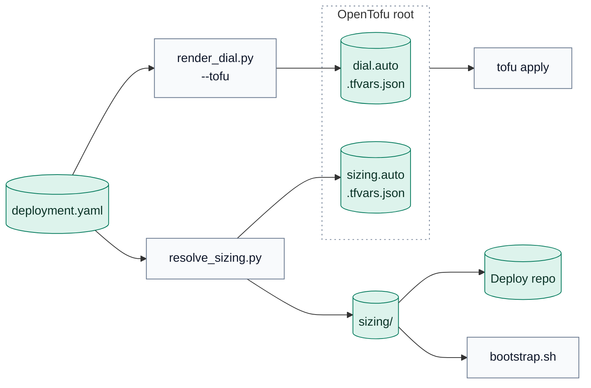
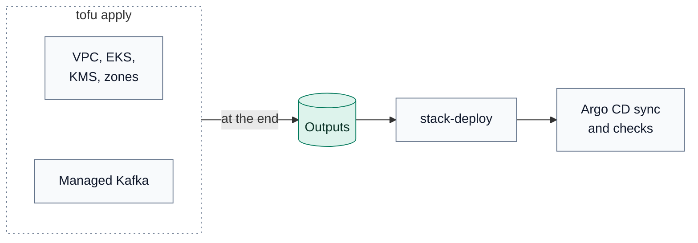

<!--
Project:   DFE (Data Fusion Engine) - product suite
File:      docs/deployment/aws-configuration.md
Purpose:   Reference for the AWS deployment: what the OpenTofu root builds,
           sizing and its locks, Kafka and ClickHouse choices.
Language:  Markdown
License:   see repository LICENSE
Copyright: HyperI / DFE contributors
-->

# DFE on AWS -- configuration

What the AWS root builds, how the dial sizes it, and the Kafka and ClickHouse choices behind it. The deploy steps are in [aws.md](aws.md).

- [What every deployment builds](#what-every-deployment-builds)
- [Sizing the deployment](#sizing-the-deployment)
- [Resolving sizing artefacts](#resolving-sizing-artefacts)
- [Sizing dials and locks](#sizing-dials-and-locks)
- [What the apply builds](#what-the-apply-builds)
- [Kafka and ClickHouse](#kafka-and-clickhouse)

## What every deployment builds

`terraform/environments/aws` builds an EKS cluster and hands it to the same bootstrap and Argo CD layers every other cluster uses. Layer 1 and Layer 2 are the same on AWS.

One file drives all of it, the deployment dial `deployment.yaml`. Copy it from `deployment.example.yaml` or let `dfe-ops init` write it ([wizard.md](wizard.md)). The account's state bucket is a one-off: run `terraform/environments/aws-state` once, before any deployment applies.

| Setting | Default | Dial key | Rule |
|---|---|---|---|
| Node architecture | Graviton (arm64) | the resolver's `shape_ref` | Every node pool and the MSK brokers resolve to arm64. The cluster module rejects a `shape_ref` that resolves to anything else. |
| Availability Zones | 3, range 2-6 | `network.az_count` | Locked once resolved ([locks](#sizing-dials-and-locks)). A Strimzi or MSK broker count steps up to at least the AZ count, so every zone gets a broker. |
| NAT gateways | one, shared | `network.nat`: `single` or `per-az` | Take `per-az` when a zone failure or the cross-zone charge costs more than the extra gateways. |
| Kubernetes API | private endpoint only | `endpoint.public`, `endpoint.allowed_cidrs` | The plan rejects a public endpoint with no allow-list. |
| S3 path | gateway VPC endpoint | always on | Keeps S3 traffic off the NAT path at no extra charge. |
| CloudTrail | on | `cloudtrail.enabled` | One trail, described [below](#encryption-and-audit). |

### Network

The receiver gets an NLB of its own, apart from the gateway's, because it takes terabytes a day and an NLB bills per GB processed ([aws.md](aws.md#receiver-ingress)). Everything DFE runs sits in the private subnets.

*Figure 1. L4 Detail -- DFE on AWS, ingress.* Up: [Deploying DFE with dfe-infra](README.md).

S3 traffic never pays the NAT gateway's per-GB charge. Image pulls the [registry cache](aws-operations.md#registry-cache) doesn't serve do, and so does a managed Kafka outside AWS.

*Figure 2. L4 Detail -- DFE on AWS, egress.* Up: [Deploying DFE with dfe-infra](README.md).

The toolbox instance, when enabled, sits in the private subnets too ([toolbox.md](toolbox.md)). Each diagram on this page is drawn from its YAML in `docs/deployment/diagrams/`. Regenerate each `.mmd` and its SVGs with `merrow graph render docs/deployment/diagrams/<name>.yaml --out docs/deployment/diagrams`.

### Cloud identity

Every controller that needs an AWS credential gets it through EKS Pod Identity, tied to its service account by the cluster module. That's the EBS CSI driver, Karpenter, the AWS Load Balancer Controller, external-dns and cert-manager. The data workloads hold an AWS identity of their own too, so no DFE pod carries a static key.

*Figure 3. L4 Detail -- DFE on AWS, data identities.* Up: [Deploying DFE with dfe-infra](README.md).

*Figure 4. L4 Detail -- DFE on AWS, controller identities.* Up: [Deploying DFE with dfe-infra](README.md).

Not drawn: Karpenter's EC2 launches, the EBS CSI driver's identity for volumes, the MSK bootstrap job's for broker IAM auth, and the dfe-receiver and dfe-hunt-runner readers of the secrets dfe-engine writes.

Karpenter's controller policy is AWS's published one with two changes. The instance-profile lifecycle statements are dropped, because the module creates the profile, and the two profile reads stay. It adds a KMS statement, which the published policy lacks, so the controller can launch nodes with encrypted root volumes. It adds an `aws:SourceAccount` condition on the interruption queue too, which the published CloudFormation omits, so no other account's EventBridge rule can enqueue a forged interruption. The managed node group stays because Karpenter's chart keeps the controller off Karpenter nodes.

### Encryption and audit

The deployment has one KMS key, and the cluster module is its one policy owner. A sibling module that needs a grant passes the statement in through `key_policy_grants`, because a second `aws_kms_key_policy` on the same key would replace the whole policy. The account-root statement stays, so every IAM-side grant on the key keeps working.

| Grant passed in | When |
|---|---|
| CloudTrail's statements | `cloudtrail.enabled`, under either telemetry sink |
| MSK broker log delivery | `kafka.provider: msk` and the `otel` sink. The other providers emit no CloudWatch-shaped broker log. |

`cloudtrail.enabled`, on by default, builds one trail for the deployment's region, with management events only and global service events included.

| CloudTrail piece | Setting |
|---|---|
| Bucket | Versioned and encrypted under the deployment key, with AWS's documented policy scoped to this trail's ARN. Objects expire after `telemetry.retention_days`. |
| CloudWatch log group | Kept `telemetry.forced_retention_days` under the `otel` sink, where the collector reads it into the otel database. Kept `telemetry.retention_days` under `cloudwatch`. |

Versioning means a principal with `s3:DeleteObject` can't remove a trail file with nothing to recover it from. It stands in for Object Lock, which can't be turned off once enabled and in compliance mode blocks the ephemeral teardown.

### external-dns

external-dns publishes what the gateway chart marks and nothing else. Its sources include Gateway API routes, and the Gateway admits routes from every namespace. Without a filter, anyone with namespace-level access could attach an HTTPRoute to the wildcard listener and get a name published under your domain with a public certificate behind it. So the addon sets `annotationFilter: dfe.hyperi.io/publish-dns=true`. `helm/edge/gateway` writes that annotation on every route it renders and on the managed proxy's Service. A route from a deploy-repo overlay is published when it has the same annotation.

external-dns runs `policy: sync` with a per-deployment `txtOwnerId` (`argocd/appsets/layer1-addons.yaml`), so a deleted Service or Ingress has its record removed. The chart's default, `upsert-only`, never deletes anything it published. Sync covers every teardown except `tofu destroy` itself. There the EKS cluster and every node go down in the same run, so whatever external-dns last published stays in the private zone with no controller left to clean it up.

`terraform/modules/kubernetes-cluster/aws/dns.tf` has a destroy-time cleanup for that case. It empties the zone of everything but its apex NS/SOA pair, using the `aws` CLI directly, before the zone is destroyed. It runs under whatever AWS identity `tofu destroy` is using. The one extra prerequisite is the `aws` CLI on the machine running the destroy. The cluster module's destroy-time sweep of leaked CNI network interfaces (`eks.tf`) needs it as well, and a destroy without the CLI fails.

## Sizing the deployment

Every AWS-relevant field in `deployment.example.yaml` is documented inline, with a worked `cloud_aws:` block near the bottom. Four dial keys decide the size.

| Dial key | Values | What it does |
|---|---|---|
| `sizing.ingest_gb_per_day` | GB/day, or blank | Blank gives the tyre-kick floor, the smallest size that runs the profile without an out-of-memory kill. It reports whatever throughput it handles and doesn't target one. |
| `sizing.focus` | `economy` 40%, `balanced` 60%, `performance` 100% | Headroom over the sized peak. None of the three trades away RF3 or `min.insync.replicas=2`. |
| `kafka.controller_pool` | `combined` (default) or `separate` | Where the KRaft metadata quorum runs. `separate` adds three controllers. |
| `sizing.overrides` | per workload | Applied last, over whatever the ratios derived. Storage-cap assertions check overridden values too. |

On AWS economy focus the floor is S, the smallest size the resolver accepts. With `kafka.provider: msk` the managed brokers are its largest single line. With Kafka in the cluster (`strimzi`) that line goes and the floor stays S. Instance types resolve to the newest arm64 generation in the region, priced from on-demand Linux rates in the AWS Pricing API, and the report names them.

At the floor the resolver's A4 check WARNS and doesn't fail. The smallest ClickHouse and Keeper types sustain a low EBS baseline and burst above it for 30 minutes a day, and both write continuously. Set `sizing.ingest_gb_per_day` once you know it, and the resolver sizes for the workload instead of the minimum. Above 100,000 GB/day it stops outright and points you at a professional-services engagement.

## Resolving sizing artefacts

The resolver and `render_dial.py` each write one tfvars file into the OpenTofu root, and the resolver writes the rest of its answer under `sizing/`.

*Figure 5. L4 Detail -- Sizing artefacts on AWS.* Up: [Deploying DFE with dfe-infra](README.md).

Run `python3 scripts/resolve_sizing.py --dial deployment.yaml --live --out terraform/environments/aws`. Every artefact lands under `--out`, the repo root if you leave it out. To resolve with no AWS call, pass `--fixtures scripts/tests/fixtures/sizing --cloud aws`. For a region other than us-west-2, capture one first with `resolve_sizing.py capture --region <region> --fixtures <dir>`.

| File | Holds | Read by |
|---|---|---|
| `sizing.auto.tfvars.json`, at the root of `--out` | `node_pools` and `resolved_shapes`, nothing the root doesn't declare | `tofu`, after `dial.auto.tfvars.json`: it loads every `*.auto.tfvars.json` in name order |
| `shapes/resolved/aws-<region>.json` | The instance-type answer, keyed by region because generations differ between regions | |
| `sizing/<tier>.values.yaml` | The tier's chart values | |
| `sizing/<tier>.data-charts.values.yaml` | Its data-charts subset | layer2-data, from the deploy repo's `infra/` |
| `sizing/<tier>.report.md` | What was sized, from which ratio, in which cost bucket | you |
| `sizing/resolved.yaml` | The baseline the next resolve diffs against | `--previous` and `dfe-ops upgrade --dial` |
| `sizing/<tier>.pools.json` | The node pools' classes | `bootstrap.sh`, which stops without it on a Karpenter cluster. The node-pools chart would fail its render with no pool classes rather than prune the cluster's NodePools. |
| `sizing/<tier>.nodes.json` | Node demand, on-prem resolves only | `bootstrap.sh`'s preflight |

The resolver is the ONE writer of `node_pools` and `resolved_shapes`. It starts from the dial's `node_pools.system` block, the always-on group you size by hand, and merges the pools it derives on top. `render_dial.py --tofu` emits neither key, so the two never collide.

Copy `<out>/sizing/` into the deploy repo's `sizing/` and commit it, so a re-size has something to check against. `dfe-ops upgrade --dial` diffs against `<deploy>/sizing/resolved.yaml`, never `--out`. `bootstrap.sh` reads `<out>/sizing/` and seeds the data-charts file into a bundled repo. A resolve run anywhere else needs `DFE_SIZING_DIR` set to that directory.

## Sizing dials and locks

Six fields in `sizing.yaml` lock once resolved. The resolver records each in `sizing/resolved.yaml`, `az_count` when it resolved against a cloud catalogue. Give a re-resolve `--previous <deploy>/sizing/resolved.yaml` and it exits 3 if any of them moved. Pass `--migrate` as well if you mean it. <!-- doc-paths: ignore -->

| Locked field | Set by | Also guarded by |
|---|---|---|
| `partition_count` | derived from `kafka.sizing.*` | `kafka.sizing.*`, in `governance/policies/sizing-locks.yaml` |
| `storage_model` | `sizing.storage_model` | `clickhouse.storageModel`, `kafka.storageModel`, in `storage-layout.yaml` |
| `kafka_provider` | `kafka.provider` | nothing else: an OpenTofu input with no chart key |
| `controller_mode` | `kafka.controller_pool` | `kafka.controllerPool.enabled`, in `sizing-locks.yaml` |
| `cloud_token` | the dial's cloud | `cloud`, in `sizing-locks.yaml` |
| `az_count` | `network.az_count` | nothing else: an OpenTofu input with no chart key. It feeds the VPC's zone list in `terraform/modules/kubernetes-cluster/aws/vpc.tf`. |

The four chart keys are protected vars in the deploy repo, so the engine's API rejects an edit unless the caller holds `helmvars:override`. Neither policy governs a direct git commit. The MSK module rejects any broker type that isn't MSK Express (`terraform/modules/managed-kafka/msk/variables.tf`).

## What the apply builds

The root creates the VPC and its subnets, the EKS cluster and its node groups, the managed Kafka when the dial asks for one, the deployment's KMS key, the Route 53 zones and the Secrets Manager store. Nothing that runs inside Kubernetes. `tofu init` reads the state bucket, key and region from `dial.auto.tfvars.json`, which `render_dial.py --tofu` writes from the dial's `target.provision` block, so there's no separate `-backend-config` to keep in step. <!-- doc-paths: ignore -->

A managed broker is the longest build, and the deploy can't start until it ends, because OpenTofu writes no outputs until the whole apply finishes.

*Figure 6. L4 Detail -- Apply and deploy on AWS.* Up: [Deploying DFE with dfe-infra](README.md).

The Kafka module takes the network, the cluster name, the KMS key and the Pod Identity trust policy as explicit inputs, so nothing holds the broker behind the control plane, the node groups or the addons. The key's ARN carries the ordering against the key policy that a broker's first log delivery needs. Two applies get the deploy going sooner: one `-target=module.cluster` to land the cluster outputs, then the full apply. The broker's annotations are written only by a bootstrap run after it exists, so that route costs a second bootstrap pass. Take the single apply unless the second pass is worth it to you.

The deploying principal's EKS access entry uses `data.aws_iam_session_context.current.issuer_arn`, so an SSO permission set, an assumed role, an instance profile or a Lambda role all work. The entry names the IAM role, with its `aws-reserved/sso.amazonaws.com/<region>/` path for SSO, not the STS session ARN.

`dfe-ops stack-deploy --from-terraform terraform/environments/aws` assembles the bootstrap env from the outputs, sets the stack version, and runs the preflight, `bootstrap.sh`, the readiness gate and the two default data checks. `bootstrap/bridge.py` is the reader it imports, not a command you run.

| stack-deploy piece | What happens on AWS |
|---|---|
| Preflight | The offline pin, drift and render checks. `--check-only` runs the preflight alone and never touches the cluster. |
| Secrets store | Secrets Manager (`aws-sm`), the one store the root composes. `stack-deploy` rejects `DFE_SECRETS_BACKEND=openbao`. |
| Chart repo | `k8s.repo_url` is the dfe-infra chart repo Argo reads. A private copy needs `DFE_REPO_TOKEN`, an HTTPS token with read access that `bootstrap.sh` turns into the Argo repository credential. Without it every Layer 2 Application stays `Unknown` with "authentication required". The dfe-* images and thin charts pull anonymously. |
| Storage class | When `k8s.storage_class` names no class the cluster has, `bootstrap.sh` creates it: `ebs.csi.aws.com`, gp3 at the 3,000 IOPS / 125 MiB/s baseline, encrypted with the account's default EBS key, `WaitForFirstConsumer`. It becomes the cluster default when there's none. EKS 1.30+ ships `gp2` alone with no default class, and the CSI add-on creates none. |
| Internal CA | The persist step renders the gateway chart with the value files Argo layers afterwards: `argocd/values/common.yaml`, `argocd/values/<cloud>.yaml`, `argocd/values/profile-<profile>.yaml`. |
| Load Balancer Controller | Gets `vpcId` (the `DFE_VPC_ID` output, carried on the cluster secret as `dfe.hyperi.io/vpc_id`) and `region` explicitly, never discovered. Node IMDS hop limit stays at 1. |

## Kafka and ClickHouse

Every managed backend on AWS is the supplier's AWS instance. The plan rejects a backend AWS doesn't offer, and a ClickHouse Cloud service on another cloud. [managed-backends.md](managed-backends.md) has the rule, the per-cloud table and the egress ports.

### Kafka

All five `kafka.provider` tokens validate on both the resolver and the OpenTofu root. The root calls the module body the dial names, each behind a `count` of its own, and `name`, `env` and `network` alone hold for every body. dfe-engine creates the topics on every provider. [kafka/README.md](kafka/README.md) has the defaults DFE runs Kafka with.

| `kafka.provider` | Brokers | How DFE authenticates | Credential for `tofu` | Message size |
|---|---|---|---|---|
| `strimzi` | In the cluster, the default. Broker autoscaling is a KEDA `ScaledObject` on the `KafkaNodePool` `/scale` subresource, on consumer lag by default, with scale-in off. | SCRAM-SHA-512 on a plaintext listener | none | |
| `redpanda` | In the cluster, opt-in, under the BSL | SCRAM-SHA-512 on a plaintext listener | none | |
| `msk` | MSK Express only, because MSK can't convert a Standard cluster to Express later | SASL/SCRAM for every DFE app. SASL/IAM for the in-cluster bootstrap Job alone. | none | |
| `confluent-cloud` | Confluent's AWS instance. Its default tier, Freight, is a Private Network Interface, not PrivateLink. | SASL/PLAIN, with the key and secret Confluent mints | `CONFLUENT_CLOUD_API_KEY`, `CONFLUENT_CLOUD_API_SECRET` | Checked against the tier: Freight caps a topic's `max.message.bytes` at 20 MB and takes the chain's 16 MiB. Basic and Standard cap it at 8,388,608. |
| `redpanda-cloud` | Serverless, its one creatable tier, over a PrivateLink-style endpoint | SASL/SCRAM, with the shared password | `REDPANDA_CLIENT_ID`, `REDPANDA_CLIENT_SECRET` | |

Export both credential pairs before `tofu plan`, whichever provider you chose, because the `redpanda` provider checks for its pair at configure time. A credential is a provider environment variable, never a tfvar. The `confluent-cloud` and `redpanda-cloud` bodies live under `terraform/modules/managed-kafka/`, tested against the same module rules as `msk/`. Neither sizes, versions or scales itself from an instance type the resolver picks. For a managed broker, the root's `DFE_KAFKA_MESSAGE_MAX_BYTES` output hands the dial's message size to dfe-engine, which creates every topic at it. An in-cluster broker keeps the engine's own default.

The MSK bootstrap Job uses IAM because Kafka ACLs live in the data plane and tofu can't write the first one. It writes the SCRAM principal's ACLs alone and exits non-zero on any failure.

The deployment has one Kafka password, generated in the root and not in the secrets module, because a managed broker is created with it. The same value has to reach the store ESO reads and the secret the broker authenticates against, and a value generated inside the secrets module never leaves it. `confluent-cloud` uses the key and secret Confluent minted instead. MSK has no `kafka` seed in the store, because its `AmazonMSK_` secret is the one copy. `redpanda-cloud` reuses MSK's seed, and takes the ephemeral-lifecycle `allow_deletion` flag. The password is never regenerated, because brokers keep the one they were created with and a fresh one locks every DFE service out. Rotation is a separate operation.

Topic retention starts from a 24-hour assumed consumer downtime on the sized (`scale`) tier, plus any `archiver_lag_hours`. `single` isn't sized and keeps the chart's 24-hour default (`kafka.retention.assumedConsumerDowntimeH`), and `slim` runs no broker. DLQ topics hold 7 days (168 hours) whatever the tier.

MSK's broker-count scaler, its telemetry sink and its rebalancing behaviour are operational detail, in [Kafka telemetry and autoscaling](aws-operations.md#kafka-telemetry-and-autoscaling). Hand-written OpenTofu for the two cloud services is in [kafka/confluent-cloud.md](kafka/confluent-cloud.md) and [kafka/redpanda-cloud.md](kafka/redpanda-cloud.md), for a deployment that stands the service up some other way.

### ClickHouse

> **Coming from Splunk or Elastic?** With the default `cached-object` storage model there are no hot, warm and cold tiers to move data between. ClickHouse keeps its parts in S3 and serves repeated reads from a local NVMe cache ([storage.md](storage.md)).

In the cluster, ClickHouse keeps its parts in S3 behind a local NVMe cache. The bucket, the cache placement and the storage model all reach the chart on the cluster secret, so a fresh deploy repo needs no overlay for any of them.

| Piece | On AWS | Key |
|---|---|---|
| Storage model | `cached-object`. `auto`, the default, means object store wherever an endpoint exists, with `local` the explicit opt-out. | `sizing.storage_model` |
| Parts | The S3 bucket `terraform/modules/kubernetes-cluster/aws/object-store.tf` provisions, reached through a Pod Identity role of its own | |
| Node pool | A local-NVMe family, `r*d`, generation floor 8 | the resolver |
| Cache disk | The node's NVMe as one RAID0 array under the kubelet, of which the cache takes 0.8. The resolver sizes it and points the cache at `instance-store`, so it doesn't share the data PVC. | `clickhouse.objectStore.cache.volume`, `clickhouse.instance_store_cache_share` |

The Karpenter pool assembles the RAID0 array through `instanceStorePolicy`, the managed node group through a nodeadm NodeConfig in its launch template. [storage.md](storage.md) has the mechanism, and the default for a node type with no such NVMe: `pvc`, bounded at 60% of the data PVC's space.

`clickhouse.mode: external` connects to a server you brought, ClickHouse Cloud first, and deploys none.

| Piece | How it reaches DFE |
|---|---|
| Host | The dial's `clickhouse.host` travels as `endpoints.clickhouse_host`. The root hands it, the ports, TLS and the user to the cluster secret as `dfe.hyperi.io/clickhouse_*`, and layer2-data, layer2-platform and layer2-apps turn those into the `clickhouse` values for clickhouse-cluster, network-policies, the otel collector and every app. |
| Password | `TF_VAR_clickhouse_external_password`, never a dial field. The secrets module seeds it at `<project>/<env>/clickhouse/external`, and clickhouse-cluster copies it into the engine's namespace as `clickhouse-admin-password`. |
| Access list | A ClickHouse Cloud service's IP access list has to admit the cluster's NAT egress, the root's `DFE_EGRESS_CIDRS` output. |
