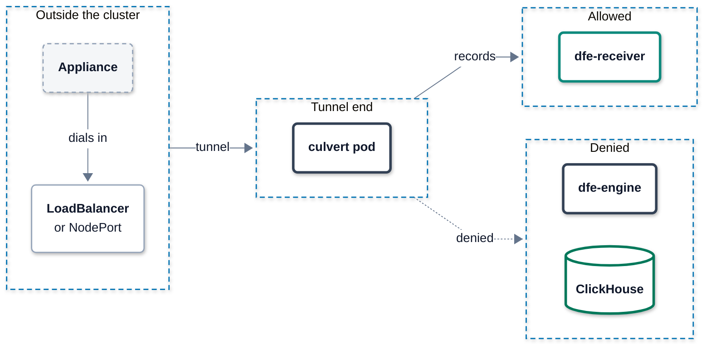

# Edge-fleet VPN

Appliances in the field have to post to the receiver. Most sit behind carrier NAT with no fixed address and nothing to open a port on. So the edge VPN turns it around: each appliance DIALS IN, and the tunnel it holds open is the path its records take. Nothing on the appliance's network is exposed, and the receiver never needs a public address at all.

It's OFF unless a deployment asks for it, on the `scale` and `mesh` tiers.

## What it is

culvert's thin chart deploys [culvert](https://github.com/hyperi-io/culvert), a VPN server that speaks OpenVPN and WireGuard at once. `helm/charts/dfe-extras` renders the tunnel's NetworkPolicy, environment and guards beside it. `versions.yaml` pins the image by tag and digest (`apps.culvert`, `digests.culvert`) and the chart by digest (`chart-digests.culvert`).

Two doors, both on one public LoadBalancer:

| protocol | port | why both |
|---|---|---|
| WireGuard | 51820/udp | the fast one, and the one a small appliance can run |
| OpenVPN | 1194/udp | the compatible one, and the one with OIDC login |

That's the chart's default. On AWS a LoadBalancer bills by the GB, so `argocd/values/edge-aws.yaml` points culvert at a NodePort instead, reached through an address you bring (see [aws.md](aws.md#receiver-ingress)). That file is the edge module's AWS tier table, one per flavour, layered by `argocd/appsets/layer2-edge.yaml` after the cloud overlay. It sets `pki.mode: external`, so a tunnel on a cloud flavour names the Secret holding its CA, server certificate and key, or the chart fails the render.

A client on a network that blocks UDP needs the OpenVPN TCP fallback: add `{ name: openvpn-tcp, port: 1194, protocol: TCP, exposed: true }` to `listeners`. It's off by default because TCP inside TCP is slow and it's a second door to defend. culvert's HTTPS tunnelling stays off, because it needs a publicly trusted certificate and buys an ingest fleet nothing.

Tunnel clients live in `100.64.0.0/10`, the CGNAT range RFC 6598 reserves, declared once in `argocd/values/common.yaml` as `vpn.clientCIDR`. Pod and service CIDRs never use it, so an appliance's LAN and the cluster can't collide with client addresses. The chart carves one /24 per tunnel, in listener order, and fails the render on a range with no room for that.

## The tunnel's address on AWS

A NodePort has no address, so `edge.ingest.tunnel.address.mode` decides where one comes from: `byo`, the default, is an address you hold in front of the cluster, and `forwarder` is the tier-2 opt-in where `terraform/modules/edge/aws` builds one. The forwarder is built and not tested in this release.

The forwarder is a small SSM-managed instance in a public subnet holding an Elastic IP, with no inbound ssh rule. It admits the tunnel's UDP listeners from `edge.ingest.tunnel.loadBalancerSourceRanges` (empty is 0.0.0.0/0) and DNATs each to the nodePort `argocd/values/apps/culvert/values.yaml` pins, across the running nodes it reads from `ec2:DescribeInstances` once a minute. So the flavour overlay sets `externalTrafficPolicy: Cluster`, because any node has to forward. EKS's cluster security group admits its own members alone, so the module adds one rule per listener sourced from the forwarder's security group: the hole is this one instance, and it closes on a return to `byo`.

The instance sits in one availability zone (`edge.ingest.tunnel.address.zone`, default the network's first). The zone and the Elastic IP go onto the cluster secret: the zone becomes culvert's `nodeSelector`, so the hop stays in one zone, and external-dns publishes `vpn.serverCN` at the address. `edge.ingest.tunnel.address.shape_ref` (`toolbox` by default) picks the newest arm64 type from `shapes/compute-shapes.yaml`. A larger type goes in `sizing.overrides.<shape>.instance_type`, and it has to be Graviton to match the AL2023 arm64 AMI.

## The receiver and nothing else, in two layers

Two independent layers limit tunnel clients to the receiver. They fail differently, so both are there: a tunnel client reaches the receiver, and the NetworkPolicy and culvert's routing both deny every other destination.



*Figure 1. L4 Detail -- Tunnel client reach. Both layers deny the paths to dfe-engine and ClickHouse.* Up: [Deploying DFE with dfe-infra](README.md).

- The NetworkPolicy (`helm/charts/dfe-extras/templates/culvert-networkpolicy.yaml`) selects the receiver pods BY LABEL and namespace, so it's exact whatever the addressing is. Client traffic is SNATed onto the pod address as it leaves the tunnel, so the pod's reach is a client's reach.
- culvert's routing control (`CULVERT_ROUTING_CONTROL_ENABLED`, `routes.destinations`) filters by CIDR and port inside the pod, and pushes the CIDRs to clients as their routes. `routes.allowedPorts` is the port list: unset is the receiver's `ingest.ports` plus DNS on 53, which is all the NetworkPolicy opens for a client, and an empty list opens every port on the destinations. The pod's own telemetry export to the collector is open to the pod but not to a client, because the port filter drops it. Clients are isolated from each other.

The NetworkPolicy bites because the culvert pods have `dfe.hyperi.io/egress-scoped: "true"`, which takes them OUT of the namespace-wide egress baseline. Policies are additive. A pod that baseline selects can always reach its whole namespace, and no later policy takes that back. The cost of opting out is that the culvert chart states its WHOLE egress surface, DNS and telemetry included. So anything a deployment adds (an external PKI backend, an OIDC issuer outside the cluster) goes in `networkPolicy.extraEgress`.

## Who may reach the door

`exposure.loadBalancerSourceRanges` is the ingress allow-list on the LoadBalancer. It starts EMPTY, which means every source address, because a fleet dials in from anywhere. If your appliances sit in known ranges, list them.

Beyond that, culvert authenticates each client:

- PKI. Every client holds a certificate of its own. `pki.mode: local` mints a CA in the pod on first start, which is fine for a trial. Without `persistence.enabled` every restart mints a fresh CA and every issued client config stops working. A rebuildable deployment uses `pki.mode: external` with a Secret carrying `ca.crt`, `server.crt`, `server.key` and optionally `crl.pem` and `tc.key`. BOTH modes want the volume, because culvert writes its revocations and its WireGuard peer allocations into the same directory, so a restart without it re-issues a revoked peer's address. `argocd/appsets/layer2-edge.yaml` turns it on for every cloud flavour, there and not in the flavour file because other charts read `persistence.enabled`.
- OIDC. `vpn.oidc.enabled` with the issuer and client id, the client secret riding a pre-created Secret. It sits under `vpn` so the cloud overlays' top-level `oidc.enabled`, the gateway's edge OIDC ([aws-operations.md](aws-operations.md#admin-ui-exposure)), can't reach the tunnel. The client completes its login against the server's callback port, so add `{ name: oauth2-udp, port: 9000, protocol: TCP, exposed: true }` to `listeners`. The chart fails the render without it, and fails it outright if a values file still sets the old `oidc.issuer` or `oidc.clientId`.

## Reaching an appliance from the bastion

Cloud flavours alone. On-prem the operator is on the LAN and the module supplies nothing.

An appliance holds its tunnel open, so an operator reaches it through the hub rather than by opening anything on the appliance's network. [edge.md](edge.md#the-tunnels-inbound-and-reaching-one-appliance) has the mechanism, the four `dfe-ops bastion` verbs, what the appliance has to accept, and the isolation regression to run on every change to `peers.classes`.

`dfe-ops bastion join` waits on https://github.com/hyperi-io/culvert/issues/40 and is not available in this release. `edge.ingest.tunnel.admin_peer.ttl_minutes` and `peer_cidr` belong to the admin peer it would mint, so neither reaches a rendered resource. `render_dial.py` rejects a dial that sets either to anything but its default. The culvert chart likewise rejects `exposure.loadBalancerSourceRanges` on a NodePort. What ends a session is `dfe-ops bastion down`, which revokes and then terminates.

`peers.classes.admin.adminCIDRs` is the toolbox instance's `/32`. One host, not its subnet. That matters because the subnet is a `/20` shared with every EKS managed node group, with Karpenter, and under the stock VPC CNI with every pod holding a secondary address on a node in that zone.

A `/32` goes stale, because every `dfe-ops bastion up` rebuilds the instance. `up` learns the address from the toolbox module's output after its targeted apply, writes it on the Argo cluster secret, and waits until culvert's `CULVERT_DOWNSTREAM_ADMIN_CIDRS` has it. `down` takes it off and waits for that before the instance is destroyed. It goes on the cluster secret, because the ApplicationSet controller reverts a patch on a generated Application.

So there's no hole at all when no bastion is up, and the one that exists names a single address. A packet reaches an appliance when something ROUTES the client range at the culvert pod, which takes the host network namespace. An ordinary pod can't do it from inside its network namespace, and node root can. Behind that stands the appliance's ssh and TLS authentication.

## One replica, and why

The chart holds at one pod and fails the render on more. WireGuard mints its server key inside the pod and sources it from no secrets backend, so a second replica issues client configs the first rejects and allocates the same tunnel addresses. OpenVPN alone can scale out on shared external PKI, but this chart runs the pair. The `replicas` key is deliberately not spelled `replicaCount`, because the scale profiles set that for every app and this one can't take it.

The pod runs as uid 0 with `NET_ADMIN`, `SETPCAP`, `SETGID` and `SETUID`, a hostPath `/dev/net/tun` and a privileged init container for `ip_forward`. The baseline Pod Security level every other DFE namespace enforces rejects that, so the tunnel runs in a `culvert` namespace the Application labels `pod-security.kubernetes.io/enforce=privileged`. The Secrets it reads (`dfe-culvert-pki`, the OIDC client secret) are created there.

## Turning it on

The VPN is an app like any other, so a values file in the deploy repo turns it on. Through the engine's app-management API:

```text
POST /api/v1/apps/culvert/instances
{ "instance": "default",
  "values": { "vpn.serverCN": "vpn.example.com",
              "exposure.loadBalancerIP": "203.0.113.10" } }
```

That commits `values/culvert-default-values.yaml`, the layer2-edge ApplicationSet turns the file into an Argo Application, and Argo deploys it. `DELETE /api/v1/apps/culvert/default` removes the file and the app with it. The console's Platform tab drives the same endpoints.

The tunnel is part of the edge module, so the deployment's `edge.enabled` is a switch above this one. With it off, `argocd/appsets/layer2-edge.yaml` generates nothing and the values file turns nothing on. Destroy the tunnel before turning the module off, because the load balancer outlives the Application that asked for it.

`vpn.serverCN` is the name clients dial and the name the server certificate is issued for, so it has to resolve to the LoadBalancer's address. Left empty it derives `{hostnames.vpn}.{domain}` from the deploy-config SSoT.

Point the receiver at the tunnel with `exposure.groups.ingest.door: tunnel` in the deploy repo's `infra/common.yaml`. It then sits on a ClusterIP, and its ingest NetworkPolicy admits the VPN pods instead of the world. Without the VPN that door leaves the receiver no external path. A cloud deployment sets it explicitly, because the cloud default door, `loadbalancer`, doesn't admit the tunnel pods.

Client and key management (issuing a config, revoking one, per-client routes) is culvert's CLI. Driving it from the engine and the console is not built. This chart ships enable, disable and the deployment dials.

The receiver's other two exposure modes, and what an open ingest door means, are in [ingest-edge.md](../ingest-edge.md).
