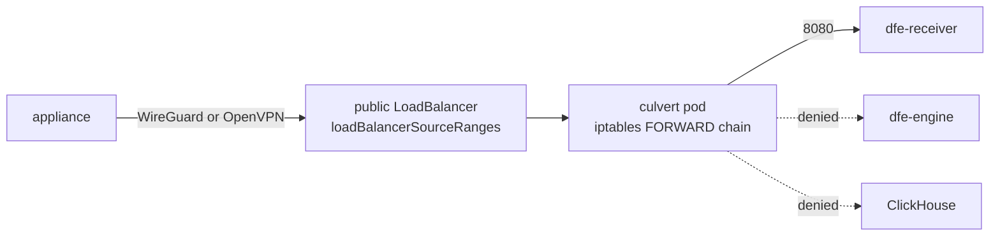

# Edge-fleet VPN

Appliances in the field have to post to the receiver. Most sit behind carrier NAT with no fixed address and nothing to open a port on. So the edge VPN turns it around: each appliance DIALS IN, and the tunnel it holds open is the path its records take. Nothing on the appliance's network is exposed, and the receiver never needs a public address at all.

It's OFF unless a deployment asks for it, and it's offered on the `scale` and `mesh` tiers.

## What it is

culvert's thin chart deploys [culvert](https://github.com/hyperi-io/culvert), a VPN server that speaks OpenVPN and WireGuard at once. The chart is published beside the image, as for every other app in the suite. `helm/charts/dfe-extras` renders the tunnel's NetworkPolicy, environment and guards beside it. `versions.yaml` pins the image by tag and digest (`apps.culvert`, `digests.culvert`) and the chart by digest (`chart-digests.culvert`).

Two doors, both on one public LoadBalancer:

| protocol | port | why both |
|---|---|---|
| WireGuard | 51820/udp | the fast one, and the one a small appliance can run |
| OpenVPN | 1194/udp | the compatible one, and the one that carries OIDC login |

That's the chart's default. On AWS a LoadBalancer bills by the GB, so `argocd/values/edge-aws.yaml` points culvert at a NodePort instead, reached through an address you bring (see [aws.md](aws.md#receiver-ingress)). That file is the edge module's AWS tier table, one per flavour, layered by `argocd/appsets/layer2-edge.yaml` after the cloud overlay. It also sets `pki.mode: external`, so a tunnel on a cloud flavour names the Secret holding its CA, server certificate and key, or the chart refuses to render.

A client on a network that blocks UDP outright needs the OpenVPN TCP fallback. Add `{ name: openvpn-tcp, port: 1194, protocol: TCP, exposed: true }` to `listeners`. It's off by default because TCP inside TCP is slow and it's a second door to defend. HTTPS tunnelling (OpenVPN inside TLS on 443, or WireGuard over WebSocket) is culvert's censorship-evasion path and stays off. It needs a publicly trusted certificate and buys an ingest fleet nothing.

## The tunnel's address on AWS

A NodePort has no address of its own, so on AWS the dial decides where one comes from. `edge.ingest.tunnel.address.mode` is `byo` (an address you already hold in front of the cluster) or `forwarder`, the tier-2 opt-in where `terraform/modules/edge/aws` builds one.

**The forwarder hasn't been proven against a live cluster. `byo` is the default.** The instance lands in a public subnet, so the Elastic IP receives, and the nodePort it rewrites each packet to is admitted on the group the nodes carry. A live run has to show two things: the DNAT path working (a client dialling the address reaches culvert's pod), and the zone placement holding, with that pod scheduled onto a node in the forwarder's own availability zone.

The forwarder is a small SSM-managed instance holding an Elastic IP, with no inbound ssh rule of any kind. It admits the tunnel's own UDP listeners from `edge.ingest.tunnel.loadBalancerSourceRanges` (empty is 0.0.0.0/0, as everywhere else here) and DNATs each to the nodePort culvert's `defaultListeners` pin in `argocd/values/apps/culvert/values.yaml`, across whichever nodes are running. It reads that node list from `ec2:DescribeInstances`, its only grant, once a minute. That's why the flavour overlay sets `externalTrafficPolicy: Cluster`: any node has to forward, whichever one holds the pod.

EKS gives a managed node group the cluster's own security group, whose ingress admits its own members alone. So the module adds one rule to it per listener, sourced from the forwarder's security group rather than a CIDR. The hole is this one instance, not everything sharing its subnet, and it closes on a return to `byo`.

The instance is pinned to one availability zone (`edge.ingest.tunnel.address.zone`, defaulting to the network's first). Both that zone and the Elastic IP are carried onto the cluster secret. The zone becomes culvert's own `nodeSelector`, so the hop from the forwarder to the pod stays inside one zone, and the address is what external-dns publishes `vpn.serverCN` at.

`edge.ingest.tunnel.address.shape_ref` names the resolved shape the instance launches on, `toolbox` by default: the newest arm64 generation the shape resolver picks from `shapes/compute-shapes.yaml`, with its root volume. A larger type for more tunnel bandwidth goes in `sizing.overrides.<shape>.instance_type`, and the dial refuses an instance type of its own. The family has to be Graviton to match the AL2023 arm64 AMI that `scripts/resolve_sizing.py images` resolves.

## Client addressing

Tunnel clients live in `100.64.0.0/10`, the CGNAT range reserved by RFC 6598, declared once in `argocd/values/common.yaml` as `vpn.clientCIDR`. Pod and service CIDRs never use that range, so an appliance's own LAN and the cluster can't collide with the addresses handed to clients. The chart carves one /24 out of it per tunnel, in listener order, and refuses a range with no room for that carve.

## Receivers only, in two layers

Two independent layers limit tunnel clients to the receiver. They fail differently, so both are there.



- The NetworkPolicy (`helm/charts/dfe-extras/templates/culvert-networkpolicy.yaml`) selects the receiver pods BY LABEL and namespace, so it's exact whatever the addressing is. Client traffic is SNATed onto the pod address on its way out of the tunnel, so what the pod may reach is what a client may reach.
- culvert's own routing control (`CULVERT_ROUTING_CONTROL_ENABLED`, `routes.destinations`) filters by CIDR inside the pod and pushes the same list to clients as their routes. An appliance is routed at exactly what it's allowed to reach. Clients are isolated from each other as well.

The NetworkPolicy only bites because the culvert pods carry `dfe.hyperi.io/egress-scoped: "true"`, which takes them OUT of the namespace-wide egress baseline. Policies are additive. A pod that baseline selects can always reach its whole namespace, and no later policy takes that back. The cost of opting out is that the culvert chart states its WHOLE egress surface, DNS and telemetry included. So anything a deployment adds (an external PKI backend, an OIDC issuer outside the cluster) goes in `networkPolicy.extraEgress`.

## Who may reach the door

`exposure.loadBalancerSourceRanges` is the ingress allow-list on the LoadBalancer. It starts EMPTY, which means every source address on earth, because a fleet that dials in from anywhere is the normal case here. If your appliances sit in known ranges, list them.

Beyond that, culvert authenticates each client:

- PKI. Every client holds its own certificate. `pki.mode: local` mints a CA in the pod on first start, which is fine for a trial. Without `persistence.enabled` every restart mints a new CA and every issued client config stops working. A deployment that has to be rebuildable uses `pki.mode: external` with a Secret carrying `ca.crt`, `server.crt`, `server.key` and optionally `crl.pem` and `tc.key`. BOTH modes want the volume, because culvert writes its revocations and its WireGuard peer allocations into the same directory, so a restart without it re-issues a revoked peer's address. `argocd/appsets/layer2-edge.yaml` turns it on for every cloud flavour for that reason. It sets it there rather than in the flavour file because `persistence.enabled` is a key other charts read.
- OIDC. `vpn.oidc.enabled` with the issuer and client id, the client secret riding a pre-created Secret. It sits under `vpn` because the cloud overlays set a top-level `oidc.enabled` for the gateway's edge OIDC on the UIs (`envoy-gateway-config`, see [aws-operations.md](aws-operations.md#admin-ui-exposure)), and that switch must not reach the tunnel. The client completes its login against the server's callback port, so add `{ name: oauth2-udp, port: 9000, protocol: TCP, exposed: true }` to `listeners`. The chart refuses to render without it, and refuses to render at all if a values file still carries the old `oidc.issuer` or `oidc.clientId`.

## Reaching an appliance from the bastion

Cloud flavours only. On-prem the operator is already on the LAN and the module supplies nothing.

An appliance holds its own tunnel open, so an operator reaches it through the hub rather than by opening anything on the appliance's network. [edge.md](edge.md#the-tunnels-inbound-and-reaching-one-appliance) carries the mechanism, the four `dfe-ops bastion` verbs, what the appliance has to accept, and the isolation regression to run on every change to `peers.classes`.

```bash
dfe-ops bastion hub <peer>      # route the client range at the pod, then shell
dfe-ops bastion peers           # name, tunnel address and last handshake
dfe-ops bastion join            # refused until hyperi-io/culvert#40 lands
dfe-ops bastion down            # revoke anything joined, THEN terminate
```

`edge.ingest.tunnel.admin_peer.ttl_minutes` and `peer_cidr` both belong to the admin PEER, which waits on `hyperi-io/culvert#40`, so neither reaches a rendered resource today. `render_dial.py` refuses a dial that sets either to anything but its default and names that issue. The culvert chart likewise refuses `exposure.loadBalancerSourceRanges` on a NodePort. What ends a session is `dfe-ops bastion down`, which revokes and then terminates.

### How wide the hole is

`peers.classes.admin.adminCIDRs` is the toolbox instance's own `/32`. One host, not its subnet. That matters because the subnet is a `/20` shared with every EKS managed node group, with Karpenter, and under the stock VPC CNI with every pod holding a secondary address on a node in that zone.

A `/32` goes stale on its own, because the instance is terminated and rebuilt on every `dfe-ops bastion up`. So it isn't written once at bootstrap. `up` learns the new address from the toolbox module's own output after its targeted apply, writes it on the Argo cluster secret, and waits until culvert's own `CULVERT_DOWNSTREAM_ADMIN_CIDRS` carries it. `down` takes it off and waits for that before the instance is destroyed. It goes on the cluster secret rather than the Application, because the ApplicationSet controller reconciles a generated Application back to its template and a patch there wouldn't survive.

So there's no hole at all while no bastion is up, and the one that exists names a single address. A packet only reaches an appliance if something ROUTES the client range at the culvert pod, which takes the host network namespace. An ordinary pod can't do it from inside its own, and node root can. Behind that stands the appliance's own ssh and TLS authentication.

### What a live run still has to prove

None of this has been exercised against a cluster. Two things to check:

- culvert's pinned image honours `CULVERT_DOWNSTREAM_ADMIN_CIDRS` with an ethernet-side ACCEPT and a NAT RETURN beside it, ahead of nothing that drops it first.
- An appliance accepts ssh on 22 and https on 443 on its tunnel interface from the admin's address. **That's an assumption to confirm with the EdgeStream Hub team**, not a fact this repo can check.

Run the isolation regression in the same window, and on every change to `peers.classes`. One appliance peer must still not reach another.

## One replica, and why

The chart holds at one pod and refuses more. WireGuard mints its server key inside the pod and sources it from no secrets backend, so a second replica issues client configs the first rejects and allocates the same tunnel addresses. OpenVPN alone can scale out on shared external PKI, but this chart runs the pair. The `replicas` key is deliberately not spelled `replicaCount`, because the scale profiles set that for every app and this one can't take it.

The pod also runs as uid 0 with `NET_ADMIN`, `SETPCAP`, `SETGID` and `SETUID`, a hostPath `/dev/net/tun` and a privileged init container for `ip_forward`. OpenVPN and wg-quick create the tun device and program iptables NAT before OpenVPN drops to nobody. The baseline Pod Security level every other DFE namespace enforces refuses all of that, so the tunnel runs in its own `culvert` namespace, which the Application labels `pod-security.kubernetes.io/enforce=privileged`. The receiver's ingest policy and the tunnel's egress policy each name the other's namespace, and the Secrets the tunnel reads (`dfe-culvert-pki`, the OIDC client secret) are created there.

## Turning it on

The VPN is an app like any other, so enabling it means a values file appearing in the deploy repo. Through the engine's app-management API:

```text
POST /api/v1/apps/culvert/instances
{ "instance": "default",
  "values": { "vpn.serverCN": "vpn.example.com",
              "exposure.loadBalancerIP": "203.0.113.10" } }
```

That commits `values/culvert-default-values.yaml`, the layer2-edge ApplicationSet turns the file into an Argo Application, and Argo deploys it. `DELETE /api/v1/apps/culvert/default` removes the file and the app with it. The console's Platform tab drives the same endpoints.

The tunnel is part of the edge module, so the deployment's `edge.enabled` is a switch above this one. With it off, `argocd/appsets/layer2-edge.yaml` generates nothing and the values file turns nothing on. Destroy the tunnel before turning the module off, because the load balancer outlives the Application that asked for it.

`vpn.serverCN` is the name clients dial and the name the server certificate is issued for, so it has to resolve to the LoadBalancer's address. Left empty it derives `{hostnames.vpn}.{domain}` from the deploy-config SSoT.

Point the receiver at the tunnel with `exposure.groups.ingest.door: tunnel` in the deploy repo's `infra/common.yaml`. That leaves it on a ClusterIP with no public address at all, and its ingest NetworkPolicy then admits the VPN pods instead of the world. Set that door WITHOUT deploying the VPN and the receiver has no external path. A cloud deployment that reaches the receiver over the tunnel sets this explicitly, because the cloud default door is `loadbalancer`, whose policy doesn't admit the tunnel pods.

## Later

Client and key management (issuing a config, revoking one, per-client routes) is culvert's own CLI today. Driving it from the engine and the console is a later addition. This chart ships enable, disable and the deployment dials.

## Related

- [README.md](README.md) - the layers and the values cascade
- [../ingest-edge.md](../ingest-edge.md) - the receiver's other two exposure modes and what an open ingest door means
