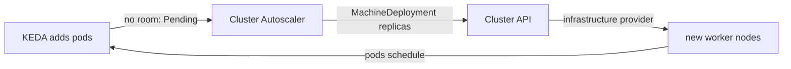

# Node autoscaling for on-premises clusters

KEDA adds pods, and a pod with no room Pends until something adds a node. [Autoscaling](../autoscaling.md) sets out the two layers and the per-target choice. On AWS the node layer is Karpenter, through the node-pools chart's `karpenter-aws` renderer. Azure and GCP renderers are planned in dfe-infra#806.

On-premises there is no node layer today. The baseline is a fixed RKE2 node pool, so capacity planning replaces node autoscaling and KEDA still scales pods inside the nodes that exist. Karpenter is not an option there, because it needs a cloud provisioning API to mint machines. This page scopes what an elastic on-premises cluster needs.

Cluster API (CAPI) holds the worker nodes as declarative `MachineDeployment` objects, with an infrastructure provider that turns "N machines" into VMs or hosts. The CAPI-aware Cluster Autoscaler watches Pending pods and moves the `MachineDeployment` replica count. That is the on-premises counterpart of what Karpenter does on AWS, and KEDA sits on top unchanged.

## What it takes

- An infrastructure provider for the target: CAPV for vSphere, Metal3 for bare metal, or another CAPI provider for the hypervisor in use. Which providers to support is the open question.
- Cluster Autoscaler's CAPI provider as a layer 1 addon, gated to on-premises clusters and pointed at the `MachineDeployment` objects, with a minimum and maximum per tier.
- Machine images and sizing per tier, the on-premises equivalent of a Karpenter NodePool.
- A credential for CAPI to reach the hypervisor or vSphere API, which is a new onboarding input for an on-premises deployment.
- A fallback for sites that allow neither, a static node count. The minimum node sizing per tier covers it, and the operator needs a clear signal that pods are Pending for want of a node.

The boundary holds: node scaling belongs to dfe-infra, driven by KEDA's pod pressure, and the engine never creates nodes. Slim and single tiers run a small fixed set with the autoscaler optional (minimum equals maximum), and the scale tier is where it earns its keep.

The work runs in three steps.

1. Choose and stand up one CAPI infrastructure provider.
2. Deploy Cluster Autoscaler against its `MachineDeployment` objects, per tier.
3. Prove the whole loop per tier: KEDA adds a pod, it Pends, a node joins, the pod schedules, and the node leaves again on scale-down.

Check the current Cluster Autoscaler, CAPI and provider versions at build time, since none are pinned here.
