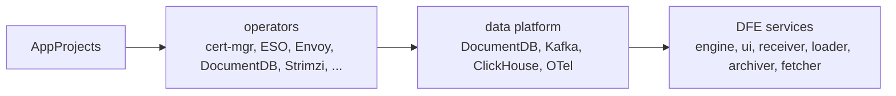
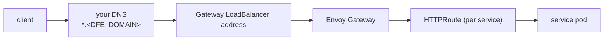

# DFE on Kubernetes on-premises

DFE on a Kubernetes cluster you run, from a bare cluster to a stack that has sent its first event through to ClickHouse. RKE2 is the reference distribution ([rke2.md](rke2.md)), and the charts need no particular one.

One command does the deploy. `dfe-ops stack-deploy` installs cert-manager, External Secrets and Argo CD, or adopts healthy ones already there. Argo CD then syncs the backing services and the DFE apps at the versions the release pins. It finishes by sending an event through to ClickHouse and checking the stack's own telemetry landed, then writes your logins to a file only you can read.

Pick the tier before anything else. It decides whether you need a secrets store.

| Tier | Transport | Shape | Secrets store |
|---|---|---|---|
| `slim` | gRPC | One replica of each stage, no broker. | None |
| `single` | Kafka | One replica of each, with a single Kafka broker in the cluster. | None |
| `scale` | Kafka | Replicas, a ClickHouse cluster and Strimzi Kafka. | OpenBao, for the broker's client credential |

`mesh` is in the charts but every deploy path refuses it. [index.md](index.md#tiers-and-the-values-cascade) has the layers and the values cascade, and [composition.md](composition.md) which apps each tier runs.

## Before you start

- A kubeconfig for the cluster, so `kubectl get nodes` works. Then `helm`, `openssl` and Python 3 on the machine you deploy from.
- Kubernetes 1.35 or later, or 1.34 with the `ImageVolume` feature gate on in the API server and every kubelet. The DocumentDB operator mounts its extension into HyperDX's store as an image volume, and its admission webhook refuses the store without one. On 1.34, `bootstrap/check_platform.py` reads the gate from the API server's `/metrics` (it needs `get` on that URL) and refuses a cluster where it is off or unreadable, unless `DFE_IMAGE_VOLUME_ENABLED=true` says it is on in the API server and every kubelet.
- Nodes for DFE to run on, labelled `dfe.hyperi.io/workload=dfe`. The `local` overlay (`argocd/values/local.yaml`) pins DFE to them with a hard nodeSelector and tolerates a matching `NoSchedule` taint, so a pool tainted at provisioning keeps other workloads off it. Bootstrap labels every node on this target (`DFE_LABEL_WORKLOAD_NODES`, default `true` for `local`). On a shared cluster, label the DFE nodes yourself and set it to `false`.
- Where data is stored is decided at the first deploy and locked after it. Read [storage.md](storage.md) first.
- For `scale`, an OpenBao: its address, plus an AppRole for External Secrets or a token OpenTofu can create one with ([index.md](index.md#secrets-store)).

## Deploy

`<version>` is the DFE release you are installing.

1. Clone the release and make your env file. It stays readable by you only, and git ignores it.

   ```bash
   git clone --branch <version> https://github.com/hyperi-io/dfe-infra && cd dfe-infra
   (umask 077 && cp bootstrap/local.env.example bootstrap/local.env)
   ```

2. Fill in `bootstrap/local.env`. `DFE_DOMAIN` is the domain every hostname sits under. `DFE_REPO_URL` is the git repository Argo CD reads the charts from, `https://github.com/hyperi-io/dfe-infra` or your own copy of it. Every other key is documented in the file. For `scale`, also set `DFE_SECRETS_BACKEND=openbao` and `DFE_VAULT_ADDR`, with the External Secrets AppRole in `DFE_VAULT_ROLE_ID` and `DFE_VAULT_SECRET_ID`.

3. Check the cluster. The preflight is read-only and changes nothing.

   ```bash
   python3 scripts/dfe-ops preflight --mode single --env-file bootstrap/local.env
   ```

4. Deploy.

   ```bash
   python3 scripts/dfe-ops stack-deploy --stack <version> --mode single \
     --target-revision <version> --env-file bootstrap/local.env
   ```

`--check-only` runs only the offline checks (pins, drift, chart render), with no cluster contact. `--dry-run` prints every command and applies none.

No OpenBao AppRole yet? `bootstrap/deploy.sh --cloud local` runs OpenTofu in `terraform/environments/local` first, then hands its outputs to the same bootstrap. Use it when you want OpenTofu to create the OpenBao KV mount and the External Secrets AppRole that `scale` reads. With no OpenBao it deploys `slim` and `single`, and the root refuses `scale`.

```bash
cd terraform/environments/local
cp terraform.tfvars.example terraform.tfvars
(umask 077 && cp ../../../bootstrap/local.env.example .env)
cd -
bash bootstrap/deploy.sh --cloud local
```

- `terraform.tfvars` takes the domain, the tier (`profile`), the NFS server, the repo URL and the git ref. For `scale`, set `vault_addr` too.
- The OpenBao token goes in `VAULT_TOKEN`, never a file in the repo. With none set, the provider reads `~/.vault-token`.
- `deploy.sh` reads `terraform/environments/local/.env`, not `bootstrap/local.env`. That file supplies `DFE_REGISTRY`, which bootstrap needs and OpenTofu does not output, and its `DFE_SECRETS_BACKEND` reaches the root as `secrets_backend` (`openbao` or `none`).
- `--dry-run` runs `tofu plan` in place of the apply. `--skip-terraform` reuses the state you have.

## What you see

`stack-deploy` prints what it is about to do: the stack, the tier, the domain, the namespace and the secrets backend. Bootstrap installs the platform, then Argo CD syncs the rest in waves. `kubectl -n argocd get app -w` shows them land.



Transform services (vrl, vector, elastic) sync on any tier where the deploy repo carries a values file for one.

Then the stack checks itself. The readiness gate waits up to 15 minutes (`--readiness-timeout`) for Argo CD to converge, then fails on a container that is not Ready, a crashloop or pull error, unmet replicas or runaway restarts. It trusts neither an Argo `Healthy` nor a pod's `Running`: a Running pod can be 0/1 ready, and an app can report Healthy while a workload crashloops. Last, it posts an event to the receiver and finds it in ClickHouse, then checks the stack's own logs and metrics landed.

The run ends on `=== stack-deploy OK ===` and the path of `.tmp/<version>-<tier>/access-summary.md`. It holds the console URL, the admin and break-glass passwords and what to do next, at mode 0600. Keep the break-glass password somewhere safe, then delete the file.

To check the stack again later:

```bash
python3 scripts/dfe-ops verify --mode single --env-file bootstrap/local.env
```

It runs the smoke tests (`bootstrap/run-all-smoke-tests.sh`) against the namespaces the deploy used: namespaces, pod readiness, CRDs, and the Gateway, HTTPRoute and network policies. `--readiness-only` runs the readiness gate alone. After `deploy.sh`, pass `--from-terraform terraform/environments/local` in place of the env file.

## DNS and ingress



Every UI and the engine API answer through the Envoy Gateway (`helm/edge/gateway/`) on the wildcard `*.<DFE_DOMAIN>`. The console is `dfe.<DFE_DOMAIN>`. cert-manager issues the TLS, and [DEPLOY-TLS-TRUST.md](../DEPLOY-TLS-TRUST.md) covers trusting it.

Point a wildcard record at the Gateway's address. Where nothing on the cluster programs a LoadBalancer Service, bootstrap installs MetalLB. `DFE_GATEWAY_IP` fixes the Gateway's address and `DFE_RECEIVER_IP` the receiver's ingest LoadBalancer, so a rebuild keeps the addresses your DNS already names. A name outside the wildcard needs its own record.

## Tear down

```bash
python3 scripts/dfe-ops teardown
```

It runs `bootstrap/destroy.sh` and asks you to type `yes` (`--force` skips that, `--dry-run` lists what goes). It deletes the Argo CD Applications and ApplicationSets, the data CRDs, the DFE namespaces and the platform Helm releases.

After `deploy.sh`, add `--with-terraform --cloud local`. Once the cluster is clean it runs `tofu destroy` in `terraform/environments/local`, which removes the OpenBao KV mount and AppRoles. Skip it and they stay in OpenBao.

Then check by hand:

- [ ] `kubectl get pv` -- the local-path volumes were reclaimed.
- [ ] Stuck finalizers (Strimzi, ClickHouse) are cleared, if deletion hangs.
- [ ] Any non-wildcard DNS records you added are gone.
- [ ] The DFE node taints and labels are off, so later scheduling is not blocked.
- [ ] No OpenBao paths are left behind.

To redeploy, run the same deploy command again.

## Troubleshooting

| What you see | What to do |
|---|---|
| ImagePullBackOff | Check the image reference has a registry host (`DFE_REGISTRY`). A mirror of your own that needs a login is covered in [index.md](index.md#optional-your-own-private-mirror). |
| `stack-deploy` refuses `scale` with `DFE_SECRETS_BACKEND=none` | It lists what reads the store. Set the four OpenBao keys in step 2, or use `deploy.sh`. |
| `stack-deploy` refuses on `DFE_KUBE_CONTEXT` | The env file names a context other than the kubeconfig's current one, and bootstrap deploys to the current one. Switch context, or empty the key. |
| DFE pods Pending on node affinity or selector | The DFE nodes lack the `dfe.hyperi.io/workload=dfe` label, or are gone. Label or restore them rather than removing the selector, which puts DFE on nodes it does not own. `dfe-ops preflight --require-label dfe.hyperi.io/workload=dfe` catches a missing label before a deploy. |
| An Application stuck OutOfSync | `kubectl -n argocd get app`, then check External Secrets and the SecretStore are healthy. |
| A route not serving | Check the Gateway and HTTPRoute are programmed and the certificate is issued. |
| Teardown hangs | Clear the CRD finalizers: `kubectl patch ... --type merge -p '{"metadata":{"finalizers":[]}}'`. |
