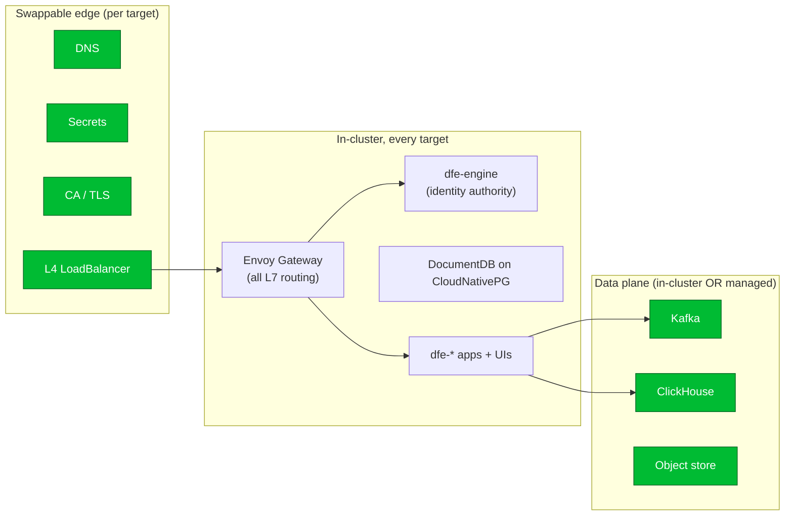

# Deployment portability matrix

DFE is one product deployed into many estates. Most components sit behind a config dial, so a deployment swaps them without a code change. A dial is an existing k8s abstraction or a chart mode, never a fork. A few components are fixed in-cluster and have no dial: the Envoy edge, the identity authority and the document store. This page shows how each target sets the dials. The definitions (what each dial turns) live in [../architecture.md](../architecture.md) "Swappable components", and that stays the SSoT.

RKE2 on-prem is the reference distribution and the tested path. The cloud columns use the same charts and dials with different values and credentials. RKE2 and AWS are built and tested. Azure and GCP are values overlays only (`argocd/values/azure.yaml`, `gcp.yaml`) with no cloud root, so a deployment there brings its own cluster and sets the values by hand.

## The invariant core vs the swappable edge

One cloud L4 LoadBalancer backs the single in-k8s Envoy Gateway, which does ALL the L7 routing. There are no per-app cloud LBs and no cloud L7 (ALB/App Gateway). dfe-engine (the identity authority), the Envoy edge and the dfe-hyperdx DocumentDB store are always in-cluster. Kafka, ClickHouse and object storage can be in-cluster or a managed endpoint.

## The matrix

| Component | The dial | On-prem RKE2 | AWS | Azure | GCP |
|---|---|---|---|---|---|
| Kubernetes | vanilla-cluster contract (preflight) | RKE2 (standard) | EKS | AKS | GKE |
| External DNS | external-dns provider / estate record | estate CoreDNS record | Route53 | Azure DNS | Cloud DNS |
| Secrets | ESO ClusterSecretStore | OpenBao | Secrets Manager | Key Vault | Secret Manager |
| Private CA / TLS | cert-manager ClusterIssuer (+ external issuer) | OpenBao PKI | ACME or AWS PCA | ACME or Key Vault | ACME or Google CAS |
| Kafka | chart mode + `kafka.bootstrapServers` | Strimzi / Redpanda* | MSK / Confluent Cloud / Redpanda Cloud, each on AWS** | Confluent Cloud on Azure** | Confluent Cloud / Redpanda Cloud, each on GCP** |
| ClickHouse | `clickhouse.mode` + `.host` | in-k8s operator | CH Cloud (pref) / in-k8s | CH Cloud (pref) / in-k8s | CH Cloud (pref) / in-k8s |
| Edge LoadBalancer | `envoyGateway.service` type=LoadBalancer | MetalLB | NLB | Azure LB | GCP LB |
| Object store | S3-compatible endpoint + creds | MinIO / Ceph RGW | S3 | Blob (S3 API) | GCS (S3 API) |
| Container registry | `global.registry`, plus a pull secret for a private mirror | Harbor | ECR | ACR | GAR |
| Image pull cache | containerd mirror per upstream | not built | ECR pull-through cache | ACR artifact cache (not built) | AR remote repos (not built) |
| StorageClass / CSI | `storageClass` (empty -> cluster default) | local-path / Longhorn | EBS | Azure Disk | PD |
| Workload identity | ServiceAccount annotations | static creds (OpenBao) | EKS Pod Identity (no annotation) | Azure Workload Identity | GKE Workload Identity |
| etcd-at-rest KMS | cluster EncryptionConfiguration provider | secretbox / aescbc | KMS | Key Vault KMS | Cloud KMS |
| Document store | documentdb chart, a DocumentDB CR on the DocumentDB operator's CloudNativePG (always in-cluster, Kubernetes 1.35+, or 1.34 with the ImageVolume feature gate) | 2 instances, gateway in each | " | " | " |
| Identity authority | dfe-engine account store (always in-cluster) | dfe-engine | dfe-engine | dfe-engine | dfe-engine |
| Federated login | `oidc.providers` external OIDC (opt-in) | any OIDC IdP | Entra / Okta / ... | Entra | Google / ... |

\* Redpanda on-prem is behind a licence gate.

\** A managed backend is offered only as its instance on the deployment's own cloud, and the plan refuses any other: [managed-backends.md](managed-backends.md).

## Notes that matter

- One LB, dumb L4. The only cloud LB per deployment is the `Service type=LoadBalancer` fronting the gateway (MetalLB provides it on-prem). We don't use cloud L7 (routing, WAF, OIDC). Envoy owns L7 in-cluster, so behaviour is identical everywhere. Cloud-specific LB tuning rides `envoyGateway.service.annotations`.
- Workload identity is how the cloud credentials work. ESO, external-dns and the cloud LB controller reach their cloud APIs through workload identity: EKS Pod Identity on AWS, which needs no annotation, and Workload Identity annotated onto the ServiceAccount on Azure and GCP. On-prem there's no cloud API, so credentials come from OpenBao through ESO. Nothing hardcodes a static cloud key.
- etcd-at-rest belongs to the cluster, not the app. dfe-engine (and every `secrets` consumer) inherits whatever the cluster's EncryptionConfiguration uses: cloud KMS on managed clusters, secretbox/aescbc on-prem. No app couples to a KMS.
- Data services are in-cluster OR managed, per deployment. Kafka and ClickHouse default to in-cluster (Strimzi, the CH operator) and swap to a managed endpoint when you point the chart's `*.host` or `bootstrapServers` at it. The DocumentDB store's PostgreSQL stays in-cluster, because it's the dfe-hyperdx store and not a general PG.
- ClickHouse on cloud: ClickHouse Cloud is PREFERRED, but self-hosted ClickHouse in-k8s (the operator) is equally ACCEPTABLE on any cloud. The `clickhouse.mode` dial supports both everywhere, so it's a per-deployment call and not a hard rule.
- A chart never assumes anything cloud-specific. A component reachable through only one provider is a bug (architecture.md).
- Declaring an external dependency also configures its clients' egress rules. The baseline is default-deny egress, so `network-policies` derives an egress allow for each external dependency the deployment declares. `clickhouse.mode: external` opens the ClickHouse clients on the ClickHouse ports, `kafka.mode: external` opens the Kafka clients, and likewise for an external OIDC issuer, secret backend, index server or OTel destination. There's no separate acknowledgement flag. Without the allow, a pod pointed at the datastore couldn't reach it, and would crashloop with nothing in the policy set to explain why. Each purpose gets only the ports that dependency speaks, and any purpose pins to a known endpoint CIDR (`externalEgress.<purpose>.allowCIDRs`) where one is fixed.

## Node autoscaling

It's a pools interface with one renderer per cloud. The resolver writes a pool class per workload, and `helm/charts/node-pools` renders the classes for the cluster's node autoscaler. That's Karpenter on AWS. Azure and GCP have no renderer in this release. On-prem runs a static node pool and renders no pool object. [../autoscaling.md](../autoscaling.md) has the per-target table.
