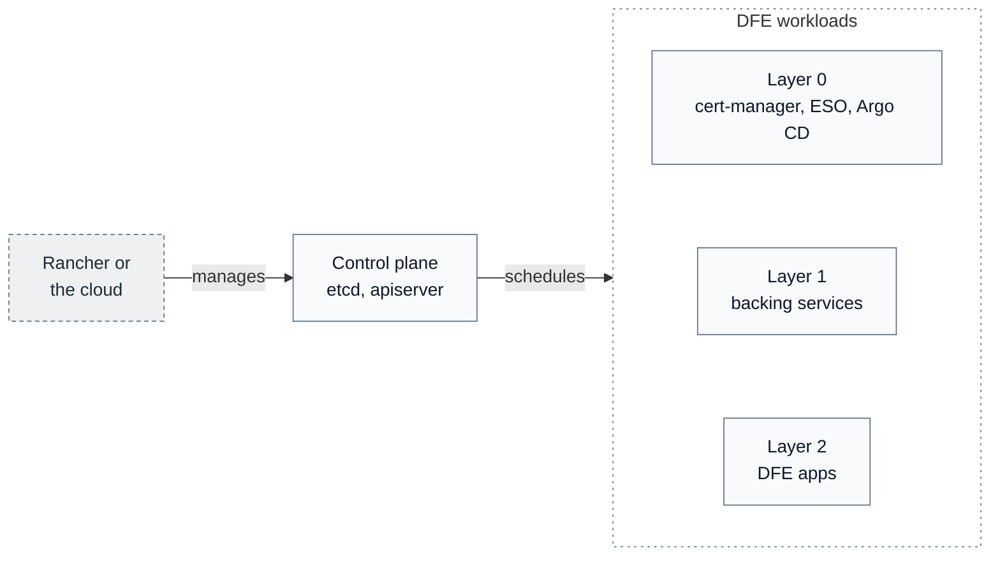
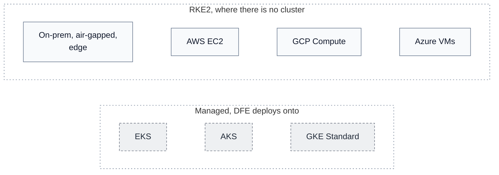

<!--
Project:   dfe-infra
File:      docs/deployment/rke2.md
Purpose:   A primer on RKE2 - what it is, how it works with DFE, and why DFE
           uses and heavily standardises on it (incl. the federal compliance baseline).
Language:  Markdown
License:   BUSL-1.1
Copyright: (c) 2026 HYPERI PTY LIMITED
-->

# RKE2 - a primer (the DFE reference distribution)

Status: dfe-infra deploys onto an RKE2 cluster and doesn't build one. Provisioning RKE2 where a customer has no cluster is the design, not built, with no tracking issue.

DFE targets any CNCF-conformant Kubernetes. RKE2 is the reference distribution. RKE2 on-prem and Amazon EKS are the tested targets, and the aws root builds the EKS cluster. Azure and GCP have values overlays (`argocd/values/azure.yaml`, `gcp.yaml`) and no cloud root, so a deployment there brings a cluster and sets the values by hand.

This page covers RKE2: what it is, how it sits under DFE, and why it's our reference.

## What is RKE2

RKE2 (Rancher Kubernetes Engine 2, originally "RKE Government") is SUSE/Rancher's security-focused, CNCF-conformant Kubernetes distribution. It keeps K3s's easy single-binary install but rebuilds the internals for enterprise security and strict upstream conformance:

- One `rke2` binary, run as `rke2-server` (control plane) or `rke2-agent` (worker).
- containerd (not Docker) and embedded etcd (not SQLite).
- Hardened from first boot: CIS defaults, audit logging on, anonymous auth off, one-flag secrets-at-rest encryption.
- FIPS-validated crypto (Go + BoringCrypto).

It isn't K3s, which runs the whole control plane in one process on SQLite and is built for the edge. RKE2 is the data-centre and regulated-workload sibling, and many shops run both.

## How RKE2 works with DFE

RKE2 runs each control-plane component (apiserver, scheduler, controller-manager, etcd) as a static pod in `kube-system`. That's the upstream `kubeadm` model, so you can see and debug each one with `kubectl`, unlike K3s's single process. A server node runs the control plane. Agent nodes run the kubelet and CNI and host the workloads.

DFE sits on top of whichever cluster you have. It assumes a conformant, running Kubernetes cluster and deploys onto it. Where there's no cluster, RKE2 is how a bare machine or cloud VM becomes one. DFE's layers run as workloads on the cluster, and Rancher or the cloud manages the control plane under them.

*Figure 1. L4 Detail -- DFE on an RKE2 cluster. The dashed box is external.* Up: [Deploying DFE with dfe-infra](README.md).

DFE never manages RKE2's control plane. Rancher/RKE2 own etcd, upgrades and hardening, and DFE deploys into the cluster they provide. What differs by cluster type:

- On RKE2, the hardened profile gives you a FIPS, CIS and STIG-hardened cluster baseline. DFE's workloads are assessed separately, and the cluster baseline doesn't cover them.
- On RKE2, the self-hosted OIDC issuer gives pods their cloud identity (AWS IRSA, GCP WIF, Azure Entra). So DFE's secrets and ESO flow works the same wherever RKE2 runs.
- On managed targets, the cloud's mechanism gives pods their identity: EKS Pod Identity, Azure Workload Identity, GKE Workload Identity ([portability-matrix.md](portability-matrix.md)).

## Why RKE2 is the reference

DFE is a product suite other organisations deploy. Where we provision the cluster, the same base has to land identically on-prem, air-gapped and on bare IaaS.

Where there's no cluster, the design puts RKE2 on every kind of host. On a managed cluster, DFE deploys onto what the cloud runs.

*Figure 2. L4 Detail -- Where RKE2 runs. Dashed boxes are run by the cloud.* Up: [Deploying DFE with dfe-infra](README.md).

One distro means one Kubernetes version matrix, one CNI/CSI, one hardening profile, one identity pattern, one debugging surface and one set of docs. The alternative is three divergent managed distros, because EKS, AKS and GKE differ on CNI, add-ons, auth and upgrade cadence. RKE2 runs on bare metal, any cloud's VMs and the edge, which is the widest customer reach, and Rancher handles the fleet lifecycle (etcd snapshots, rolling upgrades). The cost is that, on clusters we provision, we own etcd backup/restore, node OS patching, control-plane upgrades and the per-cloud OIDC webhook. That's work, but it's bounded and single-path.

RKE2 meets the federal and regulated requirements, which is a large part of the "why". Verify version specifics with Rancher Government per deployment:

- FIPS 140-2 validated crypto (Go + BoringCrypto, CMVP certificate 4691), the first NIST-FIPS-140-2-validated Kubernetes distribution. The STIG needs 140-2 or 140-3 modules, so confirm 140-3 module status for your build.
- DISA STIG. RKE2 has an official DISA-published STIG (the Rancher Government Solutions RKE2 STIG), derived from NIST SP 800-53. That's what lets the DoD run it on network systems.
- CIS Kubernetes Benchmark. It's hardened by default (`cis` profile, `kube-bench`-scannable).
- FedRAMP (cloud) and DISA STIG (on-prem) both need FIPS crypto, audit logging, strict access control and (often) air-gap. RKE2 meets them when configured correctly.
- Iron Bank (USAF hardened registry) and SELinux enforcing.

A few STIG controls need infrastructure beyond the distro: MFA / CAC-PIV, SIEM audit forwarding and an air-gapped registry. The deploy environment and the deployment's OIDC IdP supply those.

See also:

- Crypto standard: [cnsa-standard.md](../cnsa-standard.md)
- Official: RKE2 architecture (https://docs.rke2.io/architecture), FIPS support (https://docs.rke2.io/security/fips_support), the DISA RKE2 STIG (NIST NCP checklist 1040).
