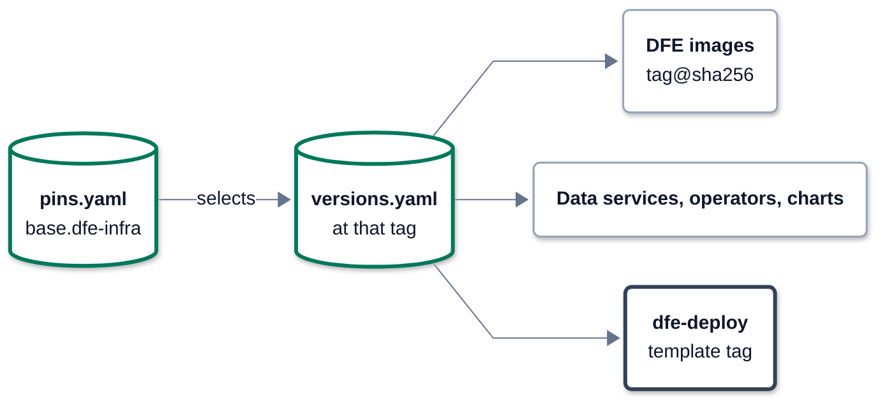

# Stack versioning

DFE is made of independently released parts: the Rust data plane, dfe-engine, dfe-ui, dfe-hyperdx, the schemas, the charts and operators, and the deploy-repo template. "DFE X.Y.Z" selects the component versions recorded in `versions.yaml` at that release tag, and each stack release tests that combination. A deployment pins one number and can move individual components off the set, visibly and at its risk.

`versions.yaml` in dfe-infra is the one place every pinned version is set: bootstrap components, operators, data services and every `dfe-*` image. A drift check (`scripts/check_versions_drift.py`) fails the build when a chart, ApplicationSet or bootstrap manifest disagrees with it.

A stack release is a dfe-infra tag, so `versions.yaml` frozen at tag `X.Y.Z` is the manifest for DFE X.Y.Z. People set the `current` pointer and its stack entry, and the Stack Release workflow (`.github/workflows/release.yml`) cuts the tag once `current` has none. Nobody hand-tags. `dfe-schemas` and `dfe-deploy` hold content rather than images. They're tagged in step with each stack release and recorded in `versions.yaml` like any other component.

One pin in the deploy repo selects a `versions.yaml`, and that file names every image, chart and content tag in the stack.



*Figure 1. L4 Detail -- One pin selects the stack.* Up: [Deploying DFE with dfe-infra](README.md).

The deploy repo's `pins.yaml` has `base.dfe-infra`, the one version that selects the stack, and a `channel` (alpha, beta, rc or release). Bumping the pin moves charts, operators and every app image in one reviewed commit and leaves `values/` and `config/` alone ([state and repositories](state-and-repos.md)).

There's no `dfe-schemas` pin. The wheel rides inside the engine image, so the engine pin selects the schema release.

## Overrides and upgrades

Need one component ahead of the set, or held behind it? List it under `overrides` in `pins.yaml`.

```yaml
overrides:
  apps:
    dfe-receiver: "v<version>@sha256:..."
```

An override beats the certified manifest, and everything not listed stays on the certified version. It must be a `tag@sha256` digest, and `dfe-stack resolve` rejects a floating tag.

Every override prints a support-drift notice, from `dfe-stack resolve` and again from dfe-engine at startup. The drift sits outside the certified-set guarantee until a later stack release absorbs it, because HyperI tests the manifest combination and not arbitrary cross products.

To apply an override, `--emit-values` writes per-service fragments (`image.tag` and `image.digest`, which the thin chart joins into `tag@digest`). Merge them into the service's existing `values/{service}-{instance}-values.yaml`. A separate file would become an Argo application of its own.

Each release's `versions.yaml` has `stack.previous`, the verified from-versions for that release. `dfe-stack graph` derives the whole upgrade graph from those entries, so no graph file needs curating. `dfe-stack check-upgrade --from A --to B` gives the verdict. A declared `previous` list is authoritative for its release. Otherwise the rule is sequential minors with free patch hops.

`upgrade-order.yaml` sets the order an upgrade applies in: bootstrap, operators, data services, then apps. `stack.upgrade-order` in `versions.yaml` is a record the rendered manifest prints, and no code orders a rollout by it. [Upgrades](upgrades.md) walks an upgrade and [rollback](upgrade-rollback.md) undoes one.

Patches are cumulative. The components of one stack are tested together and move together. A patch can move an API between dfe-engine, dfe-ui and dfe-hyperdx, so upgrade all three at once.

## Cutting a release

Component repositories release on separate lines, each with a semantic-release tag and a GHCR image. A stack release is a `dfe-stack cut` against `versions.yaml` ([cutting a stack](../cutting-a-stack.md)). The drift check and the integrated test suites, which drive data from the receiver to ClickHouse, check it, and then it's tagged.

On the tag, the same workflow renders the manifest and a flat image list for air-gap mirroring. It publishes both as a cosign-signed OCI artifact beside the images, so a mirror verifies offline. The deploy tooling's version is in the manifest, because an unpinned installer makes a build impossible to reproduce. A component can be dropped from the set when keeping it costs more than it's worth, and the release notes say so.

`scripts/dfe-stack` does all of it:

| Subcommand | Does |
|---|---|
| `render` | The rendered manifest: image pins as `tag@sha256`, content repos, everything |
| `images` | The flat DFE-owned image list for air-gap mirroring |
| `graph` | The upgrade graph from the in-file `stack.previous` entries |
| `check-upgrade --from A --to B` | The verdict on an upgrade path |
| `resolve --pins pins.yaml` | The effective component set for a deployment, with support-drift per override |
| `verify` | Compares `versions.yaml` digests with the registry |
| `cut`, `bump-app`, `release-gate` | Cut a stack, move one app, and gate a release |
