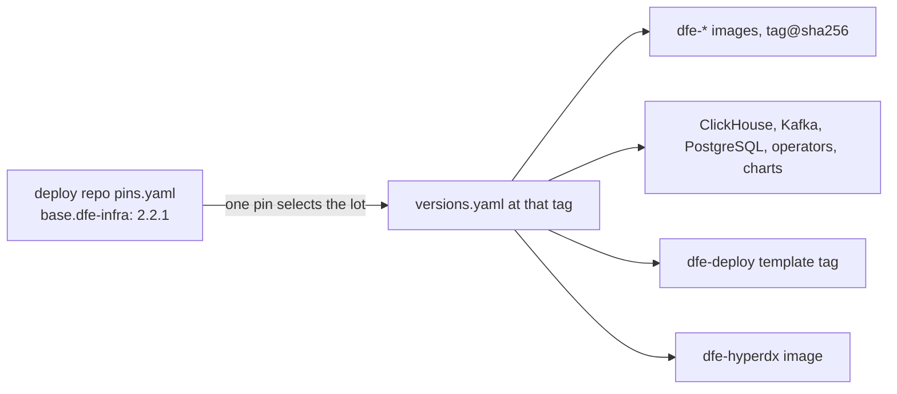

# Stack versioning

DFE is made of independently released parts: the Rust data plane, dfe-engine, dfe-ui, the HyperDX fork, the schemas, the charts and operators, and the deploy-repo template. Nobody should have to reason about that matrix. "DFE X.Y.Z" names one certified set of component versions. A deployment pins one number and gets the whole set, and can move individual components off it, visibly and at its own risk.

## Where the set is defined

`versions.yaml` in dfe-infra is the single source for every pinned version: bootstrap components, operators, data services and every `dfe-*` image. A drift check (`scripts/check_versions_drift.py`) fails the build when a chart, ApplicationSet or bootstrap manifest disagrees with it. A stack release is a dfe-infra tag, so `versions.yaml` frozen at tag `X.Y.Z` is the manifest for DFE X.Y.Z. semantic-release cuts the tag and nobody hand-edits a version number. `dfe-schemas` and `dfe-deploy` carry content rather than images, and they are tagged in step with each stack release and recorded in `versions.yaml` like any other component.



The deploy repo's `pins.yaml` carries `base.dfe-infra`, the one version that selects the stack, and a `channel` (alpha, beta, rc or release). Bumping the pin moves charts, operators and every app image in one reviewed commit and leaves `values/` and `config/` alone ([state and repositories](state-and-repos.md)). There is no `dfe-schemas` pin. The wheel rides inside the engine image, so the engine pin already selects the schema release.

## Overrides and upgrades

A deployment that needs one component ahead of the set, or held behind it, lists it under `overrides` in `pins.yaml`.

```yaml
overrides:
  apps:
    dfe-receiver: "v1.16.0@sha256:..."
```

An override beats the certified manifest, and everything not listed stays on the certified version. It must be a `tag@sha256` digest, and `dfe-stack resolve` rejects a floating tag. `dfe-stack resolve` and dfe-engine at startup both print a support-drift notice for every override. The drift is outside the certified-set guarantee until a later stack release absorbs it, because HyperI tests the manifest combination and not arbitrary cross products. To apply an override, `--emit-values` writes per-service fragments (`image.tag` and `image.digest`, which the thin chart joins into `tag@digest`) that you merge into the service's existing `values/{service}-{instance}-values.yaml`. A new file would become an Argo application of its own.

Each release's `versions.yaml` carries `stack.previous`, the verified from-versions for that release. `dfe-stack graph` derives the whole upgrade graph from those entries, so no graph file needs curating. `dfe-stack check-upgrade --from A --to B` gives the verdict. A declared `previous` list is authoritative for its own release, and otherwise the rule is sequential minors with free patch hops. `stack.upgrade-order` sets the rollout order between component groups: schemas, engine, data plane, then UI. [Upgrades](upgrades.md) walks an upgrade and [rollback](upgrade-rollback.md) undoes one.

Within a minor (2.2.z) patches are cumulative and must not change configs, deprecate APIs, change schemas or break backward compatibility. The support stance is the latest patch of the two most recent minors.

## Cutting a release

Component repositories release on their own lines, each with a semantic-release tag and a GHCR image. A stack release is a `dfe-stack cut` against `versions.yaml` ([cutting a stack](../CUTTING-A-STACK.md)), checked by the drift check and the integrated test suites that drive data from the receiver to ClickHouse, then tagged. On the tag, the `stack-manifest` workflow renders the manifest and a flat image list for air-gap mirroring, then publishes them as a cosign-signed OCI artifact beside the images, so a mirror verifies offline. The deploy tooling's own version is in the manifest, because an unpinned installer makes a build impossible to reproduce. A component can be dropped from the set when keeping it costs more than it is worth, and the release notes say so.

`scripts/dfe-stack` implements the model with these subcommands:

| Subcommand | Does |
|---|---|
| `render` | The rendered manifest: image pins as `tag@sha256`, content repos, everything |
| `images` | The flat DFE-owned image list for air-gap mirroring |
| `graph` | The upgrade graph from the in-file `stack.previous` entries |
| `check-upgrade --from A --to B` | The verdict on an upgrade path |
| `resolve --pins pins.yaml` | The effective component set for a deployment, with support-drift per override |
| `verify` | Compares `versions.yaml` digests with the registry |
| `cut`, `bump-app`, `release-gate` | Cut a stack, move one app, and gate a release |
