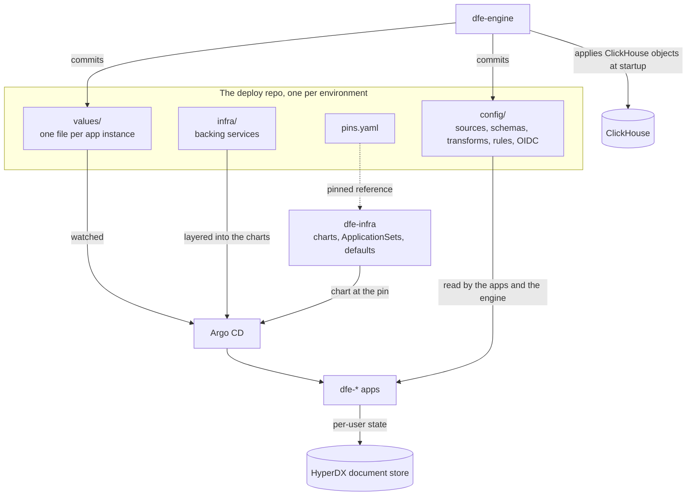

# State, storage and repositories

Where each kind of DFE state lives, and which repository owns it. Two questions decide it. Is the state provided or created? HyperI ships some and must update it cleanly, while the deployment and the engine create the rest and it has to survive those updates, so the two cannot share an update lifecycle. And does it belong in git or a database? A system definition (infrastructure, schemas, transforms, detections) is config-as-code and goes in git for review, rollback and audit. Only per-user UI state goes in a database.

Two rules follow. Config-as-code lives in git, because detection rules trapped in a database are what made Kibana gitops painful and drove the industry to detection-as-code. And the base is referenced by pinned version, never copied in. Updating is bumping the pin in `pins.yaml`, and submodules (CI-fragile) and subtrees (they drift) are not used.

## What lives where

| State | Store | Written by | Survives an update |
|---|---|---|---|
| Charts, ApplicationSets, defaults | dfe-infra at the pinned tag | HyperI | n/a, it is the update |
| Baseline schemas | the `dfe-schemas` wheel inside the dfe-engine image | HyperI | n/a |
| Which apps run, scaling, pod resources | deploy repo `values/` | operators, dfe-engine | yes |
| Backing service settings | deploy repo `infra/` | operators | yes |
| Sources, custom schemas, transforms, rules, hunts, alerts, OIDC | deploy repo `config/` | dfe-engine, analysts | yes |
| Saved searches, dashboards, preferences | HyperDX's document store, no repo | end users | yes |
| Secrets | the secrets store, read through External Secrets | operators | yes |

Mutability has three levels. Read-only core is replaced on update, such as the charts. Read-only core with a scoped read-write surface fixes the shape and lets a bounded set of fields change, such as the node count of a ClickHouse cluster. Read-write is created locally, such as a source definition.

## The repositories

One environment deploys from one repository, its own copy of the [dfe-deploy](https://github.com/hyperi-io/dfe-deploy) template. It references dfe-infra by pin and never vendors it.

The engine writes only the deploy repo, by commit, and never the base. Path-scoped credentials keep a bug from reaching it. `values/` is the only home for an app's Helm values: one `{service}-{instance}-values.yaml` per app instance, where the file's presence enables the app. Operators edit it by pull request and the engine edits the same files. A base update never touches `values/`, `infra/` or `config/`, because provided and created state sit in separate repositories.

`dfe-deploy` is a template and no environment runs from it directly. Each one copies it once and owns the copy, in one of three ways. The default is the bootstrap-seeded in-cluster repo, where bootstrap stands up the bundled Forgejo and creates the deploy repo, so nothing outside the cluster is needed. The others are a forge template copy (GitHub "Use this template", GitLab "new project from template") and a clone at the release tag with `origin` removed and your own remote added.

Never fork it. A fork of a public repository cannot be made private, and the deploy repo carries your environment's configuration. A fork also invites merging template history, when base updates arrive by bumping `pins.yaml`. After instantiation the only coupling to HyperI is the pin ([stack versioning](stack-versioning.md)).

## How state reaches a running app

Every deployed app is an ApplicationSet that fans out one multi-source Application per file under `values/`. The chart comes from dfe-infra at the pinned revision and the deploy repo's instance file is layered last, so it wins over every default. The deploy repo's URL comes from the cluster secret's `dfe.hyperi.io/config_repo_url` annotation, and an app with no instance file yet runs on the chart defaults. Singleton apps (receiver, loader, engine, UI) are one file each, and a per-config app such as the fetcher is one file per instance. Delete the file and Argo prunes the Application.

The apps declare their shape in dfe-infra's `apps.yaml`, which the engine reflects, so the engine learns which dials an app carries without reading chart internals. [Composition](composition.md) lists the default app set per profile.

State reaches a running component by exactly one of three routes.

1. GitOps. `values/` goes through Argo to Kubernetes objects. It is low frequency and auditable, and if the engine is down Argo keeps reconciling the last commit.
2. Hot read. `config/` is read directly by the apps and the engine, with no Argo round trip. The engine applies the ClickHouse objects and the bootstrap Kafka topics itself at startup, from the schema wheel in its image.
3. Application database. Per-user state goes to HyperDX's own store and never to git.

The engine committing to git is sound because the commit becomes the new source of truth. Out-of-band live changes are the anti-pattern, since reconciliation reverts them. The deploy repo's layout, invariants and governed operations are in the dfe-deploy repository's `docs/architecture.md`.
