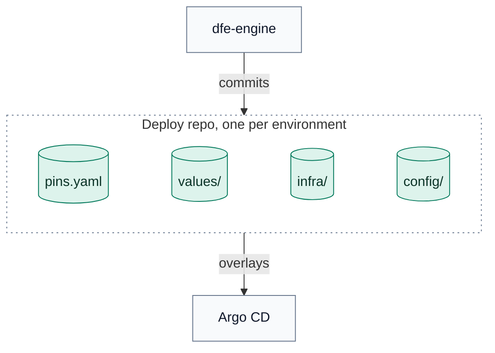

# State, storage and repositories

> **Coming from Splunk or Elastic?** DFE stores rule definitions in the deploy repo's `config/` directory, where git records their changes. Review rule and schema changes as pull requests, and revert the commit to restore the previous definition. A change made live outside git is reverted by reconciliation.

Each kind of DFE state lives in one place and is owned by one repository. Two questions decide where.

Is the state provided or created? HyperI ships some and has to update it cleanly. The deployment and the engine create the rest, and it has to survive those updates. The two can't share an update lifecycle.

Does it belong in git or a database? A system definition is config-as-code and goes in git for review, rollback and audit. Per-user UI state alone goes in a database.

The base is referenced by pinned version, never copied in. Updating is bumping the pin in `pins.yaml`. We don't use submodules (CI-fragile) or subtrees (they drift).

| State | Store | Written by | Survives an update |
|---|---|---|---|
| Charts, ApplicationSets, defaults | dfe-infra at the pinned tag | HyperI | n/a, it is the update |
| Baseline schemas | the `dfe-schemas` wheel inside the dfe-engine image | HyperI | n/a |
| Which apps run, scaling, pod resources | deploy repo `values/` | operators, dfe-engine | yes |
| Backing service settings | deploy repo `infra/` | operators | yes |
| Sources, custom schemas, transforms, rules, hunts, alerts, OIDC | deploy repo `config/` | dfe-engine, analysts | yes |
| Saved searches, dashboards, preferences | dfe-hyperdx's document store, no repo | end users | yes |
| Secrets | the secrets store, read through External Secrets | operators | yes |

Mutability has three levels:

- Read-only core is replaced on update, such as the charts.
- Some supplied definitions allow selected fields to change, such as the node count of a ClickHouse cluster.
- Read-write is created locally, such as a source definition.

## The repositories

One environment deploys from one repository, a copy of the [dfe-deploy](https://github.com/hyperi-io/dfe-deploy) template. It references dfe-infra by pin and never copies it in.

The engine commits into the deploy repo, and Argo CD reads `pins.yaml`, `values/` and `infra/` from it.

*Figure 1. L4 Detail -- The deploy repo.* Up: [L2 Services -- DFE deployment](../architecture.md#where-this-repo-sits-in-the-suite).

`config/` doesn't go through Argo CD: dfe-engine reads it, and the hunt runner's git-sync sidecar pulls its hunts and rules. Per-user state goes to dfe-hyperdx's document store, never to git.

The engine writes the deploy repo alone, by commit, and never the base. Path-scoped credentials keep a bug from reaching it.

`values/` is the one home for an app's Helm values. It holds one `{service}-{instance}-values.yaml` per app instance, and the file's presence enables the app. Operators edit it by pull request and the engine edits the same files. A base update never touches `values/`, `infra/` or `config/`, because provided and created state sit in separate repositories.

`dfe-deploy` is a template and no environment runs from it directly. Each one copies it once and owns the copy, in one of three ways:

- With no `DFE_CONFIG_REPO_URL`, bootstrap stands up the bundled Forgejo and seeds the deploy repo there, so nothing outside the cluster is needed.
- A forge template copy (GitHub "Use this template", GitLab "new project from template").
- A clone at the release tag with `origin` removed and your remote added.

Never fork it. A fork of a public repository can't be made private, and the deploy repo holds your environment's configuration. A fork invites merging template history, when base updates arrive by bumping `pins.yaml`. After instantiation the one coupling to HyperI is the pin ([stack versioning](stack-versioning.md)).

## How state reaches a running app

One ApplicationSet, `layer2-apps`, fans out one multi-source Application per file under `values/`. The chart comes from dfe-infra at the pinned revision and the deploy repo's instance file is layered last, so it wins over every default. The deploy repo's URL comes from the cluster secret's `dfe.hyperi.io/config_repo_url` annotation, and an app with no instance file yet runs on the chart defaults. Singleton apps (receiver, loader, engine, UI) are one file each, and a per-config app such as the fetcher is one file per instance. Delete the file and Argo prunes the Application.

The apps declare how they deploy in dfe-infra's `apps.yaml`, which the engine reflects, so the engine learns which dials an app has without reading chart internals. [Composition](composition.md) lists the default app set per profile.

State reaches a running component by exactly one of three routes:

1. GitOps. `values/` goes through Argo to Kubernetes objects. It's low frequency and auditable, and if the engine is down Argo keeps reconciling the last commit.
2. Hot read. `config/` is read directly by dfe-engine and, through git-sync, the hunt runner, with no Argo round trip. The engine applies the ClickHouse objects and the Kafka topics at startup, from the schema wheel in its image.
3. Application database. Per-user state goes to dfe-hyperdx's store and never to git.

Argo reconciles the engine's commits, and it reverts live changes git doesn't record. The deploy repo's layout, invariants and governed operations are in the dfe-deploy repository's `docs/architecture.md`.
