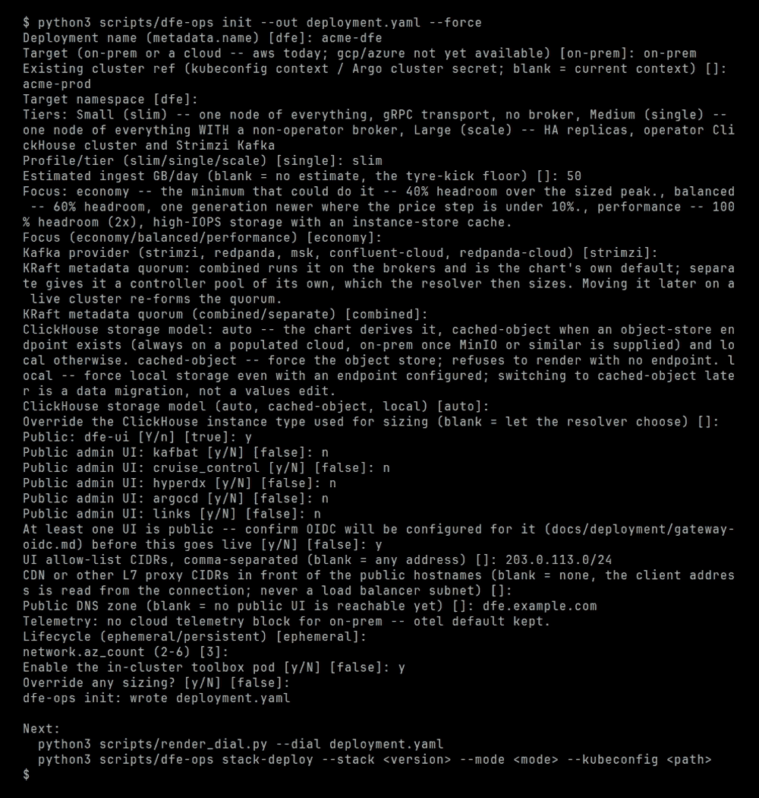

# The deployment wizard -- `dfe-ops init`

`dfe-ops init` walks you through the fields in `deployment.example.yaml` and writes a `deployment.yaml` dial. Defaults come from that file. Every non-trivial answer is checked by calling `render_dial.py`'s or `resolve_sizing.py`'s functions, so there's no second copy of their rules to drift out of step.

```bash
python3 scripts/dfe-ops init                          # interactive
python3 scripts/dfe-ops init --answers answers.env     # non-interactive (CI)
python3 scripts/dfe-ops init --dry-run                 # print the dial, write nothing
```

Every question shows its default in brackets, and Enter takes it. A rejected answer re-prompts with the validator's message.

If any UI is public, answer `y` to the OIDC confirmation. In 2.2.2 a no re-asks the same question until you answer yes, and taking every default ends there, because dfe-ui defaults to public. To keep every UI private instead, answer `n` to dfe-ui and to each admin UI. 2.2.3 keeps every UI private when you answer no.

## A worked example: on-prem Small

One whole run for an existing cluster at the Small tier, with dfe-ui public behind OIDC:



| Question | Answer | Change it for your estate? |
|---|---|---|
| Deployment name | `acme-dfe` | Yes, your own name |
| Target | `on-prem` | No |
| Existing cluster ref | `acme-prod` | Yes, your kubeconfig context, or blank for the current one |
| Target namespace | `dfe` (Enter) | Only if you deploy elsewhere |
| Profile/tier | `slim` | No, for Small |
| Estimated ingest GB/day | `50` | Yes, your estimate, or blank for none |
| Focus | `economy` (Enter) | Optional |
| Kafka provider | `strimzi` (Enter) | No. Small runs no broker, and `strimzi` builds nothing |
| KRaft metadata quorum | `combined` (Enter) | No |
| ClickHouse storage model | `auto` (Enter) | No |
| ClickHouse instance type | blank (Enter) | No. On-prem sizing has no instance type |
| Public: dfe-ui | `y` | No |
| Public admin UIs | `n` to all five | No |
| Confirm OIDC | `y` | No. See the note above |
| UI allow-list CIDRs | `203.0.113.0/24` | Yes, the ranges your users come from |
| CDN or proxy CIDRs | blank (Enter) | Only behind a CDN |
| Public DNS zone | `dfe.example.com` | Yes, your zone |
| Lifecycle | `ephemeral` (Enter) | No. Only the AWS tofu root reads it |
| Availability zones | `3` (Enter) | No. Only the AWS tofu root reads it |
| In-cluster toolbox pod | `y` | Optional |
| Override any sizing? | `n` (Enter) | No |

The same run without prompts, from an answers file:

```text title="onprem-small.answers"
name=acme-dfe
target=on-prem
existing_cluster_ref=acme-prod
existing_namespace=dfe
profile=slim
ingest_gb_per_day=50
focus=economy
clickhouse_storage_model=auto
ui_dfe_ui=y
ui_kafbat=n
ui_cruise_control=n
ui_hyperdx=n
ui_argocd=n
ui_links=n
oidc_confirmed=y
ui_allowed_cidrs=203.0.113.0/24
ui_trusted_proxy_cidrs=
public_zone=dfe.example.com
toolbox_pod_enabled=y
```

```bash
python3 scripts/dfe-ops init --answers onprem-small.answers
```

Both write this `deployment.yaml`. Run it next with `python3 scripts/dfe-ops stack-deploy --stack 2.2.2 --mode slim --kubeconfig <path>`.

<details>
<summary>The deployment.yaml both runs write</summary>

```yaml title="deployment.yaml"
## Written by `dfe-ops init` -- the schema is deployment.example.yaml; do not
## hand-add a field it does not already declare.
apiVersion: dfe.hyperi.io/v1
kind: DeployContext
platform: k8s

metadata:
  name: acme-dfe
  owner: ""
  lifecycle: ephemeral
  ttl: 48h

target:
  existing:
    clusterRef: "acme-prod"
    namespace: dfe

kubernetes_version: "1.36"

network:
  nat: single
  az_count: 3

endpoint:
  public: "false"
  allowed_cidrs: ""

dns:
  private_zone: dfe.internal
  public_zone: "dfe.example.com"
  parent_zone_id: ""

edge:
  enabled: true
  flavour: onprem
  product:
    public: true
    domain: "dfe.example.com"
    tls:
      min_version: "1.2"
      hsts: true
    rate_limit:
      enabled: true
      requests: 6000
      unit: Minute
      scope: local
    allowed_cidrs: "203.0.113.0/24"
    trusted_proxy_cidrs: ""
    waf:
      mode: none
      plan: ""
      managed_rules: ""
  engine_api:
    with_product: true
    path_prefix: /api/v1
    cli_families_public: false
    scim_public: false
  admin_uis:
    external: false
    public:
      kafbat: false
      cruise_control: false
      hyperdx: false
      argocd: false
      links: false
      forgejo: false
    oidc:
      enabled: true
      providers: []
      admin_groups: [dfe-admins, dfe-infra]
  groups:
    ingest:
      enabled: true
      door: gateway
      allow: []
      deny: []
  ingest:
    receiver:
      public:
        serviceType: LoadBalancer
        loadBalancerIP: ""
        loadBalancerClass: ""
        annotations: {}
      vpn:
        podLabel: dfe-culvert
      networkPolicy:
        enabled: true
    tunnel:
      enabled: false
      serviceType: LoadBalancer
      externalTrafficPolicy: Local
      pki_mode: local
      address:
        mode: byo
      admin_peer:
        enabled: false
        ttl_minutes: 60
        peer_cidr: ""
        reach: [22, 443]
    otel:
      enabled: false
      port: 4319
      auth:
        remoteKey: ""
  aws:
    load_balancer_controller: true
    public_zone: ""
    receiver_eips: true
    cloudfront:
      mode: none

toolbox:
  pod:
    enabled: true
    kubeApiAccess: false
    ttlSeconds: ""
  enabled: "false"
  aws:
    shape_ref: toolbox
    operator_role_arn: ""
  ttl_minutes: 60
  session:
    idle_timeout_minutes: 15
    max_duration_minutes: 240
  session_log_retention_days: 90

node_pools:
  system:
    shape_ref: eks-system
    min_size: 2
    max_size: 3
    desired_size: 2
    capacity_type: ON_DEMAND
    disk_gb: 40

telemetry:
  aws:
    sink: otel
    retention_days: ""

sizing:
  ingest_gb_per_day: "50"
  focus: economy
  peak_factor: ""
  avg_event_bytes: ""
  compression_ratio: ""
  hunt_window_days: ""
  archiver_lag_hours: ""
  spend_warn_usd_month: ""
  allow_undersized: "false"
  storage_model: auto
  overrides: {}

kafka:
  provider: strimzi
  controller_pool: combined

state:
  bucket: ""
  key: dfe/test/aws.tfstate
  region: ""

tags:
  service-name: dfe
  service-namespace: dfe
  environment: test
  owner: ""
  cost-center: ""
  lifecycle: ephemeral

registry: ghcr.io/hyperi-io

version:
  pin: 2.2.2

profile: slim

steps:
  provision: "false"
  layer1: "true"
  layer2: "true"
  ddl: "true"
  smoke: "true"

secrets:
  backend: openbao
  ref: ""

overlay: ""

retention:
  default_ttl_days: 90

k8s:
  env: local
  cloud: local
  region: local
  domain: ""
  storage_class: local-path
  repo_url: ""
  target_revision: main
  workload_identity_annotations: "{}"
  load_balancer_type: ""
  config_storage: ""

endpoints:
  clickhouse_host: ""
  kafka_bootstrap: ""
  otel_endpoint: ""
  vault_addr: ""
```

</details>

The screenshot regenerates from `images/wizard/onprem-small.tape` with [VHS](https://github.com/charmbracelet/vhs).

## The nine questions: target, tier and Kafka

1. Target. `on-prem` (an existing cluster) or a cloud. `aws` is the one cloud with a tofu root, so `gcp` and `azure` are named and rejected. A cloud target asks the AWS account, region and VPC CIDR.
2. Profile/tier, ingest, focus. The three Kubernetes tiers are labelled Small/Medium/Large for the prompt. The real dial value is `slim`/`single`/`scale` (see `scripts/profiles.py`). Estimated ingest is in GB/day, and blank means "no estimate" (the tyre-kick floor `resolve_sizing.py` reports rather than targets). Focus is `economy` (default, 40% headroom), `balanced` (60%) or `performance` (100%, high-IOPS storage), straight from `sizing/sizing.yaml`'s `focus:` table.
3. Kafka provider and quorum. One of `strimzi`, `redpanda`, `msk`, `confluent-cloud`, `redpanda-cloud`, pre-selected by tier: `msk` on AWS Small/Medium, `confluent-cloud` at Large, `strimzi` on-prem. `msk` asks the broker count. An in-cluster broker asks `kafka.controller_pool` as well. `combined` (the default, and the chart's) keeps the KRaft metadata quorum on the brokers, and `separate` gives it a sized pool. Moving it on a live cluster re-forms the quorum, so `sizing.yaml` locks it as `controller_mode`.

## Storage, exposure and the rest

4. ClickHouse storage model. `sizing.storage_model` defaults to `auto`, where the chart derives it from whether an object-store endpoint exists. `cached-object` forces the object store and fails the render without one. `local` forces local storage even with one configured. Switching later is a data migration, not a values edit ([storage.md](storage.md)). The wizard offers the one other lever on ClickHouse sizing: an instance-type override.
5. Public UIs, OIDC, CIDR, DNS. `dfe-ui` is public by default and every admin UI is opt-in, one at a time. The moment any UI is public, the wizard asks you to confirm OIDC will be wired up for it ([gateway-oidc.md](gateway-oidc.md)) and won't continue without that. The dial's `edge.admin_uis.oidc` holds the switch and no providers, which go in the deploy repo's overlay, so this is a wizard-side gate, not a renderer validation. Then comes an optional CIDR allow-list, any CDN's ranges, and the public DNS zone name. The answers land in the dial's `edge:` block: `dfe-ui` under `edge.product.public` and the admin UIs under `edge.admin_uis.public.*`. That one block replaced the old top-level `ui:` and `ingest:`.
6. Telemetry sink. AWS alone. `otel` is the default (DFE's policy). `cloudwatch` is opt-in and asks for a one-line reason, which lands as a comment beside the field.
7. Lifecycle and AZ count. `ephemeral` or `persistent`, and `network.az_count` (2-6, default 3).
8. Toolbox. The in-cluster pod (any target) and, on AWS, the on-demand SSM-managed instance. Both are opt-in, and the instance asks for the operator IAM role ARN once enabled. See [toolbox.md](toolbox.md).
9. Sizing overrides. "Override any sizing?" When you say yes it walks the documented workload names and their fields (cpu, memory, disk_gb, replicas, instance_type, iops, throughput_mibs), checked by the exact function a hand-edited dial is checked against.

## What it writes, and what it leaves blank

The template ships some estate-specific fields blank on purpose: `k8s.repo_url`, `state.bucket`, `state.region`, `tags.owner`, `tags.cost-center`. They stay blank. The operator's tooling injects them from the deployment's secrets backend at deploy time, or an operator fills them by hand. `dfe-ops init` names them in its final output on an AWS target.

## Sizing

Pass `--fixtures <dir>` (captured API answers, `scripts/resolve_sizing.py capture`) or `--live` and, once the dial is written, `dfe-ops init` runs `scripts/resolve_sizing.py resolve` against it. It prints the report path plus the total-compute line, a cost bucket and no figure. That happens for the `scale` tier alone, because `resolve_sizing.py` sizes the scale tier alone. Every other profile is skipped with a one-line note rather than a crash.

Non-interactive mode: `--answers PATH` reads a flat `key=value` file (`envfile.py`, the same reader `bootstrap/.env` uses, so no YAML lists) and drives the identical flow with no prompts. An answer that fails validation stops the run at once, since there's nobody to re-ask. CI and `scripts/tests/test_dfe_ops_init.py` use it to exercise the wizard without a terminal. `--dry-run` prints the resulting dial and writes nothing, so you can preview an answers file before it lands.

Related:

- [../../deployment.example.yaml](../../deployment.example.yaml) -- the schema this wizard walks, where every field and default traces back
- [../../scripts/render_dial.py](../../scripts/render_dial.py) -- the validators the wizard calls, and what reads the written dial
- [README.md](README.md) -- the three layers and the values cascade
- [toolbox.md](toolbox.md) -- the two troubleshooting surfaces question 8 asks about
- [gateway-oidc.md](gateway-oidc.md) -- what question 5's OIDC gate is asking you to configure
