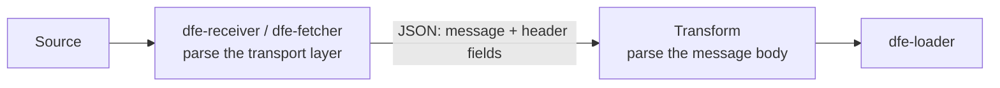

<!--
  Project:      dfe-infra
  File:         docs/design-principles.md
  Purpose:      Fleet-level design principles for the DFE suite
  Language:     Markdown

  License:      BUSL-1.1
  Copyright:    (c) 2026 HYPERI PTY LIMITED
-->

# Design principles

These are the rules every DFE app follows. Short version here, with a link to the long version where there is one.

## Land it all, then tune what pays

DFE takes whatever you send it. Real source data is messy and changes without warning, so we don't reject what we don't recognise, and we don't ask a supplier for a data contract. Nothing gets dropped.

Index engines will take a field you never mapped too, but it has a cost: unplanned fields grow the index and the infrastructure under it, and everything slows down. DFE stores a field with no mapping yet in automatic typed columns that perform well by default.

So schema work happens in two steps, and every DFE app and doc follows them:

1. Land it all. Everything works from the first event, and it's already faster than the same data in an index.
2. Put schema effort only where it pays you back. Promote a field in the meta schema (`dfe-schemas`) and new records land in its own column, while older ones stay readable where they were. Tighten its definition, such as type and cardinality. Add an index by naming the search you need (exact match, word search, substring or key search), and DFE picks and maintains the right ClickHouse index.

Schema work makes things faster. It never decides what gets in, and nothing that already works breaks while you tune.

That's also how you move to DFE. Point your existing feeds at it, dfe-transform-elastic takes Elastic feeds as they are, and you have "it works" on day one. Improve from there. More in [coming from Splunk, Elastic or a Lakehouse](../docs-site/content-root/coming-from.md#nothing-breaks-when-a-source-changes).

## Your cluster, your choice of parts

DFE runs on any standard (CNCF-conformant) Kubernetes and assumes nothing special about it. Whatever the stack needs, it brings. No cluster? We build RKE2.

Every big piece is a config choice, not a code change: DNS, the certificate authority, the secrets store, Kafka, ClickHouse, the document store, the load balancer, the deploy repo. Want MSK instead of in-cluster Kafka, or ClickHouse Cloud instead of our own? Change the config. We never fork a chart to do it, and a part only one provider can supply is a bug. The full list is in [architecture](architecture.md#swappable-components-the-modularity-contract). A new dependency goes in that table before it merges.

Nothing about your deployment is baked in. No hostnames, credentials or cluster ids in the product. No instance types, counts, volume sizes or retention as literals in OpenTofu either. They come from tfvars, and `scripts/check_tofu_literals.py` fails the build if one sneaks in ([terraform/README.md](../terraform/README.md)).

Each shared setting lives in one place. Versions go in `versions.yaml`, every other shared setting in `argocd/values/common.yaml`. Find the same fact in two places and we merge them.

## dfe-engine owns the schema

Only dfe-engine creates or changes ClickHouse databases, tables, views and roles, and Kafka topics. The definitions live in `dfe-schemas` and the engine applies them when it starts. Our charts, scripts and OpenTofu run the clusters but never touch what's inside them, and `scripts/tests/test_engine_only_schema_control.py` fails the build if they try. More in [architecture](architecture.md#schema-and-topics-dfe-engine-is-the-only-controller).

## Parse once, at the right layer

Two kinds of parsing, two places.

The predictable stuff happens at the first hop, in dfe-receiver and dfe-fetcher, as fast as we can make it. That's the transport layer: the syslog header, the beats or HEC envelope, OTLP framing, a fetched API's record framing. Out comes JSON, with the payload in `message` and the header fields beside it.

The messy stuff happens downstream in the transforms (dfe-transform-elastic, dfe-transform-vrl, dfe-transform-vector). Running a vendor's message body through grok, dissect or a pipeline is their job. They read `message` and the header fields.

If the first hop gets a record wrong, fix it there. Turning on raw capture downstream to work round it isn't a fix.

Example: dfe-receiver #212. The RFC 3164 tag split takes non-tag text as the app name and cuts `message` short for tagless PAN-OS and IOS millisecond timestamps. The fix belongs in the receiver, and dfe-transform-elastic keeps reading the parsed fields.

## JSON out, raw only where it's worth it

Every DFE inbound service, today's receiver and fetcher or any we add later, turns the standard machine formats into JSON at the edge. We don't keep a second copy of the original inside the JSON. No `event.original`, no `log.original`, no full body parked next to the fields parsed out of it.

The original bytes go in `_raw`, and that's off by default, always. Keeping them doubles every record, to write and to read. So `_raw` is opt-in per source, and only offered where you actually need the original:

- a SIEM wants to parse the native format itself
- a relay forwards it unchanged
- evidence has to be byte-exact
- a fixed parser needs the original to re-parse

It's never the normal input to a transform, and never on in a demo.

| Inbound | `_raw` offered? | Why | What `_raw` holds |
|---|---|---|---|
| syslog RFC 3164 | yes | No fixed format, so parsers guess, and a corrected parser needs the original. | the whole line, PRI and header included |
| syslog RFC 5424 | yes | Vendor payloads vary and the header gets normalised. | the whole line |
| CEF / LEEF over syslog | yes | Sentinel, QRadar and Google SecOps work from the original line. Parsing loses unmapped extensions. | the whole line |
| Splunk HEC `/raw` | yes | The body is the event, and Splunk TAs parse `_raw`. | the request body as sent |
| Splunk HEC `/event` | no | The JSON envelope is already the data. | |
| lumberjack / beats | no | The vendor line is parsed into `message`. `event.original` is not kept. | |
| OTLP | no | The JSON carries the same data as the protobuf. | |
| GELF, Fluent forward, HTTP JSON | no | Already JSON, or msgpack of the same structure. | |
| NetFlow v5 | no | The fixed layout makes the parsed record lossless. | |
| NetFlow v9 / IPFIX | no | Raw packets decode only with the exporter's template state, so the template-resolved record is kept. | |
| sFlow | backlog | The sampled packet headers are binary evidence. It's on the backlog, to add if someone asks for it. | |
| fetcher: M365, Entra, Okta, GitHub, CloudWatch | no | The APIs return JSON with no vendor digest to check bytes against. | |
| fetcher: CloudTrail | not per event | Integrity validation hashes the whole log file, so evidence lives at file level in the S3 trail. | |

Where the table comes from, checked 2026-11-03:

- RFC 3164: https://www.rfc-editor.org/rfc/rfc3164.html
- Google SecOps re-parse from raw: https://docs.cloud.google.com/chronicle/docs/event-processing/reparse-historical-data
- CloudTrail log file validation: https://docs.aws.amazon.com/awscloudtrail/latest/userguide/cloudtrail-log-file-custom-validation.html
- NetFlow template state: https://docs.elastiflow.com/additional-resources-reference-articles/faq/flow_template_not_received
- NIST SP 800-92: https://nvlpubs.nist.gov/nistpubs/legacy/sp/nistspecialpublication800-92.pdf

## The hot path: zero copy, SIMD, batches

At PB/day the hot path is VERY sensitive to parse cost. A regex per field, a String per value, a map per record. Each one is small. Times a few billion records a day it isn't.

So three things are core design in every app that touches records, not tuning done later:

- Zero copy. Parse over borrowed slices of the buffer the bytes arrived in. Copy only what the output has to own.
- SIMD. Find delimiters, quotes and newlines with vectorised byte search (memchr and friends), never a regex or a byte-at-a-time loop.
- Batches. Per-call overhead is paid once per batch, buffers are reused across it, and SIMD gets long runs to work on.

Other people's parsers give us ideas, not code or patterns. Most open source parsers we've looked at, GPL and LGPL ones included, don't work this way. They don't need to. They're built for one host's stream or one analyst's file, where a regex or a clone per event costs nothing anyone notices. At mega scale those same patterns are the bottleneck.

Example: dfe-receiver #238 (auditd) takes its edge cases from Laurel and its design from here.

## Break the parser down by usage pattern

> If you want to spot an at scale amateur, look for a regex or grok on the hot path. -- Derek

Most people speed up parsing by swapping in a faster regex engine, or by writing one parser per log format. We don't. We look at which patterns real data actually uses, then pull each one apart.

1. Count. Rank every pattern in a real corpus by how often it's hit. In dfe-transform-elastic one `%{GREEDYDATA}` form is 202 of the 4,299 grok call sites, so one native parser covers 4.7% of them.
2. Break it down. Go through each pattern a capture at a time. Every capture has a native parser? Use them. Only some? Chain those with the literal text in between. Whatever's left goes to a DFA ('the regex compiled ahead of time into a state machine').
3. Prove it. Every native form ships with a test that it gives the same answer as the regex, and a benchmark that it's faster.

dfe-transform-elastic took about 2 years to get here, and so far its dispatch wires three whole-pattern forms. The same approach goes for every hot-path parser in the suite: receiver, fetcher, auditd, the lot.

The real lessons are in the detail, because a regex and its fast version don't line up one-to-one:

- `%{GREEDYDATA}` looks like "the rest of the line". Under joni's line anchoring it is the FIRST line, so its native form is a newline scan. 11 ns against 1,098 ns.
- `%{DATA}` reads the same but is lazy. On a `\r\n` ending it stops before the `\r` where greedy keeps it, so it can't share that native form.
- A near-miss stays on the regex. Literal text around the captures is what the regex engine is good at, so the native dispatch refuses rather than guesses.
- Every native form ships with an equivalence test that runs both paths over the same inputs. The native path is an optimisation over the regex, never a rewrite of its meaning.
- "Fast" crates get measured, not trusted. simd-json lost to serde_json on this workload, on both paths.

Where it lives in dfe-transform-elastic:

- `docs/parsers.md`: the three layers, and what is wired against what exists.
- `docs/performance.md`: the techniques, the targets and the libraries.
- `crates/dfe-parse/`: the parsers. `crates/dfe-parse/benches/parsers.rs`: each one against its regex.
- `scripts/pattern_reach.py`: pattern reach across the generated tree.

A new hot-path parser gets benchmarked against a regex baseline before it merges. A native parser that more than one app needs moves into scalo-rs.

## Put the work close to what it's working on

Every job runs at the layer that does it cheapest, so nothing pays twice.

Bad records go at the first layer that can catch them: Edge Stream Hub at the edge, then dfe-receiver, the transforms and dfe-loader. ClickHouse stores only what survives. Index engines and ELT are the worst offenders. They dump everything into the engine and fix it there, so every bad record, parse and transform lands on the most expensive part of the stack. ETL does better, working in stream on the way in, but it's still one general-purpose step for everything.

dfe-receiver takes a microsecond to parse a syslog line (https://github.com/hyperi-io/dfe-receiver/blob/main/docs/performance.md). dfe-transform-elastic parses vendor bodies in compiled Rust, with up to 5x less CPU than Elasticsearch ingest for the same ECS fields, same data, same enriched output. dfe-loader reflects the destination schema from `system.columns` and coerces types against the real column, not a guess made upstream (https://github.com/hyperi-io/dfe-loader/blob/main/docs/README.md). Common remaps and renames run in the loader too, in bulk while the data loads, with no separate ETL hop.
