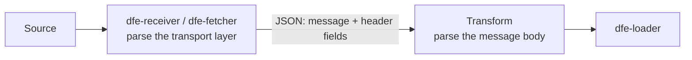

<!--
  Project:      dfe-infra
  File:         docs/design-principles.md
  Purpose:      Fleet-level design principles for the DFE suite
  Language:     Markdown

  License:      BUSL-1.1
  Copyright:    (c) 2026 HYPERI PTY LIMITED
-->

# Design principles

Rules that hold across the whole suite. Each app's own design doc says how it applies them.

## Parse once, at the right layer

Mechanical, predictable parsing happens at full efficiency at the first hop, in dfe-receiver and dfe-fetcher. They parse the transport layer into JSON: the syslog header, the beats or HEC envelope, OTLP framing, a fetched API's record framing. The payload goes in `message` and the parsed header fields sit beside it.

Conditional parsing of large text blobs happens downstream, in the transforms (dfe-transform-elastic, dfe-transform-vrl, dfe-transform-vector). A vendor's message body run through grok, dissect or a pipeline is their job. They read `message` plus the parsed header fields.

Raw capture (`_raw`, the bytes as they arrived) is off by default, always. Producing and consuming it doubles every record. It is an operator fallback, turned on per source only where needed. It is never the normal input to a transform and never a demo default.

A record parsed wrongly at the first hop is fixed in the receiver or fetcher. Turning raw capture on downstream to work round it is not a fix.

Example: dfe-receiver #212. The RFC 3164 tag split takes non-tag text as the app name and cuts `message` for tagless PAN-OS and IOS millisecond timestamps. The fix belongs in the receiver, and dfe-transform-elastic reads the parsed fields.
