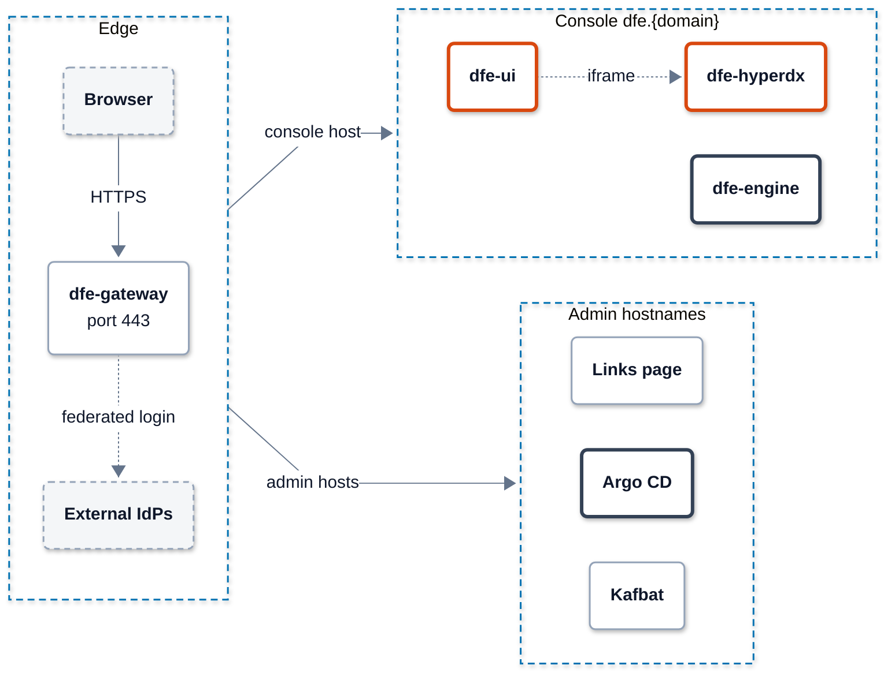
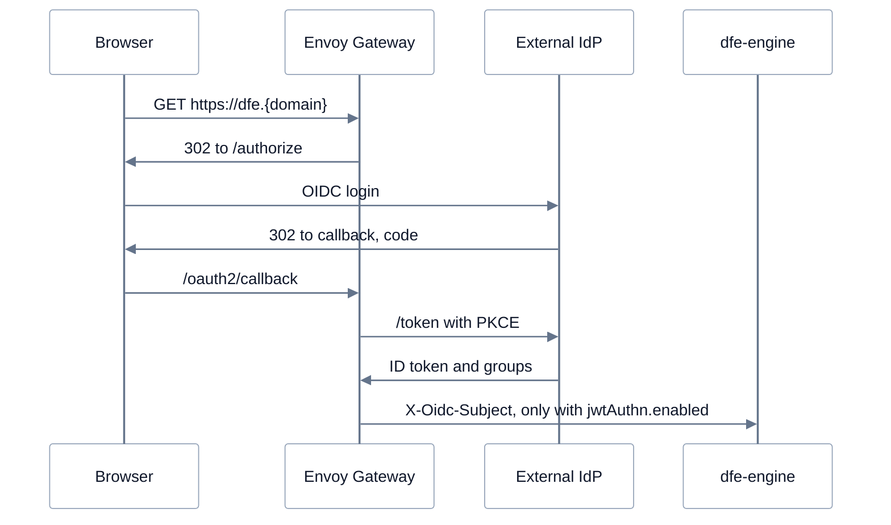

# Edge exposure and authentication

Internet-facing exposure on a cloud deploy (CIDR, rate limit, WAF, DNS): [edge-auth-cloud.md](edge-auth-cloud.md).

Every web UI with a login of its own is exposed through the Envoy Gateway by default. One without a login renders behind edge OIDC alone. Access is controlled by OIDC.

There's no bundled issuer. dfe-engine is the identity authority. It holds the local account store and maps every identity to roles and org_ids. Federated login rides external OIDC providers configured at the Envoy edge (generic OIDC: Entra, Okta, Google, Keycloak, or any conformant IdP, dex included where a deployment runs one). dfe-engine mints machine tokens (API keys plus engine JWKS) for services, with an audience disjoint from human sessions.

Edge OIDC is off by default. A vanilla deployment does LOCAL login through dfe-ui against the engine's account store, so it's exposed and authenticated with no external IdP required. To federate, turn on one or more providers as a Helm values change (`oidc.providers`). Each gets an Envoy `SecurityPolicy` on the dfe-engine route.

Local accounts follow the tier. At SME they're the daily driver. At enterprise they're BREAK-GLASS ONLY (an ops-managed random secret, deliberately MFA-free, because break-glass exists for when the IdP is down) and every other user federates. MFA always comes from the federated IdP, never locally. SAML IdPs are unsupported because the mainstream connectors are unmaintained upstream. Use their OIDC face.

Identity data stays OUT of the git CRUD cycle. Accounts live in the engine's account store (a mongo-wire document store or the YAML backend), role bindings in the engine's runtime store, and git holds deployment config alone (provider issuer URLs, client refs). Roles remain product vocabulary in code.

Port-forwarding is the debug fallback, not the product access path. It works on any deployment (it needs kubectl and nothing else), but nothing in the product assumes it.

## Exposure topology

One Gateway fronts the whole HTTP plane. Each UI gets a hostname under the deployment's `domain`. The route lives in the backend's namespace, so the parentRef alone crosses namespaces and no ReferenceGrant is needed. The gateway LB type/class is swappable per deployment (`envoyGateway.service` values).

The one Gateway routes each hostname to its backend, and sends a federated login out to the IdP.

*Figure 1. L4 Detail -- Edge exposure.* Up: [L2 Services -- DFE suite](architecture.md).

Dashed boxes are external. A dotted arrow is optional: the IdP hop runs when a provider is configured, and dfe-ui frames dfe-hyperdx from its route on `hyperdx.{domain}`. Local login is dfe-ui asking dfe-engine's account store.

- The plaintext `:80` listener has exactly one route: a 301 redirect to `https`. Every other `HTTPRoute` in the chart pins `parentRefs[].sectionName: https`, so nothing else can attach to `:80`. Without that, a `:80` request gets a 404 instead of a redirect to TLS, and on an internet-facing Gateway an admin UI's Host header reaches the cluster in cleartext with no certificate warning.
- dfe-ui is always the landing page, with dfe-hyperdx embedded as an iframe inside it. The gateway publishes `hyperdx.{domain}` (`httproute-hyperdx.yaml`) as the iframe's source, and its CSP lets the dfe-ui origin frame it.
- The links page is a convenience launch pad for admins (see below), never a landing page.

Per-surface OIDC behaviour (Kafbat, dfe-engine's browser vs machine paths, and the rest) is in [Per-surface policy](#per-surface-policy) below.

## The identity plane: engine authority + external OIDC

There are two browser login paths, and both resolve to the same engine-owned identity:

- Local (default). dfe-ui serves a login form and authenticates the user against the engine's account store.
- Federated (opt-in). The Envoy edge fronts the dfe-engine route with a `SecurityPolicy` per configured external OIDC provider. Adding or removing a provider is a Helm values change plus an ArgoCD sync, never a dfe-engine API call.

In a federated login Envoy is the OIDC client and checks the groups claim itself. With `jwtAuthn.enabled` (off by default), dfe-engine receives the subject header alone, because Envoy Gateway can't forward the array `groups` claim as one. With it off, no claim header reaches the engine.

*Figure 2. L4 Detail -- Federated login.* Up: [L2 Services -- DFE suite](architecture.md).

The local login, the default, is three steps: dfe-ui shows a form, dfe-engine checks the credentials against its account store, and dfe-engine returns the session in the `dfe_token` cookie.

Envoy denies by default: a token must pass the provider's JWKS and the route's group policy. The edge policies match on the `groups` claim, but it never reaches dfe-engine: `jwtAuthn` is off by default (`helm/edge/gateway/values.yaml`), and with it on Envoy forwards `X-Oidc-Subject` and no groups header, because `claimToHeaders` takes no array claim. So a federated user gets roles and tenancy (`org_viewer` -> pinned ClickHouse identity) only through an account an administrator links to a group by hand ([gateway-oidc.md](deployment/gateway-oidc.md#x-oidc-groups-cant-be-minted)). Local users have no groups either, so the engine grants their roles through per-user bindings.

## Route class, and the switches that reach it

Every route has its class as data (`routes.<name>.class`), and the class decides which switch can turn it off.

| Class | Exposure group | Routes | What can disable it |
|---|---|---|---|
| `product` | `console` | dfe-ui, dfe-engine (browser families), dfe-hyperdx | `exposure.groups.console.enabled: false`, then the route's `enabled` |
| `api` | `api` | dfe-engine-cli (CLI families, `/openapi.json`, SCIM) | `exposure.groups.api.enabled: false`, then the route's `enabled` |
| `infra` | `admin` | Argo CD, Forgejo, Kafbat, links, Cruise Control | `exposure.groups.admin.enabled: false` first, then no login in front of it, then its backend not deployed, then the route's `enabled` |
| `ingest` | `ingest` | otel, receiver | the route's `enabled`, and no UI switch reaches it |

Each group has the `allow` and `deny` lists its routes admit by address ([edge-auth-cloud.md](edge-auth-cloud.md)). Every web UI with a login renders by default, through a five-step cascade where the first match wins:

1. Class `product`, `api` or `infra` with its group's `enabled: false` means not rendered.
2. Class `infra` with `ownLogin: false` (links, Cruise Control) means not rendered unless the edge policy is in front of it: `oidc.enabled`, an `oidc.providers` entry and `edgePolicy: true`.
3. A backend another chart has not deployed means not rendered: Cruise Control off the Kafka cluster tier, Forgejo unless `deployRepo.bundled` (the `dfe.hyperi.io/bundled-deploy-repo` cluster label).
4. `routes.<name>.enabled: false` means not rendered.
5. Otherwise rendered.

A public flag on a route with no login of its own (`exposure.groups.admin.tools.links: true`) and no edge OIDC fails the render by name, rather than serving the route behind a policy of CIDRs alone. Under Argo CD that leaves the gateway Application in ComparisonError until the flag is removed or a provider is configured.

`exposure.groups.admin.enabled` is the one flip that takes every ops surface off the edge. A route's `enabled: true` doesn't override it, and the switch withdraws their edge policies as well. It never touches dfe-ui, the engine API or dfe-hyperdx. `exposure.groups.admin.tools` is the one list of admin UIs, one key per class-infra route.

On a cloud deploy with an internet-facing Gateway Service, this defaults off instead. See [edge-auth-cloud.md](edge-auth-cloud.md).

The `exposure:` key is shared with the dfe-receiver chart, which reads `exposure.groups.ingest` for its ingest door and `exposure.public` for its load balancer's settings. One block per deployment, each chart reading the keys it owns.

## Per-surface policy

| Surface | Hostname | Class | Exposed by default | Edge policy |
|---|---|---|---|---|
| dfe-ui (+ dfe-hyperdx iframe) | `dfe.{domain}` | product | yes | local login by default, OIDC when a provider is configured |
| dfe-engine browser paths | `dfe.{domain}/api` interactive | product | yes | OIDC when configured, machine paths API-key/JWT, never redirected |
| Argo CD | `argocd.{domain}` | infra | yes | edge OIDC + group check, Argo signs in through the same provider, `dfe-admins` and `dfe-infra` -> admin, `dfe-infra-viewers` -> read-only ([gateway-oidc.md](deployment/gateway-oidc.md#argo-cds-own-login)) |
| Links page | `links.{domain}` | infra | only behind edge OIDC | edge OIDC + group check, no auth of its own |
| Cruise Control UI | `cruise-control.{domain}` | infra | only behind edge OIDC, Kafka cluster tier | edge OIDC + group check, no auth of its own |
| Forgejo (bundled fallback) | `git.{domain}` | infra | only where bundled | edge OIDC + group check |
| Kafbat | `kafbat.{domain}` | infra | yes | its own OIDC (integrated-app pattern) -- group check is app-side |
| dfe-hyperdx | `hyperdx.{domain}` | product | yes | its own PEP on the `dfe_token` cookie -- group check is app-side |
| otel OTLP ingest | `otel.{domain}` | ingest | no (`otel.ingress.enabled`) | the ingest group's lists, then a bearer token checked by the collector |
| dfe-receiver ingest | `receiver.{domain}` | ingest | on-prem only (`exposure.groups.ingest.door: gateway`) | the ingest group's lists, then the receiver's own `server.auth`, restated as `routes.receiver.authMode` (`header` or `bearer` when internet-facing) |

The gate on an infra route is a deny-by-default Envoy `SecurityPolicy` with three blocks that work together and not apart. `oidc` logs the user in and mints a per-route access-token cookie. `jwt` re-validates that cookie against the provider's JWKS. `authorization` needs the `groups` claim to name one of `adminGroups` (`argocd/values/common.yaml`, names from dfe-engine `docs/control-plane/rbac-vocabulary.md`, default `dfe-admins`, `dfe-infra`). A token with no groups claim is refused. Per-route cookie names stop a session minted on one infra host being replayed on another.

Kafbat and dfe-hyperdx are exempt from the EDGE gate and check groups app-side instead. Kafbat runs its own OIDC against the same provider, and dfe-hyperdx can't complete an interactive redirect inside the dfe-ui iframe. Kafbat stays class `infra`, under the kill switch. dfe-hyperdx is class `product`, beside the console that frames it.

Gating Forgejo closes git-over-HTTP from OUTSIDE the cluster. Nothing in the product needs that, because Argo CD and dfe-engine reach the deploy repo on its in-cluster Service DNS.

Public hostnames on a cloud deploy, the render guard, CIDR, rate limit, WAF and DNS specifics: [edge-auth-cloud.md](edge-auth-cloud.md).

## The ingest edge

Data ingest is a second door with a separate model, the ingest exposure group `exposure.groups.ingest`. On a cloud the door is the receiver's load balancers, which render once `allow` names the senders, so a default deploy has no public ingest. On-prem the door is the gateway route on `receiver.{domain}`, HTTP `/ingest` alone. The receiver's `server.auth.mode` defaults to `none` on either door. See [ingest-edge.md](ingest-edge.md).

## The links page

A bundled static launch pad answering "where is everything?" for admins: every surface the deployment exposes, with reachability dots. It renders from the same GitOps values that deploy the services, so the sync that moves a URL re-renders the page. Admins alone at the edge. On an undomained rig it falls back to the port-forward layout.

The gateway publishes the admin UIs it renders as ConfigMap `dfe-admin-links` (key `admin_links.json`) in the app namespace, and the engine reads it as `DFE_ENGINE_ADMIN_LINKS`. The list comes from the same exposure cascade as the routes, so an infra route that does not render is not listed, and each entry has the route's hostname and its backend Service as the probe. Every infra route that renders must have `adminLink` with a `name` and a one-line `purpose`, and one without fails the render by name. The engine reads the variable at startup alone, so a list created after the engine started lands on its next restart.

`argocd/bootstrap/envoy-gateway-app.yaml` installs the operator and CRDs, and `envoy-gateway-config` configures it.
