<!--
  Project:      dfe-infra
  File:         docs/suite-graph.md
  Purpose:      The DFE suite as a graph - which repos are members, what each
                one is to an outside reader, and what moves when one of them
                releases. The human view of suite.yaml; the diagrams are
                generated from it and checked against it.
  Language:     Markdown
  License:      BUSL-1.1
  Copyright:    (c) 2026 HYPERI PTY LIMITED
-->

# The DFE suite graph

Three files at the root of this repo, one question each:

- `versions.yaml` - which VERSION of each thing a stack pins.
- `apps.yaml` - what KIND of app each deployed workload is.
- `suite.yaml` - which REPOS are ours, what each one IS, and what MOVES when one of them releases.

`suite.yaml` carries no version literal, so it can never become a second place to look a pin up. Membership is declared there and nowhere else, so a repo absent from the file isn't a member, whatever its name. The test is release authority: if we don't cut its releases, it's not in.

The diagrams on this page are generated from `suite.yaml` by `scripts/dfe-stack suite --render-docs` and compared against it by `scripts/check_suite_drift.py`. Edit the file, not the diagrams. The two overview blocks deviate from the diagram standard's generated-diagram rule 5, which asks for a membership table at this size, until the standard says otherwise.

That drift check has two halves. The in-repo half (structure, the charts, the pins, these diagrams) is binding wherever it runs. The cross-repo half reads each member's own cited file and its `Cargo.lock` and `uv.lock`. On a bare checkout with no member clones beside it, which is what CI has, that half is SKIPPED and says so. Run it on a box with the clones on disk and it gets checked, and `--strict` there turns a skip into a failure.

The lock files catch an edge nobody drew. A member whose lock resolves a producer's `package` with no edge from that producer fails the check. A node marked `unconsumed` warns when a lock resolves its package anyway, so its note stops claiming no member uses it.

## Reading a node

Each node is one repo we own and release. It declares what it is (`role`), who it's for (`audience`), what it ships (`artefacts`, each with its own `public` flag), and its licence and classification. `licence` is what the repo itself states, and `none-declared` there is a reading of the repo, not an omission in the graph. `classification` always has an answer, and `classification_source` says which rung gave it: `in-repo` for a marker in the repo itself, `org-property` for the hyperi-io custom property that answers when the repo declares nothing.

`audience` is the tag written for the reader we'll have at OSS GA:

- `general` - stands alone. Someone with no DFE deployment can install it and get value. scalo-rs, factbook-rs, scalo-py, logreducer, vector-vrl, dfe-clickhouse-rs, and culvert, the optional VPN.
- `suite` - only makes sense inside a DFE deployment.

It's kept apart from whether the artefact is public, because those come apart: dfe-schemas publishes to PyPI for anyone to install and is useless outside DFE.

## The members

Colour says what a box is, the same as on every other DFE diagram. Receiver and fetcher are teal, transforms purple, loader and archiver blue, UIs orange, and the engine, deploy repos and infra slate. Schemas are green, and libraries and other services are grey. Audience is in the list above, not the colour. A box that is optional says `optional` under its name.

The services are mostly Rust, with dfe-engine and the optional culvert the two in Python.

<!-- suite-graph:begin overview:services -->
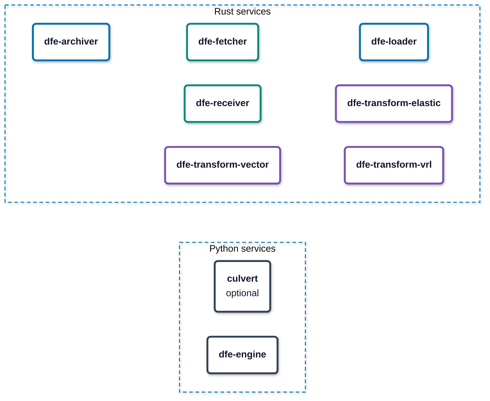
<!-- suite-graph:end overview:services -->

*Figure 1. L4 Detail -- Suite overview, services. Boxes group the services by language.* Up: top of dfe-infra.

Everything that is not a service is a library, a piece of infra, content or a UI.

<!-- suite-graph:begin overview:platform -->
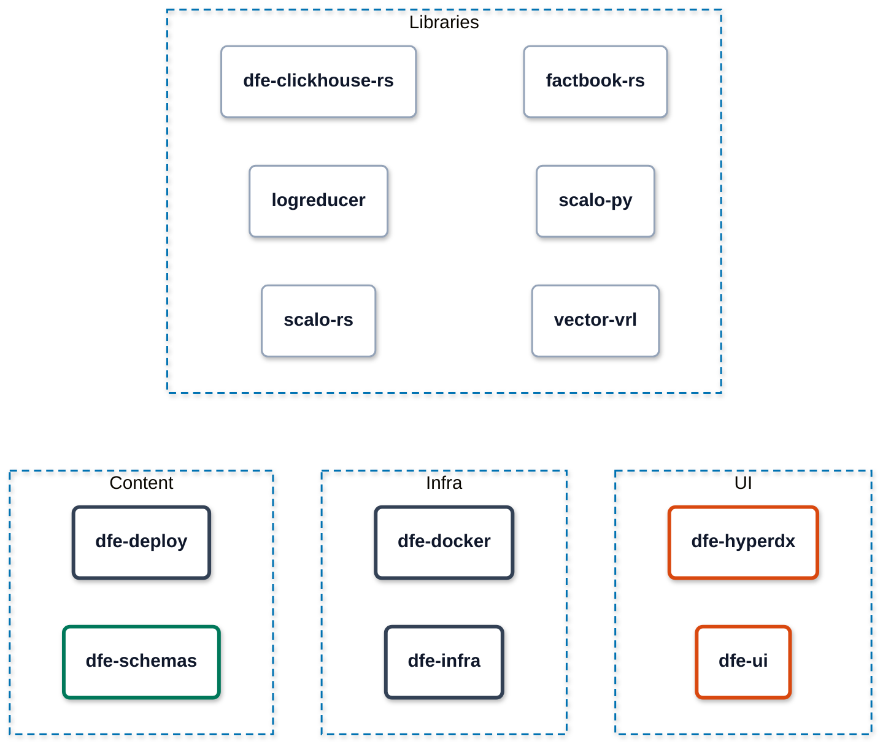
<!-- suite-graph:end overview:platform -->

*Figure 2. L4 Detail -- Suite overview, platform. Boxes group the members by role.* Up: top of dfe-infra.

## Reading an edge

An edge points PRODUCER -> CONSUMER and means: when the producer releases, the consumer is CHECKED. Checked, not bumped.

- `potential` is the default. The consumer declares a range or holds a copy. Run the check, and usually nothing moves.
- `lockstep` means the consumer can't stay behind. Every lockstep edge carries its evidence: a gate that fails the build, or a stated policy that the two are tagged together.
- `derived` means the consumer holds no copy at all. dfe-docker renders its pins from dfe-infra at build time, so there's nothing to drift. It's recorded so the tooling knows to walk past it.

The `kind` says HOW the two are tied, and `edge_kinds` in the file carries the check and the gates once per kind. Every edge cites the consumer's own file, at a line where one applies. A whole-file vendored copy cites the file, because no one line of it is the evidence. A `cargo-dep` or `python-dep` edge cites the consumer's manifest alone. The tooling reads it as TOML and finds every declaration of the producer's `package`, so a dependency added above the declaration can't move the citation off it. That citation is `evidence` and it's always the consumer's side. Where the producer keeps its own copy of the same content, that copy is the edge's `source`, and it's the only second reference an edge carries. An edge nobody could cite from the consumer side isn't in the file.

## The build cycles

One diagram per producer whose release puts something in motion. Every producer in the file has one, so a new producer with no block is an advisory the drift check raises, not a gap nobody sees. Solid arrows are lockstep or potential and dotted arrows are derived. Each caption says which kind is which.

### scalo-rs

Two edges run from scalo-rs to each Rust service. One is the crate range. The other is that scalo GENERATES each Rust service's Dockerfile and supplies the runtime base image inside it, so a scalo-rs release can change a consumer's image with no Cargo range moving. The tooling walks both.

<!-- suite-graph:begin producer:scalo-rs -->
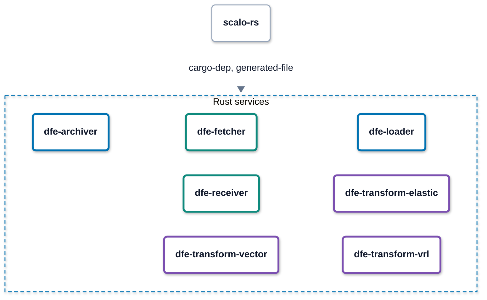
<!-- suite-graph:end producer:scalo-rs -->

*Figure 3. L4 Detail -- scalo-rs build cycle. The crate range is potential and the generated file is lockstep.* Up: [L4 Detail -- Suite overview](#the-members).

### scalo-py

dfe-engine, culvert and vector-vrl each declare it by range. vector-vrl does it in its build system rather than in the published wheel. dfe-engine also pins the runtime base image it inherits from scalo and guards that with its own test, which is the lockstep half.

<!-- suite-graph:begin producer:scalo-py -->
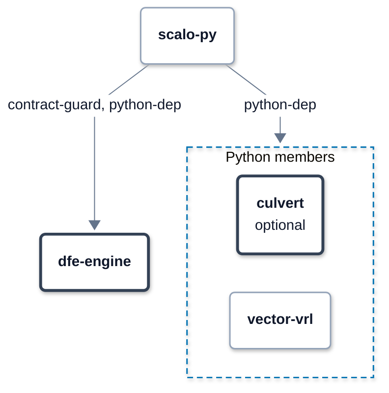
<!-- suite-graph:end producer:scalo-py -->

*Figure 4. L4 Detail -- scalo-py build cycle. The range declarations are potential and the contract guard is lockstep.* Up: [L4 Detail -- Suite overview](#the-members).

### dfe-engine

Its image tag sits in two places in this repo (its own chart and the hyperdx chart's init container), and the drift check holds both. dfe-ui vendors the engine's API spec and generates its scopes file from an engine module.

<!-- suite-graph:begin producer:dfe-engine -->
```mermaid
---
config:
  theme: base
  look: neo
  fontFamily: Inter, -apple-system, Segoe UI, Roboto, Helvetica, Arial, sans-serif
  flowchart:
    curve: linear
    nodeSpacing: 40
    rankSpacing: 64
    padding: 18
    wrappingWidth: 280
    htmlLabels: true
  elk:
    preset: modelOrder
  themeVariables:
    fontSize: 15px
    lineColor: "#64748B"
    primaryTextColor: "#0F172A"
    nodeBorder: "#334155"
    clusterBorder: "#0072B2"
    edgeLabelBackground: "#FFFFFF"
  themeCSS: >-
    p{margin:0}
    .node[data-look] rect,.node[data-look] path,.node[data-look] polygon,.node[data-look] .outer-path{filter:drop-shadow(0 1px 2px rgba(15,23,42,.10)) drop-shadow(0 6px 14px rgba(15,23,42,.10))}
    .node rect{rx:10px;ry:10px}
    .cluster rect{rx:16px;ry:16px}
    .node .label div{min-width:150px}
    .node.decision .label div{min-width:0}
    .cluster[data-look] rect{filter:none}
    .nodeLabel{line-height:1.35}
    .nodeLabel b{font-weight:600;font-size:15px;letter-spacing:-0.01em}
    .nodeLabel span{font-size:12.5px;font-weight:400;color:#334155}
    .cluster-label span.nodeLabel{display:inline-block;background:#FFFFFF;color:#0B2A3F;border:1.5px solid #0072B2;border-radius:999px;padding:2px 12px;font-size:11.5px;font-weight:700;letter-spacing:.09em;text-transform:uppercase}
    .flowchart-link{stroke-width:1.75px}
    .labelBkg{background:transparent!important}
    span.edgeLabel{display:inline-block;background:#FFFFFF!important;color:#1E293B;border:1px solid #94A3B8;border-radius:999px;padding:2px 10px;font-size:12px;font-weight:500}
    span.edgeLabel p{background:transparent!important}
    .label-icon{width:20px;height:20px;vertical-align:-4px;margin-right:6px}
    .icon-shape path[stroke-width="0"][fill="none"]{fill:#FFFFFF;stroke:#FFFFFF;stroke-width:12px;stroke-linejoin:round}
    .icon-shape p{background:transparent!important;color:#0F172A}
    .ingest .label-icon{color:#0E8A7D}
    .xform .label-icon{color:#7B4FB0}
    .load .label-icon{color:#0072B2}
    .bus .label-icon{color:#A8517F}
    .store .label-icon{color:#00785A}
    .ui .label-icon{color:#D9480F}
    .ext .label-icon{color:#64748B}
---
flowchart LR
    accTitle: L4 Detail -- dfe-engine build cycle
    accDescr: A dfe-engine release puts 2 consumers in motion. dfe-infra takes image-pin x2. dfe-ui takes generated-file and vendored-file.

    dfe_engine("<b>dfe-engine</b>")
    dfe_infra("<b>dfe-infra</b>")
    dfe_ui("<b>dfe-ui</b>")

    dfe_engine -->|image-pin x2| dfe_infra
    dfe_engine -->|generated-file, vendored-file| dfe_ui

    class dfe_engine,dfe_infra control
    class dfe_ui ui
    %% merrow:begin
    classDef ingest fill:#FFFFFF,stroke:#0E8A7D,stroke-width:3px,color:#0F172A
    classDef xform fill:#FFFFFF,stroke:#7B4FB0,stroke-width:3px,color:#0F172A
    classDef load fill:#FFFFFF,stroke:#0072B2,stroke-width:3px,color:#0F172A
    classDef bus fill:#FFFFFF,stroke:#A8517F,stroke-width:3px,color:#0F172A
    classDef store fill:#FFFFFF,stroke:#00785A,stroke-width:3px,color:#0F172A
    classDef ui fill:#FFFFFF,stroke:#D9480F,stroke-width:3px,color:#0F172A
    classDef ext fill:#F4F6F8,stroke:#94A3B8,stroke-width:1.5px,stroke-dasharray:5 4,color:#0F172A
    classDef decision fill:#FFFFFF,stroke:#9A6700,stroke-width:3px,color:#0F172A
    classDef error fill:#FFFFFF,stroke:#C2410C,stroke-width:3px,color:#0F172A
    classDef control fill:#FFFFFF,stroke:#334155,stroke-width:3px,color:#0F172A
    classDef part fill:#FFFFFF,stroke:#94A3B8,stroke-width:1.5px,color:#0F172A
    %% merrow:end
```
<!-- suite-graph:end producer:dfe-engine -->

*Figure 5. L4 Detail -- dfe-engine build cycle. The image pin is lockstep, and the generated and vendored files are potential.* Up: [L4 Detail -- Suite overview](#the-members).

### dfe-infra

The app catalogue goes OUT to dfe-engine before any library moves, which is why dfe-infra opens a pass as well as closing it. dfe-deploy pins the certified stack. dfe-docker renders and holds nothing.

<!-- suite-graph:begin producer:dfe-infra -->
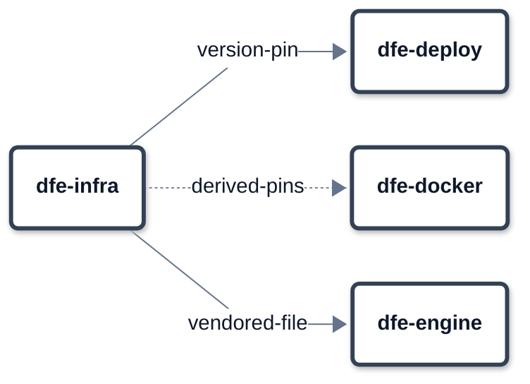
<!-- suite-graph:end producer:dfe-infra -->

*Figure 6. L4 Detail -- dfe-infra build cycle. dfe-docker's `derived-pins` edge holds no copy, the `vendored-file` edge is lockstep and the `version-pin` edge is potential.* Up: [L4 Detail -- Suite overview](#the-members).

### dfe-schemas

dfe-engine takes it as a package dependency by range. The one version pin is lockstep by policy, not by a gate: the content block in `versions.yaml` is tagged with the stack release. dfe-deploy pins none, because the wheel rides inside the dfe-engine image.

<!-- suite-graph:begin producer:dfe-schemas -->
```mermaid
---
config:
  theme: base
  look: neo
  fontFamily: Inter, -apple-system, Segoe UI, Roboto, Helvetica, Arial, sans-serif
  flowchart:
    curve: linear
    nodeSpacing: 40
    rankSpacing: 64
    padding: 18
    wrappingWidth: 280
    htmlLabels: true
  elk:
    preset: modelOrder
  themeVariables:
    fontSize: 15px
    lineColor: "#64748B"
    primaryTextColor: "#0F172A"
    nodeBorder: "#334155"
    clusterBorder: "#0072B2"
    edgeLabelBackground: "#FFFFFF"
  themeCSS: >-
    p{margin:0}
    .node[data-look] rect,.node[data-look] path,.node[data-look] polygon,.node[data-look] .outer-path{filter:drop-shadow(0 1px 2px rgba(15,23,42,.10)) drop-shadow(0 6px 14px rgba(15,23,42,.10))}
    .node rect{rx:10px;ry:10px}
    .cluster rect{rx:16px;ry:16px}
    .node .label div{min-width:150px}
    .node.decision .label div{min-width:0}
    .cluster[data-look] rect{filter:none}
    .nodeLabel{line-height:1.35}
    .nodeLabel b{font-weight:600;font-size:15px;letter-spacing:-0.01em}
    .nodeLabel span{font-size:12.5px;font-weight:400;color:#334155}
    .cluster-label span.nodeLabel{display:inline-block;background:#FFFFFF;color:#0B2A3F;border:1.5px solid #0072B2;border-radius:999px;padding:2px 12px;font-size:11.5px;font-weight:700;letter-spacing:.09em;text-transform:uppercase}
    .flowchart-link{stroke-width:1.75px}
    .labelBkg{background:transparent!important}
    span.edgeLabel{display:inline-block;background:#FFFFFF!important;color:#1E293B;border:1px solid #94A3B8;border-radius:999px;padding:2px 10px;font-size:12px;font-weight:500}
    span.edgeLabel p{background:transparent!important}
    .label-icon{width:20px;height:20px;vertical-align:-4px;margin-right:6px}
    .icon-shape path[stroke-width="0"][fill="none"]{fill:#FFFFFF;stroke:#FFFFFF;stroke-width:12px;stroke-linejoin:round}
    .icon-shape p{background:transparent!important;color:#0F172A}
    .ingest .label-icon{color:#0E8A7D}
    .xform .label-icon{color:#7B4FB0}
    .load .label-icon{color:#0072B2}
    .bus .label-icon{color:#A8517F}
    .store .label-icon{color:#00785A}
    .ui .label-icon{color:#D9480F}
    .ext .label-icon{color:#64748B}
---
flowchart LR
    accTitle: L4 Detail -- dfe-schemas build cycle
    accDescr: A dfe-schemas release puts 2 consumers in motion. dfe-engine takes python-dep. dfe-infra takes version-pin.

    dfe_schemas("<b>dfe-schemas</b>")
    dfe_engine("<b>dfe-engine</b>")
    dfe_infra("<b>dfe-infra</b>")

    dfe_schemas -->|python-dep| dfe_engine
    dfe_schemas -->|version-pin| dfe_infra

    class dfe_engine,dfe_infra control
    class dfe_schemas store
    %% merrow:begin
    classDef ingest fill:#FFFFFF,stroke:#0E8A7D,stroke-width:3px,color:#0F172A
    classDef xform fill:#FFFFFF,stroke:#7B4FB0,stroke-width:3px,color:#0F172A
    classDef load fill:#FFFFFF,stroke:#0072B2,stroke-width:3px,color:#0F172A
    classDef bus fill:#FFFFFF,stroke:#A8517F,stroke-width:3px,color:#0F172A
    classDef store fill:#FFFFFF,stroke:#00785A,stroke-width:3px,color:#0F172A
    classDef ui fill:#FFFFFF,stroke:#D9480F,stroke-width:3px,color:#0F172A
    classDef ext fill:#F4F6F8,stroke:#94A3B8,stroke-width:1.5px,stroke-dasharray:5 4,color:#0F172A
    classDef decision fill:#FFFFFF,stroke:#9A6700,stroke-width:3px,color:#0F172A
    classDef error fill:#FFFFFF,stroke:#C2410C,stroke-width:3px,color:#0F172A
    classDef control fill:#FFFFFF,stroke:#334155,stroke-width:3px,color:#0F172A
    classDef part fill:#FFFFFF,stroke:#94A3B8,stroke-width:1.5px,color:#0F172A
    %% merrow:end
```
<!-- suite-graph:end producer:dfe-schemas -->

*Figure 7. L4 Detail -- dfe-schemas build cycle. The package range is potential and the version pin is lockstep.* Up: [L4 Detail -- Suite overview](#the-members).

### logreducer

dfe-engine takes it as a package dependency by range, with the `enhanced` extra, and imports it lazily for the sampler's smart and anomaly modes.

<!-- suite-graph:begin producer:logreducer -->
```mermaid
---
config:
  theme: base
  look: neo
  fontFamily: Inter, -apple-system, Segoe UI, Roboto, Helvetica, Arial, sans-serif
  flowchart:
    curve: linear
    nodeSpacing: 40
    rankSpacing: 64
    padding: 18
    wrappingWidth: 280
    htmlLabels: true
  elk:
    preset: modelOrder
  themeVariables:
    fontSize: 15px
    lineColor: "#64748B"
    primaryTextColor: "#0F172A"
    nodeBorder: "#334155"
    clusterBorder: "#0072B2"
    edgeLabelBackground: "#FFFFFF"
  themeCSS: >-
    p{margin:0}
    .node[data-look] rect,.node[data-look] path,.node[data-look] polygon,.node[data-look] .outer-path{filter:drop-shadow(0 1px 2px rgba(15,23,42,.10)) drop-shadow(0 6px 14px rgba(15,23,42,.10))}
    .node rect{rx:10px;ry:10px}
    .cluster rect{rx:16px;ry:16px}
    .node .label div{min-width:150px}
    .node.decision .label div{min-width:0}
    .cluster[data-look] rect{filter:none}
    .nodeLabel{line-height:1.35}
    .nodeLabel b{font-weight:600;font-size:15px;letter-spacing:-0.01em}
    .nodeLabel span{font-size:12.5px;font-weight:400;color:#334155}
    .cluster-label span.nodeLabel{display:inline-block;background:#FFFFFF;color:#0B2A3F;border:1.5px solid #0072B2;border-radius:999px;padding:2px 12px;font-size:11.5px;font-weight:700;letter-spacing:.09em;text-transform:uppercase}
    .flowchart-link{stroke-width:1.75px}
    .labelBkg{background:transparent!important}
    span.edgeLabel{display:inline-block;background:#FFFFFF!important;color:#1E293B;border:1px solid #94A3B8;border-radius:999px;padding:2px 10px;font-size:12px;font-weight:500}
    span.edgeLabel p{background:transparent!important}
    .label-icon{width:20px;height:20px;vertical-align:-4px;margin-right:6px}
    .icon-shape path[stroke-width="0"][fill="none"]{fill:#FFFFFF;stroke:#FFFFFF;stroke-width:12px;stroke-linejoin:round}
    .icon-shape p{background:transparent!important;color:#0F172A}
    .ingest .label-icon{color:#0E8A7D}
    .xform .label-icon{color:#7B4FB0}
    .load .label-icon{color:#0072B2}
    .bus .label-icon{color:#A8517F}
    .store .label-icon{color:#00785A}
    .ui .label-icon{color:#D9480F}
    .ext .label-icon{color:#64748B}
---
flowchart LR
    accTitle: L4 Detail -- logreducer build cycle
    accDescr: A logreducer release puts 1 consumer in motion. dfe-engine takes python-dep.

    logreducer("<b>logreducer</b>")
    dfe_engine("<b>dfe-engine</b>")

    logreducer -->|python-dep| dfe_engine

    class dfe_engine control
    class logreducer part
    %% merrow:begin
    classDef ingest fill:#FFFFFF,stroke:#0E8A7D,stroke-width:3px,color:#0F172A
    classDef xform fill:#FFFFFF,stroke:#7B4FB0,stroke-width:3px,color:#0F172A
    classDef load fill:#FFFFFF,stroke:#0072B2,stroke-width:3px,color:#0F172A
    classDef bus fill:#FFFFFF,stroke:#A8517F,stroke-width:3px,color:#0F172A
    classDef store fill:#FFFFFF,stroke:#00785A,stroke-width:3px,color:#0F172A
    classDef ui fill:#FFFFFF,stroke:#D9480F,stroke-width:3px,color:#0F172A
    classDef ext fill:#F4F6F8,stroke:#94A3B8,stroke-width:1.5px,stroke-dasharray:5 4,color:#0F172A
    classDef decision fill:#FFFFFF,stroke:#9A6700,stroke-width:3px,color:#0F172A
    classDef error fill:#FFFFFF,stroke:#C2410C,stroke-width:3px,color:#0F172A
    classDef control fill:#FFFFFF,stroke:#334155,stroke-width:3px,color:#0F172A
    classDef part fill:#FFFFFF,stroke:#94A3B8,stroke-width:1.5px,color:#0F172A
    %% merrow:end
```
<!-- suite-graph:end producer:logreducer -->

*Figure 8. L4 Detail -- logreducer build cycle. The package range is potential.* Up: [L4 Detail -- Suite overview](#the-members).

### dfe-clickhouse-rs

The crate is `dfe-clickhouse`. dfe-fetcher takes it as an optional dependency, behind its db crate's `clickhouse` feature, for the ping and the typed server exception. dfe-loader still reaches ClickHouse through the upstream crate with a patch onto the clickhouse-rs fork, so a release here moves nothing there.

<!-- suite-graph:begin producer:dfe-clickhouse-rs -->
```mermaid
---
config:
  theme: base
  look: neo
  fontFamily: Inter, -apple-system, Segoe UI, Roboto, Helvetica, Arial, sans-serif
  flowchart:
    curve: linear
    nodeSpacing: 40
    rankSpacing: 64
    padding: 18
    wrappingWidth: 280
    htmlLabels: true
  elk:
    preset: modelOrder
  themeVariables:
    fontSize: 15px
    lineColor: "#64748B"
    primaryTextColor: "#0F172A"
    nodeBorder: "#334155"
    clusterBorder: "#0072B2"
    edgeLabelBackground: "#FFFFFF"
  themeCSS: >-
    p{margin:0}
    .node[data-look] rect,.node[data-look] path,.node[data-look] polygon,.node[data-look] .outer-path{filter:drop-shadow(0 1px 2px rgba(15,23,42,.10)) drop-shadow(0 6px 14px rgba(15,23,42,.10))}
    .node rect{rx:10px;ry:10px}
    .cluster rect{rx:16px;ry:16px}
    .node .label div{min-width:150px}
    .node.decision .label div{min-width:0}
    .cluster[data-look] rect{filter:none}
    .nodeLabel{line-height:1.35}
    .nodeLabel b{font-weight:600;font-size:15px;letter-spacing:-0.01em}
    .nodeLabel span{font-size:12.5px;font-weight:400;color:#334155}
    .cluster-label span.nodeLabel{display:inline-block;background:#FFFFFF;color:#0B2A3F;border:1.5px solid #0072B2;border-radius:999px;padding:2px 12px;font-size:11.5px;font-weight:700;letter-spacing:.09em;text-transform:uppercase}
    .flowchart-link{stroke-width:1.75px}
    .labelBkg{background:transparent!important}
    span.edgeLabel{display:inline-block;background:#FFFFFF!important;color:#1E293B;border:1px solid #94A3B8;border-radius:999px;padding:2px 10px;font-size:12px;font-weight:500}
    span.edgeLabel p{background:transparent!important}
    .label-icon{width:20px;height:20px;vertical-align:-4px;margin-right:6px}
    .icon-shape path[stroke-width="0"][fill="none"]{fill:#FFFFFF;stroke:#FFFFFF;stroke-width:12px;stroke-linejoin:round}
    .icon-shape p{background:transparent!important;color:#0F172A}
    .ingest .label-icon{color:#0E8A7D}
    .xform .label-icon{color:#7B4FB0}
    .load .label-icon{color:#0072B2}
    .bus .label-icon{color:#A8517F}
    .store .label-icon{color:#00785A}
    .ui .label-icon{color:#D9480F}
    .ext .label-icon{color:#64748B}
---
flowchart TB
    accTitle: L4 Detail -- dfe-clickhouse-rs build cycle
    accDescr: A dfe-clickhouse-rs release puts 2 consumers in motion. dfe-fetcher and dfe-loader take cargo-dep.

    dfe_clickhouse_rs("<b>dfe-clickhouse-rs</b>")
    subgraph rust_services["Rust services"]
        direction LR
        dfe_fetcher("<b>dfe-fetcher</b>")
        dfe_loader("<b>dfe-loader</b>")
    end

    dfe_clickhouse_rs -->|cargo-dep| rust_services

    class dfe_fetcher ingest
    class dfe_loader load
    class dfe_clickhouse_rs part
    %% merrow:begin
    classDef ingest fill:#FFFFFF,stroke:#0E8A7D,stroke-width:3px,color:#0F172A
    classDef xform fill:#FFFFFF,stroke:#7B4FB0,stroke-width:3px,color:#0F172A
    classDef load fill:#FFFFFF,stroke:#0072B2,stroke-width:3px,color:#0F172A
    classDef bus fill:#FFFFFF,stroke:#A8517F,stroke-width:3px,color:#0F172A
    classDef store fill:#FFFFFF,stroke:#00785A,stroke-width:3px,color:#0F172A
    classDef ui fill:#FFFFFF,stroke:#D9480F,stroke-width:3px,color:#0F172A
    classDef ext fill:#F4F6F8,stroke:#94A3B8,stroke-width:1.5px,stroke-dasharray:5 4,color:#0F172A
    classDef decision fill:#FFFFFF,stroke:#9A6700,stroke-width:3px,color:#0F172A
    classDef error fill:#FFFFFF,stroke:#C2410C,stroke-width:3px,color:#0F172A
    classDef control fill:#FFFFFF,stroke:#334155,stroke-width:3px,color:#0F172A
    classDef part fill:#FFFFFF,stroke:#94A3B8,stroke-width:1.5px,color:#0F172A
    style rust_services fill:none,stroke:#0072B2,stroke-width:1.5px,stroke-dasharray:6 4
    %% merrow:end
```
<!-- suite-graph:end producer:dfe-clickhouse-rs -->

*Figure 9. L4 Detail -- dfe-clickhouse-rs build cycle. The crate range is potential.* Up: [L4 Detail -- Suite overview](#the-members).

## The build cycles: the deployed members

The other direction. Every deployed member is a producer too, and what its release puts in motion is a pin in this repo.

### dfe-ui and dfe-hyperdx

Each moves one image pin in this repo when it releases. dfe-hyperdx also has its release tag pinned in the content block.

A dfe-ui release moves one image pin in dfe-infra.

<!-- suite-graph:begin producer:dfe-ui -->
```mermaid
---
config:
  theme: base
  look: neo
  fontFamily: Inter, -apple-system, Segoe UI, Roboto, Helvetica, Arial, sans-serif
  flowchart:
    curve: linear
    nodeSpacing: 40
    rankSpacing: 64
    padding: 18
    wrappingWidth: 280
    htmlLabels: true
  elk:
    preset: modelOrder
  themeVariables:
    fontSize: 15px
    lineColor: "#64748B"
    primaryTextColor: "#0F172A"
    nodeBorder: "#334155"
    clusterBorder: "#0072B2"
    edgeLabelBackground: "#FFFFFF"
  themeCSS: >-
    p{margin:0}
    .node[data-look] rect,.node[data-look] path,.node[data-look] polygon,.node[data-look] .outer-path{filter:drop-shadow(0 1px 2px rgba(15,23,42,.10)) drop-shadow(0 6px 14px rgba(15,23,42,.10))}
    .node rect{rx:10px;ry:10px}
    .cluster rect{rx:16px;ry:16px}
    .node .label div{min-width:150px}
    .node.decision .label div{min-width:0}
    .cluster[data-look] rect{filter:none}
    .nodeLabel{line-height:1.35}
    .nodeLabel b{font-weight:600;font-size:15px;letter-spacing:-0.01em}
    .nodeLabel span{font-size:12.5px;font-weight:400;color:#334155}
    .cluster-label span.nodeLabel{display:inline-block;background:#FFFFFF;color:#0B2A3F;border:1.5px solid #0072B2;border-radius:999px;padding:2px 12px;font-size:11.5px;font-weight:700;letter-spacing:.09em;text-transform:uppercase}
    .flowchart-link{stroke-width:1.75px}
    .labelBkg{background:transparent!important}
    span.edgeLabel{display:inline-block;background:#FFFFFF!important;color:#1E293B;border:1px solid #94A3B8;border-radius:999px;padding:2px 10px;font-size:12px;font-weight:500}
    span.edgeLabel p{background:transparent!important}
    .label-icon{width:20px;height:20px;vertical-align:-4px;margin-right:6px}
    .icon-shape path[stroke-width="0"][fill="none"]{fill:#FFFFFF;stroke:#FFFFFF;stroke-width:12px;stroke-linejoin:round}
    .icon-shape p{background:transparent!important;color:#0F172A}
    .ingest .label-icon{color:#0E8A7D}
    .xform .label-icon{color:#7B4FB0}
    .load .label-icon{color:#0072B2}
    .bus .label-icon{color:#A8517F}
    .store .label-icon{color:#00785A}
    .ui .label-icon{color:#D9480F}
    .ext .label-icon{color:#64748B}
---
flowchart LR
    accTitle: L4 Detail -- dfe-ui build cycle
    accDescr: A dfe-ui release puts 1 consumer in motion. dfe-infra takes image-pin.

    dfe_ui("<b>dfe-ui</b>")
    dfe_infra("<b>dfe-infra</b>")

    dfe_ui -->|image-pin| dfe_infra

    class dfe_infra control
    class dfe_ui ui
    %% merrow:begin
    classDef ingest fill:#FFFFFF,stroke:#0E8A7D,stroke-width:3px,color:#0F172A
    classDef xform fill:#FFFFFF,stroke:#7B4FB0,stroke-width:3px,color:#0F172A
    classDef load fill:#FFFFFF,stroke:#0072B2,stroke-width:3px,color:#0F172A
    classDef bus fill:#FFFFFF,stroke:#A8517F,stroke-width:3px,color:#0F172A
    classDef store fill:#FFFFFF,stroke:#00785A,stroke-width:3px,color:#0F172A
    classDef ui fill:#FFFFFF,stroke:#D9480F,stroke-width:3px,color:#0F172A
    classDef ext fill:#F4F6F8,stroke:#94A3B8,stroke-width:1.5px,stroke-dasharray:5 4,color:#0F172A
    classDef decision fill:#FFFFFF,stroke:#9A6700,stroke-width:3px,color:#0F172A
    classDef error fill:#FFFFFF,stroke:#C2410C,stroke-width:3px,color:#0F172A
    classDef control fill:#FFFFFF,stroke:#334155,stroke-width:3px,color:#0F172A
    classDef part fill:#FFFFFF,stroke:#94A3B8,stroke-width:1.5px,color:#0F172A
    %% merrow:end
```
<!-- suite-graph:end producer:dfe-ui -->

*Figure 10. L4 Detail -- dfe-ui build cycle. The image pin is lockstep.* Up: [L4 Detail -- Suite overview](#the-members).

A dfe-hyperdx release moves one image pin in dfe-infra.

<!-- suite-graph:begin producer:dfe-hyperdx -->
```mermaid
---
config:
  theme: base
  look: neo
  fontFamily: Inter, -apple-system, Segoe UI, Roboto, Helvetica, Arial, sans-serif
  flowchart:
    curve: linear
    nodeSpacing: 40
    rankSpacing: 64
    padding: 18
    wrappingWidth: 280
    htmlLabels: true
  elk:
    preset: modelOrder
  themeVariables:
    fontSize: 15px
    lineColor: "#64748B"
    primaryTextColor: "#0F172A"
    nodeBorder: "#334155"
    clusterBorder: "#0072B2"
    edgeLabelBackground: "#FFFFFF"
  themeCSS: >-
    p{margin:0}
    .node[data-look] rect,.node[data-look] path,.node[data-look] polygon,.node[data-look] .outer-path{filter:drop-shadow(0 1px 2px rgba(15,23,42,.10)) drop-shadow(0 6px 14px rgba(15,23,42,.10))}
    .node rect{rx:10px;ry:10px}
    .cluster rect{rx:16px;ry:16px}
    .node .label div{min-width:150px}
    .node.decision .label div{min-width:0}
    .cluster[data-look] rect{filter:none}
    .nodeLabel{line-height:1.35}
    .nodeLabel b{font-weight:600;font-size:15px;letter-spacing:-0.01em}
    .nodeLabel span{font-size:12.5px;font-weight:400;color:#334155}
    .cluster-label span.nodeLabel{display:inline-block;background:#FFFFFF;color:#0B2A3F;border:1.5px solid #0072B2;border-radius:999px;padding:2px 12px;font-size:11.5px;font-weight:700;letter-spacing:.09em;text-transform:uppercase}
    .flowchart-link{stroke-width:1.75px}
    .labelBkg{background:transparent!important}
    span.edgeLabel{display:inline-block;background:#FFFFFF!important;color:#1E293B;border:1px solid #94A3B8;border-radius:999px;padding:2px 10px;font-size:12px;font-weight:500}
    span.edgeLabel p{background:transparent!important}
    .label-icon{width:20px;height:20px;vertical-align:-4px;margin-right:6px}
    .icon-shape path[stroke-width="0"][fill="none"]{fill:#FFFFFF;stroke:#FFFFFF;stroke-width:12px;stroke-linejoin:round}
    .icon-shape p{background:transparent!important;color:#0F172A}
    .ingest .label-icon{color:#0E8A7D}
    .xform .label-icon{color:#7B4FB0}
    .load .label-icon{color:#0072B2}
    .bus .label-icon{color:#A8517F}
    .store .label-icon{color:#00785A}
    .ui .label-icon{color:#D9480F}
    .ext .label-icon{color:#64748B}
---
flowchart LR
    accTitle: L4 Detail -- dfe-hyperdx build cycle
    accDescr: A dfe-hyperdx release puts 1 consumer in motion. dfe-infra takes image-pin.

    dfe_hyperdx("<b>dfe-hyperdx</b>")
    dfe_infra("<b>dfe-infra</b>")

    dfe_hyperdx -->|image-pin| dfe_infra

    class dfe_infra control
    class dfe_hyperdx ui
    %% merrow:begin
    classDef ingest fill:#FFFFFF,stroke:#0E8A7D,stroke-width:3px,color:#0F172A
    classDef xform fill:#FFFFFF,stroke:#7B4FB0,stroke-width:3px,color:#0F172A
    classDef load fill:#FFFFFF,stroke:#0072B2,stroke-width:3px,color:#0F172A
    classDef bus fill:#FFFFFF,stroke:#A8517F,stroke-width:3px,color:#0F172A
    classDef store fill:#FFFFFF,stroke:#00785A,stroke-width:3px,color:#0F172A
    classDef ui fill:#FFFFFF,stroke:#D9480F,stroke-width:3px,color:#0F172A
    classDef ext fill:#F4F6F8,stroke:#94A3B8,stroke-width:1.5px,stroke-dasharray:5 4,color:#0F172A
    classDef decision fill:#FFFFFF,stroke:#9A6700,stroke-width:3px,color:#0F172A
    classDef error fill:#FFFFFF,stroke:#C2410C,stroke-width:3px,color:#0F172A
    classDef control fill:#FFFFFF,stroke:#334155,stroke-width:3px,color:#0F172A
    classDef part fill:#FFFFFF,stroke:#94A3B8,stroke-width:1.5px,color:#0F172A
    %% merrow:end
```
<!-- suite-graph:end producer:dfe-hyperdx -->

*Figure 11. L4 Detail -- dfe-hyperdx build cycle. The image pin is lockstep.* Up: [L4 Detail -- Suite overview](#the-members).

### dfe-deploy

The certified stack's own tag comes back the other way. dfe-deploy is pinned in this repo's content block as well as pinning this repo.

<!-- suite-graph:begin producer:dfe-deploy -->
```mermaid
---
config:
  theme: base
  look: neo
  fontFamily: Inter, -apple-system, Segoe UI, Roboto, Helvetica, Arial, sans-serif
  flowchart:
    curve: linear
    nodeSpacing: 40
    rankSpacing: 64
    padding: 18
    wrappingWidth: 280
    htmlLabels: true
  elk:
    preset: modelOrder
  themeVariables:
    fontSize: 15px
    lineColor: "#64748B"
    primaryTextColor: "#0F172A"
    nodeBorder: "#334155"
    clusterBorder: "#0072B2"
    edgeLabelBackground: "#FFFFFF"
  themeCSS: >-
    p{margin:0}
    .node[data-look] rect,.node[data-look] path,.node[data-look] polygon,.node[data-look] .outer-path{filter:drop-shadow(0 1px 2px rgba(15,23,42,.10)) drop-shadow(0 6px 14px rgba(15,23,42,.10))}
    .node rect{rx:10px;ry:10px}
    .cluster rect{rx:16px;ry:16px}
    .node .label div{min-width:150px}
    .node.decision .label div{min-width:0}
    .cluster[data-look] rect{filter:none}
    .nodeLabel{line-height:1.35}
    .nodeLabel b{font-weight:600;font-size:15px;letter-spacing:-0.01em}
    .nodeLabel span{font-size:12.5px;font-weight:400;color:#334155}
    .cluster-label span.nodeLabel{display:inline-block;background:#FFFFFF;color:#0B2A3F;border:1.5px solid #0072B2;border-radius:999px;padding:2px 12px;font-size:11.5px;font-weight:700;letter-spacing:.09em;text-transform:uppercase}
    .flowchart-link{stroke-width:1.75px}
    .labelBkg{background:transparent!important}
    span.edgeLabel{display:inline-block;background:#FFFFFF!important;color:#1E293B;border:1px solid #94A3B8;border-radius:999px;padding:2px 10px;font-size:12px;font-weight:500}
    span.edgeLabel p{background:transparent!important}
    .label-icon{width:20px;height:20px;vertical-align:-4px;margin-right:6px}
    .icon-shape path[stroke-width="0"][fill="none"]{fill:#FFFFFF;stroke:#FFFFFF;stroke-width:12px;stroke-linejoin:round}
    .icon-shape p{background:transparent!important;color:#0F172A}
    .ingest .label-icon{color:#0E8A7D}
    .xform .label-icon{color:#7B4FB0}
    .load .label-icon{color:#0072B2}
    .bus .label-icon{color:#A8517F}
    .store .label-icon{color:#00785A}
    .ui .label-icon{color:#D9480F}
    .ext .label-icon{color:#64748B}
---
flowchart LR
    accTitle: L4 Detail -- dfe-deploy build cycle
    accDescr: A dfe-deploy release puts 1 consumer in motion. dfe-infra takes version-pin.

    dfe_deploy("<b>dfe-deploy</b>")
    dfe_infra("<b>dfe-infra</b>")

    dfe_deploy -->|version-pin| dfe_infra

    class dfe_deploy,dfe_infra control
    %% merrow:begin
    classDef ingest fill:#FFFFFF,stroke:#0E8A7D,stroke-width:3px,color:#0F172A
    classDef xform fill:#FFFFFF,stroke:#7B4FB0,stroke-width:3px,color:#0F172A
    classDef load fill:#FFFFFF,stroke:#0072B2,stroke-width:3px,color:#0F172A
    classDef bus fill:#FFFFFF,stroke:#A8517F,stroke-width:3px,color:#0F172A
    classDef store fill:#FFFFFF,stroke:#00785A,stroke-width:3px,color:#0F172A
    classDef ui fill:#FFFFFF,stroke:#D9480F,stroke-width:3px,color:#0F172A
    classDef ext fill:#F4F6F8,stroke:#94A3B8,stroke-width:1.5px,stroke-dasharray:5 4,color:#0F172A
    classDef decision fill:#FFFFFF,stroke:#9A6700,stroke-width:3px,color:#0F172A
    classDef error fill:#FFFFFF,stroke:#C2410C,stroke-width:3px,color:#0F172A
    classDef control fill:#FFFFFF,stroke:#334155,stroke-width:3px,color:#0F172A
    classDef part fill:#FFFFFF,stroke:#94A3B8,stroke-width:1.5px,color:#0F172A
    %% merrow:end
```
<!-- suite-graph:end producer:dfe-deploy -->

*Figure 12. L4 Detail -- dfe-deploy build cycle. The version pin is lockstep.* Up: [L4 Detail -- Suite overview](#the-members).

### The components

Every deployed component is a producer too. A component release moves its image pin here (the tag, the image digest and the thin chart's digest, every copy held by the drift check) and nothing else, with two exceptions. dfe-engine authors the loader's and the receiver's configs, so it carries a hand-written copy of each one's validation rules that no script can compare.

A dfe-loader release moves its image pin in dfe-infra, and dfe-engine carries a hand-written copy of its validation rules.

<!-- suite-graph:begin producer:dfe-loader -->
```mermaid
---
config:
  theme: base
  look: neo
  fontFamily: Inter, -apple-system, Segoe UI, Roboto, Helvetica, Arial, sans-serif
  flowchart:
    curve: linear
    nodeSpacing: 40
    rankSpacing: 64
    padding: 18
    wrappingWidth: 280
    htmlLabels: true
  elk:
    preset: modelOrder
  themeVariables:
    fontSize: 15px
    lineColor: "#64748B"
    primaryTextColor: "#0F172A"
    nodeBorder: "#334155"
    clusterBorder: "#0072B2"
    edgeLabelBackground: "#FFFFFF"
  themeCSS: >-
    p{margin:0}
    .node[data-look] rect,.node[data-look] path,.node[data-look] polygon,.node[data-look] .outer-path{filter:drop-shadow(0 1px 2px rgba(15,23,42,.10)) drop-shadow(0 6px 14px rgba(15,23,42,.10))}
    .node rect{rx:10px;ry:10px}
    .cluster rect{rx:16px;ry:16px}
    .node .label div{min-width:150px}
    .node.decision .label div{min-width:0}
    .cluster[data-look] rect{filter:none}
    .nodeLabel{line-height:1.35}
    .nodeLabel b{font-weight:600;font-size:15px;letter-spacing:-0.01em}
    .nodeLabel span{font-size:12.5px;font-weight:400;color:#334155}
    .cluster-label span.nodeLabel{display:inline-block;background:#FFFFFF;color:#0B2A3F;border:1.5px solid #0072B2;border-radius:999px;padding:2px 12px;font-size:11.5px;font-weight:700;letter-spacing:.09em;text-transform:uppercase}
    .flowchart-link{stroke-width:1.75px}
    .labelBkg{background:transparent!important}
    span.edgeLabel{display:inline-block;background:#FFFFFF!important;color:#1E293B;border:1px solid #94A3B8;border-radius:999px;padding:2px 10px;font-size:12px;font-weight:500}
    span.edgeLabel p{background:transparent!important}
    .label-icon{width:20px;height:20px;vertical-align:-4px;margin-right:6px}
    .icon-shape path[stroke-width="0"][fill="none"]{fill:#FFFFFF;stroke:#FFFFFF;stroke-width:12px;stroke-linejoin:round}
    .icon-shape p{background:transparent!important;color:#0F172A}
    .ingest .label-icon{color:#0E8A7D}
    .xform .label-icon{color:#7B4FB0}
    .load .label-icon{color:#0072B2}
    .bus .label-icon{color:#A8517F}
    .store .label-icon{color:#00785A}
    .ui .label-icon{color:#D9480F}
    .ext .label-icon{color:#64748B}
---
flowchart LR
    accTitle: L4 Detail -- dfe-loader build cycle
    accDescr: A dfe-loader release puts 1 consumer in motion. dfe-infra takes image-pin.

    dfe_loader("<b>dfe-loader</b>")
    dfe_infra("<b>dfe-infra</b>")

    dfe_loader -->|image-pin| dfe_infra

    class dfe_infra control
    class dfe_loader load
    %% merrow:begin
    classDef ingest fill:#FFFFFF,stroke:#0E8A7D,stroke-width:3px,color:#0F172A
    classDef xform fill:#FFFFFF,stroke:#7B4FB0,stroke-width:3px,color:#0F172A
    classDef load fill:#FFFFFF,stroke:#0072B2,stroke-width:3px,color:#0F172A
    classDef bus fill:#FFFFFF,stroke:#A8517F,stroke-width:3px,color:#0F172A
    classDef store fill:#FFFFFF,stroke:#00785A,stroke-width:3px,color:#0F172A
    classDef ui fill:#FFFFFF,stroke:#D9480F,stroke-width:3px,color:#0F172A
    classDef ext fill:#F4F6F8,stroke:#94A3B8,stroke-width:1.5px,stroke-dasharray:5 4,color:#0F172A
    classDef decision fill:#FFFFFF,stroke:#9A6700,stroke-width:3px,color:#0F172A
    classDef error fill:#FFFFFF,stroke:#C2410C,stroke-width:3px,color:#0F172A
    classDef control fill:#FFFFFF,stroke:#334155,stroke-width:3px,color:#0F172A
    classDef part fill:#FFFFFF,stroke:#94A3B8,stroke-width:1.5px,color:#0F172A
    %% merrow:end
```
<!-- suite-graph:end producer:dfe-loader -->

*Figure 13. L4 Detail -- dfe-loader build cycle. The image pin is lockstep and the mirrored logic is potential.* Up: [L4 Detail -- Suite overview](#the-members).

A dfe-receiver release moves its image pin in dfe-infra, and dfe-engine carries a hand-written copy of its validation rules.

<!-- suite-graph:begin producer:dfe-receiver -->
```mermaid
---
config:
  theme: base
  look: neo
  fontFamily: Inter, -apple-system, Segoe UI, Roboto, Helvetica, Arial, sans-serif
  flowchart:
    curve: linear
    nodeSpacing: 40
    rankSpacing: 64
    padding: 18
    wrappingWidth: 280
    htmlLabels: true
  elk:
    preset: modelOrder
  themeVariables:
    fontSize: 15px
    lineColor: "#64748B"
    primaryTextColor: "#0F172A"
    nodeBorder: "#334155"
    clusterBorder: "#0072B2"
    edgeLabelBackground: "#FFFFFF"
  themeCSS: >-
    p{margin:0}
    .node[data-look] rect,.node[data-look] path,.node[data-look] polygon,.node[data-look] .outer-path{filter:drop-shadow(0 1px 2px rgba(15,23,42,.10)) drop-shadow(0 6px 14px rgba(15,23,42,.10))}
    .node rect{rx:10px;ry:10px}
    .cluster rect{rx:16px;ry:16px}
    .node .label div{min-width:150px}
    .node.decision .label div{min-width:0}
    .cluster[data-look] rect{filter:none}
    .nodeLabel{line-height:1.35}
    .nodeLabel b{font-weight:600;font-size:15px;letter-spacing:-0.01em}
    .nodeLabel span{font-size:12.5px;font-weight:400;color:#334155}
    .cluster-label span.nodeLabel{display:inline-block;background:#FFFFFF;color:#0B2A3F;border:1.5px solid #0072B2;border-radius:999px;padding:2px 12px;font-size:11.5px;font-weight:700;letter-spacing:.09em;text-transform:uppercase}
    .flowchart-link{stroke-width:1.75px}
    .labelBkg{background:transparent!important}
    span.edgeLabel{display:inline-block;background:#FFFFFF!important;color:#1E293B;border:1px solid #94A3B8;border-radius:999px;padding:2px 10px;font-size:12px;font-weight:500}
    span.edgeLabel p{background:transparent!important}
    .label-icon{width:20px;height:20px;vertical-align:-4px;margin-right:6px}
    .icon-shape path[stroke-width="0"][fill="none"]{fill:#FFFFFF;stroke:#FFFFFF;stroke-width:12px;stroke-linejoin:round}
    .icon-shape p{background:transparent!important;color:#0F172A}
    .ingest .label-icon{color:#0E8A7D}
    .xform .label-icon{color:#7B4FB0}
    .load .label-icon{color:#0072B2}
    .bus .label-icon{color:#A8517F}
    .store .label-icon{color:#00785A}
    .ui .label-icon{color:#D9480F}
    .ext .label-icon{color:#64748B}
---
flowchart LR
    accTitle: L4 Detail -- dfe-receiver build cycle
    accDescr: A dfe-receiver release puts 1 consumer in motion. dfe-infra takes image-pin.

    dfe_receiver("<b>dfe-receiver</b>")
    dfe_infra("<b>dfe-infra</b>")

    dfe_receiver -->|image-pin| dfe_infra

    class dfe_infra control
    class dfe_receiver ingest
    %% merrow:begin
    classDef ingest fill:#FFFFFF,stroke:#0E8A7D,stroke-width:3px,color:#0F172A
    classDef xform fill:#FFFFFF,stroke:#7B4FB0,stroke-width:3px,color:#0F172A
    classDef load fill:#FFFFFF,stroke:#0072B2,stroke-width:3px,color:#0F172A
    classDef bus fill:#FFFFFF,stroke:#A8517F,stroke-width:3px,color:#0F172A
    classDef store fill:#FFFFFF,stroke:#00785A,stroke-width:3px,color:#0F172A
    classDef ui fill:#FFFFFF,stroke:#D9480F,stroke-width:3px,color:#0F172A
    classDef ext fill:#F4F6F8,stroke:#94A3B8,stroke-width:1.5px,stroke-dasharray:5 4,color:#0F172A
    classDef decision fill:#FFFFFF,stroke:#9A6700,stroke-width:3px,color:#0F172A
    classDef error fill:#FFFFFF,stroke:#C2410C,stroke-width:3px,color:#0F172A
    classDef control fill:#FFFFFF,stroke:#334155,stroke-width:3px,color:#0F172A
    classDef part fill:#FFFFFF,stroke:#94A3B8,stroke-width:1.5px,color:#0F172A
    %% merrow:end
```
<!-- suite-graph:end producer:dfe-receiver -->

*Figure 14. L4 Detail -- dfe-receiver build cycle. The image pin is lockstep and the mirrored logic is potential.* Up: [L4 Detail -- Suite overview](#the-members).

A dfe-fetcher release moves one image pin in dfe-infra and nothing else.

<!-- suite-graph:begin producer:dfe-fetcher -->
```mermaid
---
config:
  theme: base
  look: neo
  fontFamily: Inter, -apple-system, Segoe UI, Roboto, Helvetica, Arial, sans-serif
  flowchart:
    curve: linear
    nodeSpacing: 40
    rankSpacing: 64
    padding: 18
    wrappingWidth: 280
    htmlLabels: true
  elk:
    preset: modelOrder
  themeVariables:
    fontSize: 15px
    lineColor: "#64748B"
    primaryTextColor: "#0F172A"
    nodeBorder: "#334155"
    clusterBorder: "#0072B2"
    edgeLabelBackground: "#FFFFFF"
  themeCSS: >-
    p{margin:0}
    .node[data-look] rect,.node[data-look] path,.node[data-look] polygon,.node[data-look] .outer-path{filter:drop-shadow(0 1px 2px rgba(15,23,42,.10)) drop-shadow(0 6px 14px rgba(15,23,42,.10))}
    .node rect{rx:10px;ry:10px}
    .cluster rect{rx:16px;ry:16px}
    .node .label div{min-width:150px}
    .node.decision .label div{min-width:0}
    .cluster[data-look] rect{filter:none}
    .nodeLabel{line-height:1.35}
    .nodeLabel b{font-weight:600;font-size:15px;letter-spacing:-0.01em}
    .nodeLabel span{font-size:12.5px;font-weight:400;color:#334155}
    .cluster-label span.nodeLabel{display:inline-block;background:#FFFFFF;color:#0B2A3F;border:1.5px solid #0072B2;border-radius:999px;padding:2px 12px;font-size:11.5px;font-weight:700;letter-spacing:.09em;text-transform:uppercase}
    .flowchart-link{stroke-width:1.75px}
    .labelBkg{background:transparent!important}
    span.edgeLabel{display:inline-block;background:#FFFFFF!important;color:#1E293B;border:1px solid #94A3B8;border-radius:999px;padding:2px 10px;font-size:12px;font-weight:500}
    span.edgeLabel p{background:transparent!important}
    .label-icon{width:20px;height:20px;vertical-align:-4px;margin-right:6px}
    .icon-shape path[stroke-width="0"][fill="none"]{fill:#FFFFFF;stroke:#FFFFFF;stroke-width:12px;stroke-linejoin:round}
    .icon-shape p{background:transparent!important;color:#0F172A}
    .ingest .label-icon{color:#0E8A7D}
    .xform .label-icon{color:#7B4FB0}
    .load .label-icon{color:#0072B2}
    .bus .label-icon{color:#A8517F}
    .store .label-icon{color:#00785A}
    .ui .label-icon{color:#D9480F}
    .ext .label-icon{color:#64748B}
---
flowchart LR
    accTitle: L4 Detail -- dfe-fetcher build cycle
    accDescr: A dfe-fetcher release puts 1 consumer in motion. dfe-infra takes image-pin.

    dfe_fetcher("<b>dfe-fetcher</b>")
    dfe_infra("<b>dfe-infra</b>")

    dfe_fetcher -->|image-pin| dfe_infra

    class dfe_infra control
    class dfe_fetcher ingest
    %% merrow:begin
    classDef ingest fill:#FFFFFF,stroke:#0E8A7D,stroke-width:3px,color:#0F172A
    classDef xform fill:#FFFFFF,stroke:#7B4FB0,stroke-width:3px,color:#0F172A
    classDef load fill:#FFFFFF,stroke:#0072B2,stroke-width:3px,color:#0F172A
    classDef bus fill:#FFFFFF,stroke:#A8517F,stroke-width:3px,color:#0F172A
    classDef store fill:#FFFFFF,stroke:#00785A,stroke-width:3px,color:#0F172A
    classDef ui fill:#FFFFFF,stroke:#D9480F,stroke-width:3px,color:#0F172A
    classDef ext fill:#F4F6F8,stroke:#94A3B8,stroke-width:1.5px,stroke-dasharray:5 4,color:#0F172A
    classDef decision fill:#FFFFFF,stroke:#9A6700,stroke-width:3px,color:#0F172A
    classDef error fill:#FFFFFF,stroke:#C2410C,stroke-width:3px,color:#0F172A
    classDef control fill:#FFFFFF,stroke:#334155,stroke-width:3px,color:#0F172A
    classDef part fill:#FFFFFF,stroke:#94A3B8,stroke-width:1.5px,color:#0F172A
    %% merrow:end
```
<!-- suite-graph:end producer:dfe-fetcher -->

*Figure 15. L4 Detail -- dfe-fetcher build cycle. The image pin is lockstep.* Up: [L4 Detail -- Suite overview](#the-members).

A dfe-archiver release moves one image pin in dfe-infra and nothing else.

<!-- suite-graph:begin producer:dfe-archiver -->
```mermaid
---
config:
  theme: base
  look: neo
  fontFamily: Inter, -apple-system, Segoe UI, Roboto, Helvetica, Arial, sans-serif
  flowchart:
    curve: linear
    nodeSpacing: 40
    rankSpacing: 64
    padding: 18
    wrappingWidth: 280
    htmlLabels: true
  elk:
    preset: modelOrder
  themeVariables:
    fontSize: 15px
    lineColor: "#64748B"
    primaryTextColor: "#0F172A"
    nodeBorder: "#334155"
    clusterBorder: "#0072B2"
    edgeLabelBackground: "#FFFFFF"
  themeCSS: >-
    p{margin:0}
    .node[data-look] rect,.node[data-look] path,.node[data-look] polygon,.node[data-look] .outer-path{filter:drop-shadow(0 1px 2px rgba(15,23,42,.10)) drop-shadow(0 6px 14px rgba(15,23,42,.10))}
    .node rect{rx:10px;ry:10px}
    .cluster rect{rx:16px;ry:16px}
    .node .label div{min-width:150px}
    .node.decision .label div{min-width:0}
    .cluster[data-look] rect{filter:none}
    .nodeLabel{line-height:1.35}
    .nodeLabel b{font-weight:600;font-size:15px;letter-spacing:-0.01em}
    .nodeLabel span{font-size:12.5px;font-weight:400;color:#334155}
    .cluster-label span.nodeLabel{display:inline-block;background:#FFFFFF;color:#0B2A3F;border:1.5px solid #0072B2;border-radius:999px;padding:2px 12px;font-size:11.5px;font-weight:700;letter-spacing:.09em;text-transform:uppercase}
    .flowchart-link{stroke-width:1.75px}
    .labelBkg{background:transparent!important}
    span.edgeLabel{display:inline-block;background:#FFFFFF!important;color:#1E293B;border:1px solid #94A3B8;border-radius:999px;padding:2px 10px;font-size:12px;font-weight:500}
    span.edgeLabel p{background:transparent!important}
    .label-icon{width:20px;height:20px;vertical-align:-4px;margin-right:6px}
    .icon-shape path[stroke-width="0"][fill="none"]{fill:#FFFFFF;stroke:#FFFFFF;stroke-width:12px;stroke-linejoin:round}
    .icon-shape p{background:transparent!important;color:#0F172A}
    .ingest .label-icon{color:#0E8A7D}
    .xform .label-icon{color:#7B4FB0}
    .load .label-icon{color:#0072B2}
    .bus .label-icon{color:#A8517F}
    .store .label-icon{color:#00785A}
    .ui .label-icon{color:#D9480F}
    .ext .label-icon{color:#64748B}
---
flowchart LR
    accTitle: L4 Detail -- dfe-archiver build cycle
    accDescr: A dfe-archiver release puts 1 consumer in motion. dfe-infra takes image-pin.

    dfe_archiver("<b>dfe-archiver</b>")
    dfe_infra("<b>dfe-infra</b>")

    dfe_archiver -->|image-pin| dfe_infra

    class dfe_infra control
    class dfe_archiver load
    %% merrow:begin
    classDef ingest fill:#FFFFFF,stroke:#0E8A7D,stroke-width:3px,color:#0F172A
    classDef xform fill:#FFFFFF,stroke:#7B4FB0,stroke-width:3px,color:#0F172A
    classDef load fill:#FFFFFF,stroke:#0072B2,stroke-width:3px,color:#0F172A
    classDef bus fill:#FFFFFF,stroke:#A8517F,stroke-width:3px,color:#0F172A
    classDef store fill:#FFFFFF,stroke:#00785A,stroke-width:3px,color:#0F172A
    classDef ui fill:#FFFFFF,stroke:#D9480F,stroke-width:3px,color:#0F172A
    classDef ext fill:#F4F6F8,stroke:#94A3B8,stroke-width:1.5px,stroke-dasharray:5 4,color:#0F172A
    classDef decision fill:#FFFFFF,stroke:#9A6700,stroke-width:3px,color:#0F172A
    classDef error fill:#FFFFFF,stroke:#C2410C,stroke-width:3px,color:#0F172A
    classDef control fill:#FFFFFF,stroke:#334155,stroke-width:3px,color:#0F172A
    classDef part fill:#FFFFFF,stroke:#94A3B8,stroke-width:1.5px,color:#0F172A
    %% merrow:end
```
<!-- suite-graph:end producer:dfe-archiver -->

*Figure 16. L4 Detail -- dfe-archiver build cycle. The image pin is lockstep.* Up: [L4 Detail -- Suite overview](#the-members).

A dfe-transform-vrl release moves one image pin in dfe-infra and nothing else.

<!-- suite-graph:begin producer:dfe-transform-vrl -->
```mermaid
---
config:
  theme: base
  look: neo
  fontFamily: Inter, -apple-system, Segoe UI, Roboto, Helvetica, Arial, sans-serif
  flowchart:
    curve: linear
    nodeSpacing: 40
    rankSpacing: 64
    padding: 18
    wrappingWidth: 280
    htmlLabels: true
  elk:
    preset: modelOrder
  themeVariables:
    fontSize: 15px
    lineColor: "#64748B"
    primaryTextColor: "#0F172A"
    nodeBorder: "#334155"
    clusterBorder: "#0072B2"
    edgeLabelBackground: "#FFFFFF"
  themeCSS: >-
    p{margin:0}
    .node[data-look] rect,.node[data-look] path,.node[data-look] polygon,.node[data-look] .outer-path{filter:drop-shadow(0 1px 2px rgba(15,23,42,.10)) drop-shadow(0 6px 14px rgba(15,23,42,.10))}
    .node rect{rx:10px;ry:10px}
    .cluster rect{rx:16px;ry:16px}
    .node .label div{min-width:150px}
    .node.decision .label div{min-width:0}
    .cluster[data-look] rect{filter:none}
    .nodeLabel{line-height:1.35}
    .nodeLabel b{font-weight:600;font-size:15px;letter-spacing:-0.01em}
    .nodeLabel span{font-size:12.5px;font-weight:400;color:#334155}
    .cluster-label span.nodeLabel{display:inline-block;background:#FFFFFF;color:#0B2A3F;border:1.5px solid #0072B2;border-radius:999px;padding:2px 12px;font-size:11.5px;font-weight:700;letter-spacing:.09em;text-transform:uppercase}
    .flowchart-link{stroke-width:1.75px}
    .labelBkg{background:transparent!important}
    span.edgeLabel{display:inline-block;background:#FFFFFF!important;color:#1E293B;border:1px solid #94A3B8;border-radius:999px;padding:2px 10px;font-size:12px;font-weight:500}
    span.edgeLabel p{background:transparent!important}
    .label-icon{width:20px;height:20px;vertical-align:-4px;margin-right:6px}
    .icon-shape path[stroke-width="0"][fill="none"]{fill:#FFFFFF;stroke:#FFFFFF;stroke-width:12px;stroke-linejoin:round}
    .icon-shape p{background:transparent!important;color:#0F172A}
    .ingest .label-icon{color:#0E8A7D}
    .xform .label-icon{color:#7B4FB0}
    .load .label-icon{color:#0072B2}
    .bus .label-icon{color:#A8517F}
    .store .label-icon{color:#00785A}
    .ui .label-icon{color:#D9480F}
    .ext .label-icon{color:#64748B}
---
flowchart LR
    accTitle: L4 Detail -- dfe-transform-vrl build cycle
    accDescr: A dfe-transform-vrl release puts 1 consumer in motion. dfe-infra takes image-pin.

    dfe_transform_vrl("<b>dfe-transform-vrl</b>")
    dfe_infra("<b>dfe-infra</b>")

    dfe_transform_vrl -->|image-pin| dfe_infra

    class dfe_infra control
    class dfe_transform_vrl xform
    %% merrow:begin
    classDef ingest fill:#FFFFFF,stroke:#0E8A7D,stroke-width:3px,color:#0F172A
    classDef xform fill:#FFFFFF,stroke:#7B4FB0,stroke-width:3px,color:#0F172A
    classDef load fill:#FFFFFF,stroke:#0072B2,stroke-width:3px,color:#0F172A
    classDef bus fill:#FFFFFF,stroke:#A8517F,stroke-width:3px,color:#0F172A
    classDef store fill:#FFFFFF,stroke:#00785A,stroke-width:3px,color:#0F172A
    classDef ui fill:#FFFFFF,stroke:#D9480F,stroke-width:3px,color:#0F172A
    classDef ext fill:#F4F6F8,stroke:#94A3B8,stroke-width:1.5px,stroke-dasharray:5 4,color:#0F172A
    classDef decision fill:#FFFFFF,stroke:#9A6700,stroke-width:3px,color:#0F172A
    classDef error fill:#FFFFFF,stroke:#C2410C,stroke-width:3px,color:#0F172A
    classDef control fill:#FFFFFF,stroke:#334155,stroke-width:3px,color:#0F172A
    classDef part fill:#FFFFFF,stroke:#94A3B8,stroke-width:1.5px,color:#0F172A
    %% merrow:end
```
<!-- suite-graph:end producer:dfe-transform-vrl -->

*Figure 17. L4 Detail -- dfe-transform-vrl build cycle. The image pin is lockstep.* Up: [L4 Detail -- Suite overview](#the-members).

A dfe-transform-vector release moves one image pin in dfe-infra and nothing else.

<!-- suite-graph:begin producer:dfe-transform-vector -->
```mermaid
---
config:
  theme: base
  look: neo
  fontFamily: Inter, -apple-system, Segoe UI, Roboto, Helvetica, Arial, sans-serif
  flowchart:
    curve: linear
    nodeSpacing: 40
    rankSpacing: 64
    padding: 18
    wrappingWidth: 280
    htmlLabels: true
  elk:
    preset: modelOrder
  themeVariables:
    fontSize: 15px
    lineColor: "#64748B"
    primaryTextColor: "#0F172A"
    nodeBorder: "#334155"
    clusterBorder: "#0072B2"
    edgeLabelBackground: "#FFFFFF"
  themeCSS: >-
    p{margin:0}
    .node[data-look] rect,.node[data-look] path,.node[data-look] polygon,.node[data-look] .outer-path{filter:drop-shadow(0 1px 2px rgba(15,23,42,.10)) drop-shadow(0 6px 14px rgba(15,23,42,.10))}
    .node rect{rx:10px;ry:10px}
    .cluster rect{rx:16px;ry:16px}
    .node .label div{min-width:150px}
    .node.decision .label div{min-width:0}
    .cluster[data-look] rect{filter:none}
    .nodeLabel{line-height:1.35}
    .nodeLabel b{font-weight:600;font-size:15px;letter-spacing:-0.01em}
    .nodeLabel span{font-size:12.5px;font-weight:400;color:#334155}
    .cluster-label span.nodeLabel{display:inline-block;background:#FFFFFF;color:#0B2A3F;border:1.5px solid #0072B2;border-radius:999px;padding:2px 12px;font-size:11.5px;font-weight:700;letter-spacing:.09em;text-transform:uppercase}
    .flowchart-link{stroke-width:1.75px}
    .labelBkg{background:transparent!important}
    span.edgeLabel{display:inline-block;background:#FFFFFF!important;color:#1E293B;border:1px solid #94A3B8;border-radius:999px;padding:2px 10px;font-size:12px;font-weight:500}
    span.edgeLabel p{background:transparent!important}
    .label-icon{width:20px;height:20px;vertical-align:-4px;margin-right:6px}
    .icon-shape path[stroke-width="0"][fill="none"]{fill:#FFFFFF;stroke:#FFFFFF;stroke-width:12px;stroke-linejoin:round}
    .icon-shape p{background:transparent!important;color:#0F172A}
    .ingest .label-icon{color:#0E8A7D}
    .xform .label-icon{color:#7B4FB0}
    .load .label-icon{color:#0072B2}
    .bus .label-icon{color:#A8517F}
    .store .label-icon{color:#00785A}
    .ui .label-icon{color:#D9480F}
    .ext .label-icon{color:#64748B}
---
flowchart LR
    accTitle: L4 Detail -- dfe-transform-vector build cycle
    accDescr: A dfe-transform-vector release puts 1 consumer in motion. dfe-infra takes image-pin.

    dfe_transform_vector("<b>dfe-transform-vector</b>")
    dfe_infra("<b>dfe-infra</b>")

    dfe_transform_vector -->|image-pin| dfe_infra

    class dfe_infra control
    class dfe_transform_vector xform
    %% merrow:begin
    classDef ingest fill:#FFFFFF,stroke:#0E8A7D,stroke-width:3px,color:#0F172A
    classDef xform fill:#FFFFFF,stroke:#7B4FB0,stroke-width:3px,color:#0F172A
    classDef load fill:#FFFFFF,stroke:#0072B2,stroke-width:3px,color:#0F172A
    classDef bus fill:#FFFFFF,stroke:#A8517F,stroke-width:3px,color:#0F172A
    classDef store fill:#FFFFFF,stroke:#00785A,stroke-width:3px,color:#0F172A
    classDef ui fill:#FFFFFF,stroke:#D9480F,stroke-width:3px,color:#0F172A
    classDef ext fill:#F4F6F8,stroke:#94A3B8,stroke-width:1.5px,stroke-dasharray:5 4,color:#0F172A
    classDef decision fill:#FFFFFF,stroke:#9A6700,stroke-width:3px,color:#0F172A
    classDef error fill:#FFFFFF,stroke:#C2410C,stroke-width:3px,color:#0F172A
    classDef control fill:#FFFFFF,stroke:#334155,stroke-width:3px,color:#0F172A
    classDef part fill:#FFFFFF,stroke:#94A3B8,stroke-width:1.5px,color:#0F172A
    %% merrow:end
```
<!-- suite-graph:end producer:dfe-transform-vector -->

*Figure 18. L4 Detail -- dfe-transform-vector build cycle. The image pin is lockstep.* Up: [L4 Detail -- Suite overview](#the-members).

A dfe-transform-elastic release moves one image pin in dfe-infra and nothing else.

<!-- suite-graph:begin producer:dfe-transform-elastic -->
```mermaid
---
config:
  theme: base
  look: neo
  fontFamily: Inter, -apple-system, Segoe UI, Roboto, Helvetica, Arial, sans-serif
  flowchart:
    curve: linear
    nodeSpacing: 40
    rankSpacing: 64
    padding: 18
    wrappingWidth: 280
    htmlLabels: true
  elk:
    preset: modelOrder
  themeVariables:
    fontSize: 15px
    lineColor: "#64748B"
    primaryTextColor: "#0F172A"
    nodeBorder: "#334155"
    clusterBorder: "#0072B2"
    edgeLabelBackground: "#FFFFFF"
  themeCSS: >-
    p{margin:0}
    .node[data-look] rect,.node[data-look] path,.node[data-look] polygon,.node[data-look] .outer-path{filter:drop-shadow(0 1px 2px rgba(15,23,42,.10)) drop-shadow(0 6px 14px rgba(15,23,42,.10))}
    .node rect{rx:10px;ry:10px}
    .cluster rect{rx:16px;ry:16px}
    .node .label div{min-width:150px}
    .node.decision .label div{min-width:0}
    .cluster[data-look] rect{filter:none}
    .nodeLabel{line-height:1.35}
    .nodeLabel b{font-weight:600;font-size:15px;letter-spacing:-0.01em}
    .nodeLabel span{font-size:12.5px;font-weight:400;color:#334155}
    .cluster-label span.nodeLabel{display:inline-block;background:#FFFFFF;color:#0B2A3F;border:1.5px solid #0072B2;border-radius:999px;padding:2px 12px;font-size:11.5px;font-weight:700;letter-spacing:.09em;text-transform:uppercase}
    .flowchart-link{stroke-width:1.75px}
    .labelBkg{background:transparent!important}
    span.edgeLabel{display:inline-block;background:#FFFFFF!important;color:#1E293B;border:1px solid #94A3B8;border-radius:999px;padding:2px 10px;font-size:12px;font-weight:500}
    span.edgeLabel p{background:transparent!important}
    .label-icon{width:20px;height:20px;vertical-align:-4px;margin-right:6px}
    .icon-shape path[stroke-width="0"][fill="none"]{fill:#FFFFFF;stroke:#FFFFFF;stroke-width:12px;stroke-linejoin:round}
    .icon-shape p{background:transparent!important;color:#0F172A}
    .ingest .label-icon{color:#0E8A7D}
    .xform .label-icon{color:#7B4FB0}
    .load .label-icon{color:#0072B2}
    .bus .label-icon{color:#A8517F}
    .store .label-icon{color:#00785A}
    .ui .label-icon{color:#D9480F}
    .ext .label-icon{color:#64748B}
---
flowchart LR
    accTitle: L4 Detail -- dfe-transform-elastic build cycle
    accDescr: A dfe-transform-elastic release puts 1 consumer in motion. dfe-infra takes image-pin.

    dfe_transform_elastic("<b>dfe-transform-elastic</b>")
    dfe_infra("<b>dfe-infra</b>")

    dfe_transform_elastic -->|image-pin| dfe_infra

    class dfe_infra control
    class dfe_transform_elastic xform
    %% merrow:begin
    classDef ingest fill:#FFFFFF,stroke:#0E8A7D,stroke-width:3px,color:#0F172A
    classDef xform fill:#FFFFFF,stroke:#7B4FB0,stroke-width:3px,color:#0F172A
    classDef load fill:#FFFFFF,stroke:#0072B2,stroke-width:3px,color:#0F172A
    classDef bus fill:#FFFFFF,stroke:#A8517F,stroke-width:3px,color:#0F172A
    classDef store fill:#FFFFFF,stroke:#00785A,stroke-width:3px,color:#0F172A
    classDef ui fill:#FFFFFF,stroke:#D9480F,stroke-width:3px,color:#0F172A
    classDef ext fill:#F4F6F8,stroke:#94A3B8,stroke-width:1.5px,stroke-dasharray:5 4,color:#0F172A
    classDef decision fill:#FFFFFF,stroke:#9A6700,stroke-width:3px,color:#0F172A
    classDef error fill:#FFFFFF,stroke:#C2410C,stroke-width:3px,color:#0F172A
    classDef control fill:#FFFFFF,stroke:#334155,stroke-width:3px,color:#0F172A
    classDef part fill:#FFFFFF,stroke:#94A3B8,stroke-width:1.5px,color:#0F172A
    %% merrow:end
```
<!-- suite-graph:end producer:dfe-transform-elastic -->

*Figure 19. L4 Detail -- dfe-transform-elastic build cycle. The image pin is lockstep.* Up: [L4 Detail -- Suite overview](#the-members).

## The build-cycle table

`scripts/dfe-stack suite --cycles` prints it from the file: one row per producer and edge kind, the consumers merged, with the check text and the gates that prove it. The tooling that walks a release walks that table. It isn't a listing of cycles in the graph. The graph has one, dfe-infra to dfe-engine and back, and the lanes are what resolve it.

## What reaches one member

`scripts/dfe-stack suite --consumer <node>` answers the other direction: the in-edges. Someone picking up one member sees every producer whose release puts work on their desk.

## Backing-service pins in the members

`scripts/check_member_pins.py` (also `dfe-suite pins`, and part of `dfe-suite signals`) holds every member's test, compose and script image pins to `versions.yaml`'s current stack. It reads each member's main, from a local checkout after a fetch or otherwise (or with `--api`) through `gh api` from the repo its node names, compares tag and digest, and exits 1 with the edits as `file:line old -> new`. A pin with no digest is drift. dfe-infra and the dfe-hyperdx fork are not scanned, and a managed Kafka version (MSK's `3.9.x.kraft`) is not an image.

Adding a service is a data edit in the current stack's block of `versions.yaml`:

- annotate its key (`# renovate: datasource=docker depName=<ref>` or `# image: <ref>`) and give it a `services-digests:` entry under the same key. An undigested pin is not checked.
- `aliases=<ref>` on the annotation line names the same image under another registry, once both resolve to one index digest.
- `rejects=<ref>` names a look-alike that is a different image: apache/kafka rejects apache/kafka-native.

A member that has to pin something else gets a `pin_waivers:` entry in `suite.yaml`: member, file, image and reason, with no version. A waiver that excuses nothing fails the scan.

## Lanes

A full suite pass runs the lanes in this order: `toolchain` (dfe-infra, dfe-docker), `libraries`, `consumers`, `deployment`. The order is declared in the file, not derived from the edges, because dfe-infra sits at both ends. It feeds the catalogue out first and consumes the new app versions last, and no sort can place a node at both ends.

## What is deliberately not here

Runtime dependencies sit in `runtime_edges`: the UI calling the engine's API, the engine driving the components through their management API. They're real, and recorded so an outside reader sees the whole picture. But a release on either side changes no file in the other, so a build pass has nothing to check.

dfe-transform-wasm and dfe-transform-splack are coming, not members. Both are alpha and neither has a release tag. Their `versions.yaml` pins are commented out and neither has a chart here, so each joins the file when its first tag exists.

dfe-toolbox and dfe-extras are charts this repo builds itself, so neither is a member. Both are listed under `non_members` with the reason, because a chart with no member is otherwise an advisory on every drift-check run, and an advisory nobody can act on trains the reader to skip the ones that mean something. The listing is checked, not trusted: `check_suite_drift.py` fails when an entry is also a node, and when an entry names no chart and no app pin, so it can't outlive what it silences.

## Swept but not in the graph

`scripts/dfe-sweep` reads every unarchived repo in the org that carries one of its `member_topics` (`dfe-suite`, `hyperi-common`, `hyperi-tools`), whether or not suite.yaml has a node for it. A repo with a topic and no node is swept for open findings and work items, and that's all. It has no edge, no lane and no place in a release pass. macbash, which checks and fixes bash scripts for macOS, is one, tagged `hyperi-tools`. The sweep prints every reason a repo is in, so the topic says why.
