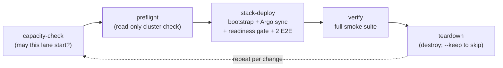

# The validation cycle: create -> test e2e -> destroy

This is the loop we use to prove a DFE deployment works: on a development cluster, on a teammate's clone, on a production estate. It's the validation SSoT this repo owns. Everything estate-specific rides in a gitignored env file, so the committed repo runs the same cycle everywhere.



One command runs the whole loop (mode defaults: `scale` on Kubernetes, `slim`
on Compose):

```bash
python3 scripts/dfe-ops cycle --mode single \
    --kubeconfig .tmp/target.kubeconfig --env-file bootstrap/.env
```

A dev/test deployment is ephemeral by design. Create it, test it, destroy it, redeploy it in another mode, without asking anyone. The one exception is a resident reference deployment, pinned to a version and updated only explicitly after an extended stable-release period.

Each stage runs as its own `dfe-ops` subcommand, so the cycle and the hand-run commands can't drift. The cycle exports `--kubeconfig` as `KUBECONFIG` to every stage so they all aim at the SAME cluster (by hand they use your current context, so check it first). A failed deploy still destroys, because a broken cycle mustn't strand a half-stack. `--keep` skips the destroy, on a dev cluster only.

The rest of the cycle's detail sits in three pages:

- [release-rounds.md](release-rounds.md): how a release candidate is proven, and how long each proof takes.
- [cloud-cycle.md](cloud-cycle.md): batching, unattended cloud runs, the edge stage and the managed backends.
- [failure-evidence.md](failure-evidence.md): what the readiness gate refuses, and what a failed stage leaves to read.

## Upgrading a persistent deploy instead of cycling it

A reference deploy isn't cycled. Destroying it is the whole thing we don't want. Argo tracks a git ref there, so a `git push` to that ref IS the upgrade, and `refresh` is the other half. It hard-refreshes every Application so the pushed commit lands now instead of at the next poll, waits for every tracked Application to report Synced and Healthy with no operation still running, then re-proves the deploy with the [readiness gate](failure-evidence.md#what-the-readiness-gate-refuses) and the `verify` smoke suite. Without that wait the gate exits on its first clean poll, which is the old revision's pods.

```bash
python3 scripts/dfe-ops refresh --mode slim \
    --kubeconfig .tmp/target.kubeconfig --env-file bootstrap/.env
```

It deploys nothing and tears nothing down. `--readiness-timeout` bounds the sync wait and the gate separately. `--skip-verify` stops after the gate, which proves the deploy is Ready but not that it works. It's also the one path needing no namespace. The smoke stage runs inside the app namespace, so `refresh` otherwise refuses to start when neither `--env-file` (`DFE_NAMESPACE`) nor `--namespace` names one, and every namespaced suite would fail on `namespaces "dfe" not found`.

## The env-file contract (how a teammate gets running)

Everything estate-specific (addresses, domains, storage class, secrets endpoints) lives in ONE flat `DFE_*` env file. The committed [bootstrap/local.env.example](../bootstrap/local.env.example) is the template, with placeholder values only (RFC 2606 domains, RFC 5737 addresses). The filled copy (`bootstrap/.env`) is gitignored and distributed out-of-band, e.g. as a Bitwarden secure note.

The whole onboarding:

1. `git clone` this repo.
2. Get the deployment's `.env` out-of-band -> save as `bootstrap/.env`.
3. Get a kubeconfig (`python3 scripts/dfe-ops kubeconfig --node <addr> --vault-path <kv path of the node SSH key> --out .tmp/target.kubeconfig`, or from whoever runs the cluster).
4. `python3 scripts/dfe-ops cycle --mode single --kubeconfig .tmp/target.kubeconfig --env-file bootstrap/.env`

No step edits a tracked file. If a value belongs in git, it isn't estate-specific. If it's estate-specific, it belongs in `.env`, never both. Two settings live there and nowhere else: `DFE_SKIP_PLATFORM_CHECK=true` installs onto a cluster outside `platform.kubernetes`, warning as it goes, and `DFE_LOCAL_PATH_DIR` puts the local-path-provisioner's volumes somewhere other than upstream's `/opt/local-path-provisioner`, for nodes that keep their data off the root filesystem. Unset is upstream's behaviour, and an adopted StorageClass ignores it.

## The cluster contract ("vanilla Rancher") and preflight

The product rule: assume a vanilla Rancher/RKE2 cluster and BRING what the stack needs. "Vanilla" means the things bootstrap CAN'T create for itself. Everything else (cert-manager, ESO, Argo CD, MetalLB, local-path storage) is detect-or-install: an existing operator is adopted, an absent one installed. The Argo CD bootstrap installed is the exception. A re-run upgrades it in place to the pinned chart and flags, and preflight previews that as UPGRADES.

What the cluster must supply:

| Contract item | Why | Preflight check |
| --- | --- | --- |
| Reachable API server inside the stack's `platform.kubernetes` (versions.yaml) | the deploy target, and the support window | FAIL below the floor, as `bootstrap/check_platform.py` does at bootstrap |
| The `ImageVolume` feature gate on a cluster below 1.35, when the stack pins the DocumentDB operator | the operator mounts its extension as an image volume, so its pods fail to start without it | FAIL unless the API server's `/metrics` reports it on, or `DFE_IMAGE_VOLUME_ENABLED=true` is set, as bootstrap does |
| Admin-ish RBAC (create ns/CRD/clusterrole/deploy/secret) | bootstrap installs operators | FAIL if not |
| >= 1 Ready node (3 for `scale`) with headroom | scheduling | WARN under guidance floors |
| The workload node label, when the overlay selects on one | pods sit Pending forever without it -- looks like a chart fault, is the wrong cluster | FAIL if no Ready node carries it |
| A default StorageClass -- or none at all | PVCs. Bootstrap falls back to local-path when absent | WARN/FAIL as applicable |
| A LoadBalancer path on cloud targets | on-prem gets MetalLB from bootstrap, pooled on `DFE_GATEWAY_IP`/`DFE_RECEIVER_IP` | WARN |
| No Strimzi CRD storing a version the 1.x operator no longer serves (`status.storedVersions` other than `v1`, e.g. `v1beta2`) | the 1.x operator chart cannot apply over it, so no Kafka broker starts and the readiness gate times out | FAIL naming each CRD and the `kubectl delete crd <name>` that clears it. Runs in `preflight` and again in `stack-deploy` just before `bootstrap.sh`, so a deploy without the cycle is refused too. A cluster carrying a live Kafka needs `dfe-ops upgrade preflight` instead. `stack-deploy --check-only` contacts no cluster and skips it, and a CRD list that cannot be read is a WARN |
| Pull access to the image registry | image supply | WARN (from the operator's machine) |

Check any cluster read-only before touching it:

```bash
python3 scripts/dfe-ops preflight --mode scale --env-file bootstrap/.env \
    --require-label dfe.hyperi.io/workload=dfe
```

On a shared cluster whose nodes lack the workload label, preflight fails that check. That's the wrong-cluster trap it exists to catch.

## Targets: on-prem now, cloud by parameter

The cycle is target-neutral: the target is (kubeconfig + env file), nothing else.

- On-prem Rancher/RKE2 (the baseline we start from): as above.
- AWS (and other clouds): `tofu apply` the environment first, then either `--from-terraform terraform/environments/aws` (reads the outputs) or an `.env` exported from them. Cloud deltas live in the env file (`DFE_STORAGE_CLASS=gp3`, cloud LB, workload-identity annotations), and the cycle itself is identical. **A cloud test deployment is destroyed the same day, no exceptions.** The cycle destroys by default, and when it was provisioned via `--from-terraform` the destroy stage also runs the IaC destroy (`teardown --with-terraform`), so the control plane and nodes die with the test, not just the DFE workloads on them.
- Local kind (a throwaway cluster on the machine you run it from): `dfe-ops kind up --ref <ref> --mode single --env-file bootstrap/.env` creates the cluster on a docker network of its own, has the cluster CA sign each kubelet's serving certificate (kind's own carries no IP SAN, which metrics-server refuses), adds the StorageClass the `local-dfe` overlay asks for and two front-door addresses from that network for bootstrap's MetalLB, then runs the ref's OWN `stack-deploy` from a checkout of it, with Argo pinned to the resolved commit. `DFE_*` comes from the env files alone. DNS, an external deploy repo and CA persistence are forced off. single and slim need no env file at all, because the published images pull anonymously and nothing those tiers deploy reads a secrets store. Pass one for a private chart repo, scale's store, or a private mirror of your own. On Linux the front door answers from the host. On Docker Desktop use the port-forwards `acceptance` and `ui` open. `kind status` reports health, and `kind down` removes the cluster, its network and `.tmp/kind/<name>`, then proves each gone.

## What the stages actually run

| Stage | Wraps | Gate |
| --- | --- | --- |
| `capacity-check` | `--lane k8s` reads allocatable minus scheduled requests, `--lane docker` the daemon host's available memory | the mode's `lane_floor` in `scripts/profiles.py`. A breach REFUSES, and `--watch` keeps checking while a lane runs so the newer lane aborts instead of the host swapping |
| `preflight` | read-only kubectl against the target | cluster contract above |
| `stack-deploy` | offline pin/drift/render preflight, the Strimzi stored-version read of the target cluster, then `bootstrap/bootstrap.sh` (Layer 0/1 + Argo profile sync at the pinned stack) | bounded readiness + the 2 default E2E tests (receiver->CH data path, self-monitoring OTel) |
| `verify` | `bootstrap/run-all-smoke-tests.sh` | readiness, auth, data, KEDA, integration. The scale proof injects pressure through the shim twice: phase 1 takes a throwaway Deployment 1->2->1, and phase 2 takes every app whose ScaledObject carries the shim trigger from its floor to one above and back, all at once. A ScaledObject with no shim trigger, or whose Deployment the profile does not run, is a reported SKIP, so slim, where `apps/dfe-receiver/profile-slim.yaml` clears the trigger, skips phase 2. At scale-out the HPA's pressure reading must be at or over target, and each app must have written `scaling_pressure` rows of its own. UNPROVEN fails the stage like FAIL, and `DFE_KEDA_SCALE_TEST=0` skips the proof |
| `acceptance` | `onboarding` drives the setup wizard and first console session in Chrome (`--console-only` on a deploy already set up). `flows` is the engine repo's live pytest suite over port-forwards. `source` is the section below. A suite needing a source the deployment already carries goes through the pytest passthrough | `all` runs onboarding FIRST and stops on it: a deployment nobody could have onboarded has failed whatever the data path then does. The wizard's screens come from the engine's own `auth/setup-status`, so a screen the deployment no longer asks for is a failure, not a variation |
| `ui` (opt-in: `--ui-repo`, needs `--e2e`) | the onboarding runner signs in with the minted admin password, makes the forced password change and completes the wizard, then every dfe-ui spec not tagged `@docker-only` runs over the gateway URL, with the suite's time budgets raised for a deployed stack (`--test-timeout-ms` 120000, `--expect-timeout-ms` 30000, `--nav-timeout-ms` 30000) | a failed onboarding stops the run, and an engine serving no `/api/e2e` is refused |
| `teardown` | `bootstrap/destroy.sh` (`--with-terraform` also destroys IaC state) | leaves the cluster as preflight found it |
| `refresh` (not a cycle stage) | the section above | the tracked ref landed and every tracked Application is Synced + Healthy, then bounded readiness + the full smoke suite |

## The post-deploy source tests (`acceptance --suite source`)

These aren't part of the stock POST. The default E2E tests prove the deploy moved data. These prove an operator can add a source and watch it work. Run them on demand after a deploy, here and on docker through dfe-docker's `make test-source`, which calls the same runner. There are four cases, chosen with `--source-case`:

- `filebeat` (the default) pushes the corpus's cisco_ios lines at the receiver in the Elastic Agent envelope, routed on `data_stream.dataset`, through the bundled VRL.
- `elastic` pushes the same lines at a transform compiled into dfe-transform-elastic.
- `vector` runs the same program through dfe-transform-vector.
- `cloudwatch` (run as `--aws-service cloudtrail`) lets a fetcher pull an AWS upstream.

dfe-docker's `make proof` runs `filebeat` and `vector` on every stack version.

The CloudWatch case needs a SIXTH env file naming the upstream (`.tmp/aws-test.env`: `DFE_AWS_REGION`, `DFE_AWS_LOG_GROUP`), and `--fetcher-credentials-vault-path kv/<path>` to put the AWS keys in the Secret the fetcher chart names before the source is created.

What each case does and what proves it: [source-suite.md](source-suite.md).
