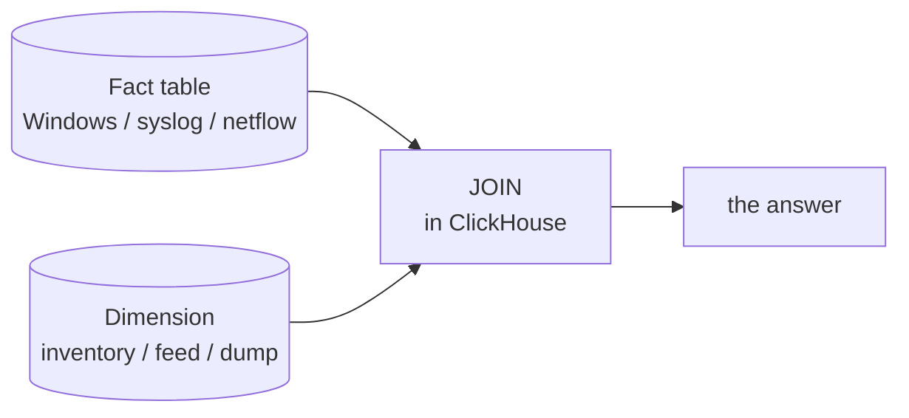

# Use cases

DFE earns the *Fusion* in its name when a large fact table is joined with other
data for context. Telemetry is usually the fact table. The context is whatever
answers the actual question -- an inventory, a directory, a feed, a snapshot.
The pattern is the same each time: load the context as a small *dimension* table
and JOIN it against the fact table in ClickHouse.

## Cyber: hosts not sending audit logs

A question every defender has: *which Windows hosts on my network are not
sending me audit logs?* Telemetry alone cannot answer it -- a host that sends
nothing is, by definition, absent from the log fact table. You have to know what
*should* be there.

DFE fuses two sources:

- the **fact table** -- the Windows event logs (or syslog, or netflow) already
  flowing in, large and time-series.
- a **dimension** -- a point-in-time inventory of the estate, for example a
  RunZero export pulled via API: "what the network looked like at time X",
  timestamped but *not* time-series.

Load the inventory as a small dimension table and anti-join it against the hosts
seen in the log fact table over the same window. The gap is the answer: assets
that exist but are silent. ClickHouse handles this comfortably while the
dimension stays small. An index engine cannot do the JOIN at all, and a data lake
would make you model and pipeline the inventory first.

This is a HyperI XDR use case -- XDR is DFE with the cyber add-ons. Pulling
state-of-the-world dumps like this is exactly what additional `dfe-fetcher` and
fetcher-SDK sources expand.

## Defence and the field: fusing disparate sources

Operational situational awareness rarely come from one clean source. It comes from many
loosely controlled ones: sensors, coalition partner feeds, weather, order of
battle, damage assessments -- a mix of telemetry, streams and periodic dumps, of
varying quality and structure.

DFE fuses them into one queryable store and keeps working as they change.
Because all inbound data works by default, a new or altered source is a
*performance improvement* to reconcile later, not a hard gate that drops data
today. And because DFE is lean -- native Rust over ClickHouse, not a
resource-heavy monolith -- the same stack runs in a theatre data centre or at
the edge, with little or no compromise, rather than only in a distant cloud
region.
