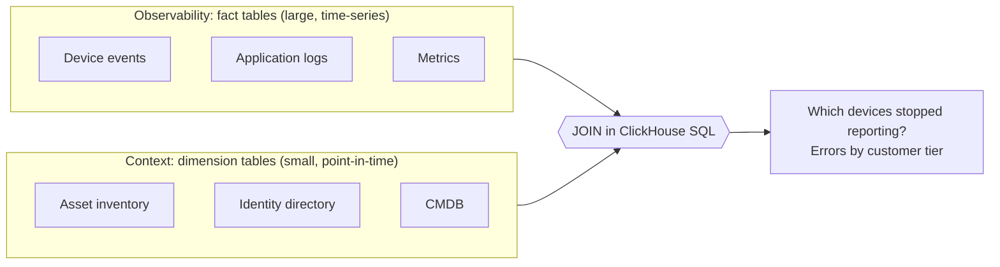

# Use cases

DFE earns the *Fusion* in its name when a large *fact* table (the observability data) is joined with a *dimension* table (the context). Telemetry is usually the fact table. The context is whatever answers the actual question: an inventory, a directory, a feed, a snapshot. The pattern is the same each time. Load the context as a small dimension table and JOIN it against the fact table in ClickHouse SQL.

## Cyber: hosts not sending audit logs

> **Coming from Splunk or Elastic?** Matching logs against an inventory isn't what an index engine does. DFE keeps both as ClickHouse tables, so it's one anti-join. More in [what's different](../docs-site/content-root/coming-from.md#sources-join).

The question is *which Windows hosts on my network are not sending me audit logs?* Telemetry alone can't answer, because a host that sends nothing is absent from the log fact table by definition. You have to know what *should* be there.

DFE fuses two sources:

- The fact table (the observability data): the Windows event logs (or syslog, or netflow) already flowing in, large and time-series.
- A dimension table (the context): a point-in-time inventory of the estate, for example a RunZero export pulled via API. That's "what the network looked like at time X", timestamped but *not* time-series.

Load the inventory as a small dimension table and anti-join it against the hosts seen in the log fact table over the same window. The gap is the answer: assets that exist but are silent. ClickHouse handles this while the dimension stays small. A data lake would make you model and pipeline the inventory first.

This is a HyperI XDR use case, and XDR is DFE with the cyber add-ons. State-of-the-world dumps like this are what additional `dfe-fetcher` and fetcher-SDK sources expand.

## Defence and the field: fusing disparate sources

Operational situational awareness rarely comes from one clean source. It comes from many loosely controlled ones: sensors, coalition partner feeds, weather, order of battle, damage assessments. That's a mix of telemetry, streams and periodic dumps, of varying quality and structure.

DFE fuses them into one queryable store and keeps working as they change. All inbound data works by default, so a new or altered source is a *performance improvement* to reconcile later, not a hard gate that drops data today. DFE is also lean, native Rust over ClickHouse rather than a resource-heavy monolith, so the same stack runs in a theatre data centre or at the edge not only in a distant cloud region.
